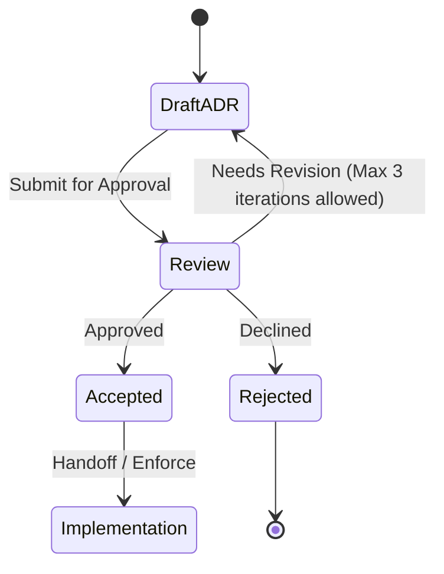

# ADR-0001: Derive the vault key with Argon2id

## Status

Proposed. Needs approval by mjbvilhena.

This record answers the US-74 placeholder. It does not add acceptance criteria to that story. Drafting it is not acceptance.

## Context

US-35 and the specification already fix the outcome. The vault key is derived from a passphrase he chooses. A slow memory-hard KDF and a salt let another device re-create the same key. No copy of the key, wrapped or otherwise, is stored off the phone. On the phone the derived key is held in the Android Keystore, or wrapped by a hardware-backed Keystore key, without user authentication. Background sync and reminders can decrypt after the first unlock since boot. Sensitive content still needs the US-37 unlock. Changing the passphrase re-encrypts the vault (US-86). A phone that still holds the key can set a new passphrase after that unlock, without the old passphrase. Forgetting the passphrase when no phone holds the key means the content is lost. Drive keeps old revisions. Old zips and old Drive revisions may still open with the passphrase they were made under (US-86).

US-74 leaves the method, the minimum parameters, where the non-secret salt lives, the passphrase floor, the retry delay, and a phone with no secure hardware. It also leaves envelope encryption versus a full re-encrypt on passphrase change. The content cipher, mode, and key size stay out of this record. The specification still waits on a separate ADR for those.

Domain and layer consultants: `docs/domain/vault/DOMAIN.md`, `docs/layers/data/LAYER.md`. Both are Proposed.

Doing nothing leaves US-35's "method named in the US-74 ADR" with nothing to name, so a second phone cannot be specified.

## Decision

Recommended option: Argon2id, with the derived 32-byte output as the vault key itself. A hardware-backed Keystore key wraps that output on the phone only. Passphrase change generates a new salt and re-encrypts. There is no envelope key stored on Drive.

Rules, if this record is accepted:

- KDF is Argon2id, version 0x13. Not Argon2i, Argon2d, scrypt, bcrypt, or PBKDF2.
- Minimum parameters for a new vault: memory 65536 KiB (64 MiB), iterations 3, parallelism 1, salt 16 bytes from `SecureRandom`, output 32 bytes. A new vault must not go below these. RFC 9106's second recommended option is memory 64 MiB, iterations 3, parallelism 4. Parallelism stays 1 here so a low-end phone does not have to run four lanes. Memory and iterations stay at that RFC floor.
- The passphrase is NFC-normalised before the KDF, so two phones derive the same key. It is not trimmed.
- The header stores the KDF id, the salt, memory, iterations, parallelism, and output length. It does not store the key or the passphrase. The same header is in app-private storage, in a clear prefix of the Drive file, and in a clear zip entry, because a new device must read it before decrypt. Drive file names stay opaque (US-36).
- On the phone, Android Keystore generates a wrapping key with user authentication off. On API 28+ it is created with `setUnlockedDeviceRequired(false)`. The 32-byte derived key is wrapped by that Keystore key. The wrap blob stays on the phone. It is not uploaded and it is not put in the zip. `KeyInfo` is read on that wrapping key: API 31+ security level StrongBox or TEE, API 26–30 `isInsideSecureHardware()` true, `isUserAuthenticationRequired` false (US-35).
- A phone whose Keystore cannot provide that hardware level does not get a software key. Any software entry just created is deleted. Vault bytes are not written. He is told this phone cannot hold the key. There is no memory-only mode and no passphrase prompt on every launch.
- Passphrase floor: at least 12 Unicode code points, at most 128, rejected if it is on a bundled common-password list. No composition rules. No network check. The US-35 guidance text still shows. The floor is checked before the KDF runs.
- Retry: a wrong passphrase changes nothing and is reported (US-35). The next attempt is accepted only after 2 seconds, then 4, 8, 16, and 32 seconds. The wait is stored as a timestamp, not as the passphrase, and survives process death. It resets after a correct passphrase. The KDF does not run during the wait.
- Passphrase change (US-86) and the on-phone reset after US-37 both mint a new salt, derive a new key, and re-encrypt the phone vault and the current Drive copy. The previous local generation is replaced only after the new generation is complete. The app does not delete older Drive revisions. An old zip stays readable with the passphrase and salt it was exported under.
- A crash leaves the phone vault and the Drive copy each readable under exactly one passphrase (US-86). The other install asks for the new passphrase and does not overwrite the re-encrypted vault.

Default for a new case: if a parameter is missing from a header, refuse to derive. Do not fill in a silent default that could mint a second key.

## Alternatives considered

| Option | Why it was plausible | Why it lost |
| --- | --- | --- |
| scrypt at the OWASP floor (N = 2^17, r = 8, p = 1) | Memory-hard, widely implemented, and named beside Argon2id in the request | Argon2id is the RFC 9106 and OWASP preference for new systems. scrypt's memory is tied to N and r, so the phone floor is clumsier to state. Same salt and header story either way. The loss is the algorithm, not the rest of this record |
| PBKDF2-HMAC-SHA256 | Built into Android `SecretKeyFactory` with no extra library | Not memory-hard. US-35 requires a memory-hard derivation. A high iteration count does not replace memory |
| Envelope: a random data key wrapped by the derived key, wrap stored on Drive | Passphrase change re-wraps one small blob instead of re-encrypting the vault | A wrapped data key on Drive is a wrapped key off the phone, which the specification forbids. US-86 also requires the vault to be re-encrypted, and its crash scenario assumes a generation that can be half-finished |
| Import the raw Argon2 output as the Keystore key | One key object, nothing to wrap | Android Keystore does not reliably import a raw AES key into TEE or StrongBox. US-35 allows a hardware key that wraps the derived key. That is the path that matches the platform |
| Software Keystore, or keep the derived key only in memory, when there is no TEE | Emulators and some phones have no secure hardware, and US-35 says the fallback is decided here | A software key fails the US-35 `KeyInfo` scenario. A memory-only key cannot serve sync and reminders after the first unlock since boot without asking for the passphrase. Refusing the phone is the fallback that does not weaken those rules |
| Delete old Drive revisions on passphrase change | Shrinks the window where the old passphrase still decrypts something | US-86 says old revisions may still open with the old passphrase, and the product rule is that Drive keeps them. The app must not delete them |

## Consequences

- **Positive.** A second device needs the passphrase and the clear header, not a key file. The parameters are high enough to name in a test. A wrong guess is delayed. A phone without secure hardware cannot silently downgrade the key.
- **Negative / accepted trade-offs.** 64 MiB and three iterations will be slow on a low-end phone. That cost is the point of a memory-hard KDF. Parallelism 1 is below RFC 9106's four lanes. Old Drive revisions and old zips remain decryptable with the old passphrase. Emulators without TEE cannot hold a real key. The content cipher is still undecided, so the 32-byte length is a proposal to that future ADR.
- **Follow-ups.** A cipher ADR still has to name algorithm, mode, key size, and the wrap algorithm. US-57 still has to show search and encryption together. US-74 stays a placeholder until mjbvilhena accepts this record and a later story edit adds criteria. He is the approver.

## Compliance

- [ ] New vaults use Argon2id at or above the minimum parameters, with a 16-byte salt in the clear header
- [ ] Tests show the wrap blob and the key are absent from the Drive payload and the zip, and the header is present
- [ ] `KeyInfo` matches US-35, and a software security level deletes the entry and writes no vault
- [ ] A 11-code-point passphrase and a listed common passphrase are refused before the KDF
- [ ] Two wrong attempts cannot start the second KDF inside the delay
- [ ] Passphrase change re-encrypts, leaves old Drive revisions in place, and does not store an envelope key
- [ ] PBKDF2, scrypt, and a Drive-stored wrapped data key are forbidden

## Related

- Domain consultant `vault`. Layer consultant `data`.
- US-35, US-74, US-86, US-21, US-36, US-81.
- RFC 9106 (Argon2), section 4, second recommended option, with parallelism reduced to 1 as stated above.
- OWASP Password Storage Cheat Sheet: Argon2id is the preferred memory-hard algorithm; its published minimum (19 MiB, 2 iterations, parallelism 1) is below the floor in this record.

## Anti-patterns

- Storing the wrap blob "for convenience" on Drive.
- Lowering memory on a slow phone without a new ADR.
- Treating this Proposed record as permission to implement.

## Skill State Machine (sdlc-adr-drafter)

Status: Proposed. Needs approval by mjbvilhena.
