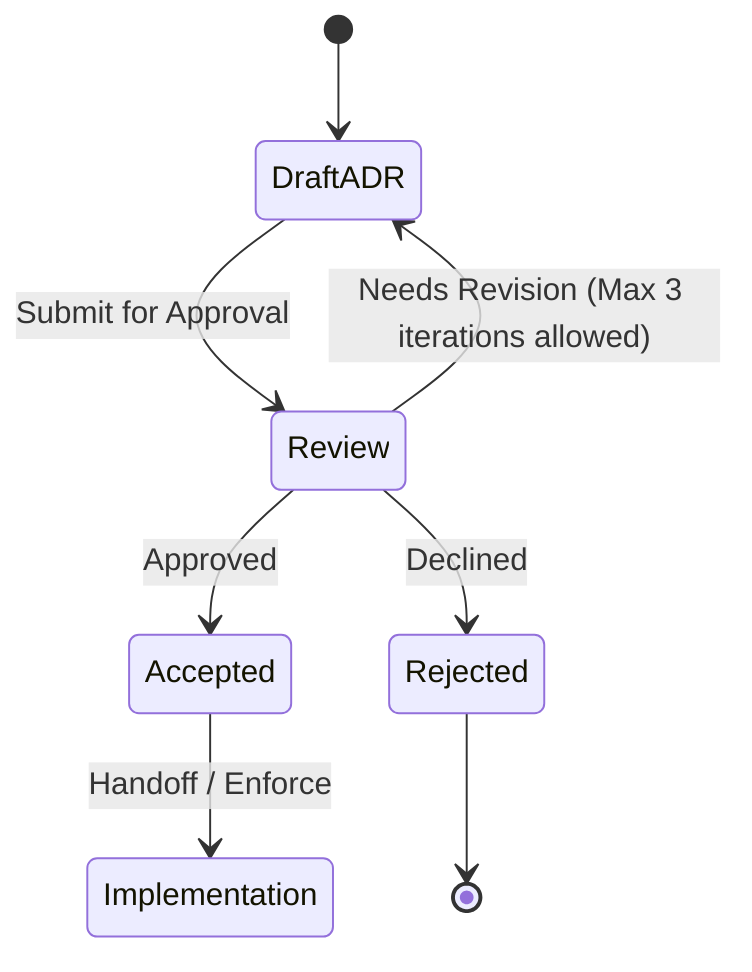

# ADR-0001: Derive the vault key with Argon2id

## Status

Proposed. Needs approval by mjbvilhena.

This record answers the US-74 placeholder. It does not add acceptance criteria to that story. Drafting it is not acceptance. The forgotten-passphrase reset delay is decided below. Three choices stay open under Decision pending. Accepting this record would not decide those three.

## Context

US-35 and the specification already fix the outcome. The vault key is derived from a passphrase he chooses. A slow memory-hard KDF and a salt let another device re-create the same key. No copy of the key, wrapped or otherwise, is stored off the phone. On the phone the derived key is held in the Android Keystore, or wrapped by a hardware-backed Keystore key, without user authentication. Background sync and reminders can decrypt after the first unlock since boot. Sensitive content still needs the US-37 unlock. Changing the passphrase re-encrypts the vault (US-86). A phone that still holds the key can set a new passphrase after that unlock, without the old passphrase. Forgetting the passphrase when no phone holds the key means the content is lost. Old zips and old Drive revisions may still open with the passphrase they were made under (US-86).

US-74 leaves the method, the minimum parameters, where the non-secret salt lives, the passphrase floor, the retry delay, and a phone with no secure hardware. It also leaves envelope encryption versus a full re-encrypt on passphrase change.

How the derived key encrypts the database, files, and containers is ADR-0006. This record names the KDF, the on-phone wrap, and the header fields that ADR-0006 authenticates.

Domain and layer consultants: `docs/domain/vault/DOMAIN.md`, `docs/layers/data/LAYER.md`. Both are Proposed.

Doing nothing leaves US-35's "method named in the US-74 ADR" with nothing to name, so a second phone cannot be specified.

## Decision

Recommended option: Argon2id, with the derived 32-byte output as the vault key itself. A hardware-backed Keystore key wraps that output on the phone only. Passphrase change generates a new salt and re-encrypts. A normal change re-encrypts the phone and Drive together. A forgotten-passphrase reset re-encrypts the phone, then waits 24 hours before re-keying Drive. There is no envelope key stored on Drive.

Rules, if this record is accepted. The three items under Decision pending are not in this list:

- KDF is Argon2id, version 0x13. Not Argon2i, Argon2d, scrypt, bcrypt, or PBKDF2. The implementation is native Argon2id, JNI to the Password Hashing Competition reference. A pure-Java or pure-Kotlin port is not this implementation.
- Parameter floor for a new vault: memory 65536 KiB (64 MiB), iterations 3, parallelism 1, salt 16 bytes from `SecureRandom`, output 32 bytes. A new vault must not go below these.
- Parameter ceiling when a header is read: memory 262144 KiB, iterations 10, parallelism 1, salt exactly 16 bytes, output exactly 32 bytes, version exactly 0x13. A header outside the floor or the ceiling is refused. Parameters are not clamped, and the KDF is not run on that header. A missing parameter is the same refusal. There is no silent default that could mint a second key.
- RFC 9106's second recommended option is memory 64 MiB, iterations 3, parallelism 4. Parallelism stays 1. Memory is the cost that an attacker must pay, and raising parallelism does not lower that memory. Extra lanes shorten wall time for a multi-core attacker as well as for the phone. A low-end phone is limited by memory bandwidth, so four lanes do not reliably make unlock faster.
- Before US-35 implementation is treated as done, unlock time at this floor is measured on a Motorola Moto E4 (XT1762), 2 GB RAM, API 26, and the measurement is recorded with the build. A slow result is not a reason to lower the floor without a new ADR. This record sets no pass or fail number of seconds.
- The passphrase is NFC-normalised before the KDF, so two phones derive the same key. It is not trimmed.
- The clear header stores the KDF id, the salt, memory, iterations, parallelism, and output length. It does not store the key or the passphrase. That header is additional authenticated data on the container ciphertext (ADR-0006), so a change to the salt or the parameters fails authentication. The same header is in app-private storage, in a clear prefix of each Drive records file, and in a clear zip entry, because a new device must read it before decrypt. Drive file names stay opaque (US-36).
- A generation number lives inside the ciphertext, not only in the clear header (ADR-0006). The phone keeps the highest generation it has accepted. A Drive copy or a zip whose generation is lower than that mark is a rollback and is not applied over the newer vault. A new install has no mark yet and takes the generation it can decrypt, then stores that mark.
- On the phone, Android Keystore generates an AES-256 wrapping key with user authentication off. On API 28+ it is created with `setUnlockedDeviceRequired(false)`. The wrap is AES-256-GCM. The nonce is generated by the Keystore, not by app code, and it is stored with the wrap blob. The wrap blob stays on the phone. It is not uploaded and it is not put in the zip. `KeyInfo` is read on that wrapping key: API 31+ security level StrongBox or TEE, API 26–30 `isInsideSecureHardware()` true, `isUserAuthenticationRequired` false (US-35). What happens when that hardware level is missing is Decision pending, not a rule of this list.
- Wrapping is kept even though the Keystore can import a raw AES key, including into StrongBox. A Keystore key is not exportable. SQLCipher and the file AEAD in ADR-0006 need the raw 32-byte key in process memory. The wrap is how those bytes are stored on the phone. Importing the raw key would leave nothing to unwrap into those callers.
- Retry: a wrong passphrase changes nothing and is reported (US-35). The next attempt is accepted only after 2 seconds, then 4, 8, 16, and 32 seconds. After the delay has reached 32 seconds, each further wrong attempt waits 32 seconds. There is no permanent lockout. The wait is stored as a timestamp, not as the passphrase, and survives process death. A correct passphrase resets the delay. The KDF does not run during the wait. This delay applies on the phone. It does not apply to an offline guess against a copied Drive file or zip. Argon2id is what makes that offline guess expensive.
- A normal passphrase change, where he enters the current passphrase (US-86), mints a new salt, derives a new key, increments the generation, and re-encrypts the phone vault and the current Drive copy without a wait. The previous local generation is replaced only after the new generation is complete. This path skips the 24-hour rule below.
- A forgotten-passphrase reset is the US-86 path that uses a US-37 unlock instead of the current passphrase. Which US-37 factor that unlock accepts is Decision pending. The delay below is decided for that path whichever factor is used.
- Forgotten-passphrase reset, decided. The phone vault is re-keyed when the local re-encrypt completes. The Drive copy keeps the old passphrase for 24 hours, then it is re-keyed to the new one. Twenty-four hours is 24 × 60 minutes. During those 24 hours every other phone that holds the vault key shows a notice and can cancel. The notice carries no passphrase and no item content. A phone that does not hold the key shows nothing and cannot cancel.
- The 24 hours start when a pending-reset marker is stored on Drive, not when he taps reset. The marker is ciphertext in that install's records file. It names the install and the time it was written. It does not contain the new key or the new passphrase. Until the marker is on Drive, the Drive copy stays on the old passphrase and the clock has not started.
- One phone. If no other install holds the key, nobody is shown the notice. The Drive copy still waits 24 hours from the marker. If, during that wait, an install derives the old key from the old passphrase, that install holds the key, shows the notice, and can cancel. If none does, and the resetting phone is online with no cancel, it re-keys Drive when the 24 hours have passed.
- The resetting phone goes offline. It may finish the local re-key while offline. It cannot start the clock or re-key Drive until the marker is uploaded. If it uploaded the marker and then goes offline, the clock still runs. Other phones can cancel. Drive stays on the old passphrase until that phone is online, has read the other installs' files, has found no cancel, and the 24 hours have passed.
- Cancelling. Any other install that holds the old vault key may cancel, once. A second cancel does nothing. The cancel is a record in that install's records file. The resetting phone reads those files before it re-keys Drive. If a cancel is present, Drive is not re-keyed and stays on the old passphrase. The resetting phone then replaces its local vault with that complete old Drive copy and discards the new local generation. The new passphrase opens nothing. The resetting phone does not cancel its own reset.
- Crash safety (US-86) still holds. At every step the phone vault is wholly under the old passphrase or wholly under the new one, and the Drive copy is wholly under the old passphrase or wholly under the new one. Neither file is mixed. During the 24 hours the phone is under the new passphrase, after its local re-encrypt has completed, and Drive is under the old one. A crash during the local re-encrypt leaves the phone wholly old or wholly new, and leaves Drive old. Re-keying Drive writes a complete new generation and replaces the old Drive generation only after that write finishes. A crash there leaves Drive wholly old or wholly new, and leaves the phone new. A cancel discards the new local generation only after the old Drive copy is confirmed readable under the old passphrase. A crash there leaves the phone wholly new, with the reset still pending, or wholly old, with the cancel finished, and leaves Drive old. The resetting phone keeps a local wrap of the old key until Drive is re-keyed or the cancel finishes, so it can still read the old Drive copy and the cancel. That wrap stays on the phone. It is deleted when the wait ends or the cancel finishes. Another install does not overwrite the Drive copy.
- Drive keeps old revisions for about 30 days or about 100 revisions, whichever keeps more, and then purges them. A revision marked keep-forever is not purged. This app does not set keep-forever, and it does not delete revisions itself. The old passphrase can still open a revision that has not been purged, and it can still open a zip he keeps. That is the old-passphrase window. US-86's sentence that old revisions may open with the old passphrase stays as written. This record only names how long Drive keeps those revisions.
- A crash leaves the phone vault and the Drive copy each readable under exactly one passphrase (US-86). On a normal passphrase change, the other install asks for the new passphrase and does not overwrite the re-encrypted vault. On a forgotten-passphrase reset, the other install keeps the old passphrase until the Drive copy is re-keyed, and during the 24 hours it shows the notice instead of asking for the new passphrase.

Default for a new case: if a parameter is missing or outside the floor and ceiling, refuse to derive.

## Decision pending: mjbvilhena

These are not decided. The current recommendation is the option this draft would keep. It is not a rule until he chooses.

### Passphrase floor

Current recommendation: at least 12 Unicode code points, at most 128, rejected if it is on a bundled common-password list. No composition rules. No network check. The US-35 guidance text still shows. The floor is checked before the KDF runs.

| Option | Trade-off |
| --- | --- |
| 12 Unicode code points, plus the common-password list | Current recommendation. Short enough to type on a phone. A 12-point passphrase of ordinary words is still guessable offline, where the 32-second delay does not apply |
| 15 Unicode code points, plus the same list | Fewer guesses succeed. Harder to type and easier to lock himself out. The KDF cost does not change |
| A strength meter, with or without a length floor | He sees a judgement of the passphrase. A meter is not a parameter the other phone can check, and a library update can change the score. A weak passphrase that the meter accepts still reaches the KDF |

### Phones without secure hardware

Current recommendation: a phone whose Keystore cannot provide the US-35 hardware level does not get a software key. Any software entry just created is deleted. Vault bytes are not written. He is told this phone cannot hold the key. There is no memory-only mode and no passphrase prompt on every launch as a substitute.

| Option | Trade-off |
| --- | --- |
| Refuse the phone | Current recommendation. Matches the US-35 `KeyInfo` scenario. An emulator or a phone with no TEE cannot hold a vault |
| Software Keystore | Those phones work. The key is not hardware-backed, and the US-35 `KeyInfo` scenario fails. Any local process that can use the app's keys can unwrap later |
| Keep the derived key only in memory, and ask for the passphrase on every launch | Nothing software-wrapped sits at rest. Sync and reminders after the first unlock since boot cannot decrypt without the passphrase, which US-35 requires them to do |

### PIN or biometric for the US-86 reset

Current recommendation: leave the approved US-86 text as it is. A phone that holds the key resets after a successful US-37 unlock, and that story allows biometric or device PIN. This record does not add a stricter factor.

| Option | Trade-off |
| --- | --- |
| Biometric or device PIN, as US-86 states | Current recommendation. Matches the approved story and the app-lock rule that the device PIN is the fallback when there are no biometrics. Someone who knows the PIN and holds the phone can open sensitive items and can set a new passphrase |
| Biometric only, for sensitive unlock and for the reset | A known PIN is not enough. A phone with no biometrics cannot open sensitive items or reset. That cuts against the approved fallback to the device PIN |

## Alternatives considered

| Option | Why it was plausible | Why it lost |
| --- | --- | --- |
| scrypt at the OWASP floor (N = 2^17, r = 8, p = 1) | Memory-hard, widely implemented, and named beside Argon2id in the request | Argon2id is the RFC 9106 and OWASP preference for new systems. scrypt's memory is tied to N and r, so the phone floor is clumsier to state. Same salt and header story either way. The loss is the algorithm, not the rest of this record |
| PBKDF2-HMAC-SHA256 | Built into Android `SecretKeyFactory` with no extra library | Not memory-hard. US-35 requires a memory-hard derivation. A high iteration count does not replace memory |
| Envelope: a random data key wrapped by the derived key, wrap stored on Drive | Passphrase change re-wraps one small blob instead of re-encrypting the vault | A wrapped data key on Drive is a wrapped key off the phone, which the specification forbids. US-86 also requires the vault to be re-encrypted, and its crash scenario assumes a generation that can be half-finished |
| Import the raw Argon2 output as the Keystore key, including into StrongBox | One key object, and import of a raw AES key is possible | The Keystore key cannot be exported. SQLCipher and file AEAD need the raw 32 bytes in process. Wrapping with AES-256-GCM and a Keystore nonce keeps those bytes available after unwrap and still keeps them off Drive. Import loses for that reason, not because import is impossible |
| Delete old Drive revisions, or set keep-forever, on passphrase change | Shrinks or stretches the window where the old passphrase still decrypts something | US-86 says old revisions may still open with the old passphrase. Drive already purges revisions after about 30 days or about 100 revisions. The app does not delete them and does not set keep-forever |

## Consequences

- **Positive.** A second device needs the passphrase and the clear header, not a key file. The parameters have a floor and a ceiling a test can refuse. Salt and parameter tampering fails the container tag. A rolled-back ciphertext carries an older generation. A wrong guess on the phone is delayed, and the delay stays at 32 seconds instead of ending. A forgotten-passphrase reset does not re-key Drive until 24 hours have passed and no other phone that holds the key has cancelled.
- **Negative / accepted trade-offs.** 64 MiB and three iterations will be slow on the named API 26 phone. That cost is the point of a memory-hard KDF. Parallelism 1 is below RFC 9106's four lanes, for the reason stated above. Offline guessing against a Drive copy or a zip does not wait 32 seconds. Old revisions remain decryptable with the old passphrase until Drive purges them, and a zip he keeps remains decryptable after that. During the 24-hour wait the resetting phone's vault is already under the new passphrase. A sole phone has no other install to show the notice, so nothing can cancel unless some install derives the old key during the wait. The passphrase floor, phones without secure hardware, and the reset factor are not decided.
- **Follow-ups.** ADR-0006 names the ciphers that use this 32-byte key. US-57 still has to show search and encryption together. US-74 stays a placeholder until mjbvilhena accepts this record and a later story edit adds criteria. He decides the pending items separately. He is the approver.

## Compliance

- [ ] New vaults use native Argon2id inside the floor and ceiling, with a 16-byte salt in the clear header
- [ ] A header outside the floor or ceiling, or with a missing field, does not run the KDF
- [ ] Changing the salt or the parameters in the header fails authentication
- [ ] A ciphertext with a lower generation than the phone's mark does not replace the vault
- [ ] Unlock time on a Motorola Moto E4 (XT1762), API 26, is recorded, and the floor is not lowered to suit it
- [ ] Tests show the wrap blob and the key are absent from the Drive payload and the zip, and the header is present
- [ ] The wrap is AES-256-GCM and the nonce comes from the Keystore
- [ ] After the delay has reached 32 seconds, another wrong attempt still waits 32 seconds, and a correct passphrase clears the delay
- [ ] Passphrase change re-encrypts, does not set keep-forever, and does not store an envelope key
- [ ] A forgotten-passphrase reset leaves the Drive copy on the old passphrase for 24 hours after the marker is on Drive, and another phone that holds the key can cancel. A normal change, where he enters the current passphrase, re-encrypts the phone and Drive without that wait. A crash still leaves each copy under exactly one passphrase
- [ ] The passphrase floor, the no-hardware fallback, and the reset factor are not coded as if Decision pending had been resolved
- [ ] PBKDF2, scrypt, a pure-Java Argon2, and a Drive-stored wrapped data key are forbidden

## Related

- Domain consultant `vault`. Layer consultant `data`.
- US-35, US-74, US-86, US-21, US-36, US-81.
- ADR-0006 for the container that authenticates this header and carries the generation.
- RFC 9106 (Argon2), section 4, second recommended option, with parallelism 1 for the reason stated above.
- OWASP Password Storage Cheat Sheet: Argon2id is the preferred memory-hard algorithm; its published minimum (19 MiB, 2 iterations, parallelism 1) is below the floor in this record.
- Drive revisions: Google keeps about the last 100 revisions or revisions younger than about 30 days, whichever keeps more, unless the revision is marked keep-forever.

## Anti-patterns

- Saying the Keystore cannot import a raw AES key. It can. Wrapping is chosen because the raw key must come back out.
- Storing the wrap blob on Drive.
- Clamping an out-of-range header instead of refusing it.
- Lowering memory because the Moto E4 measurement was slow, without a new ADR.
- Treating a pending floor, hardware fallback, or reset factor as decided.
- Re-keying Drive as soon as a forgotten-passphrase reset finishes on the phone, or starting the 24 hours before the marker is on Drive.
- Treating this Proposed record as permission to implement.

## Skill State Machine (sdlc-adr-drafter)

Status: Proposed. Needs approval by mjbvilhena.
