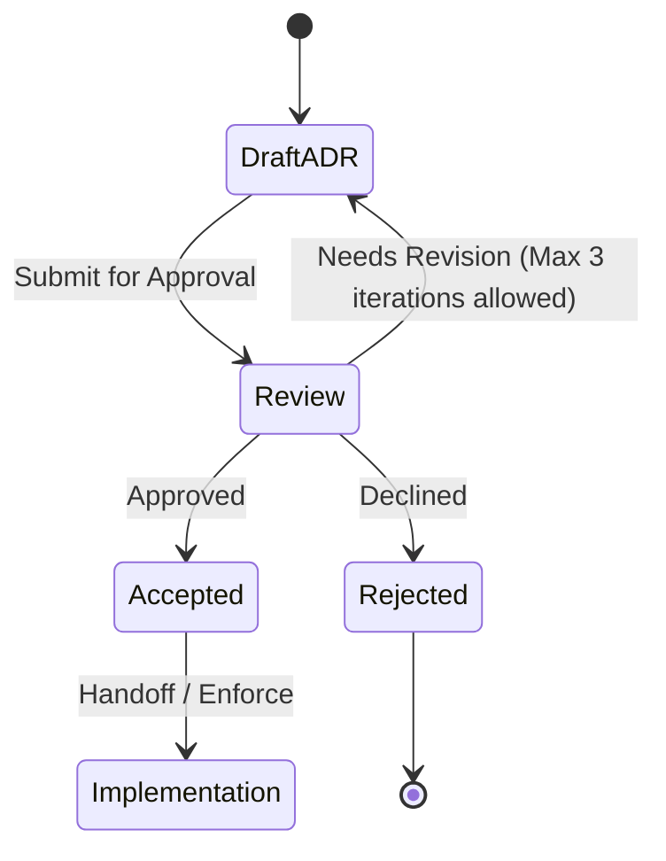

# ADR-0001: Derive the vault key with Argon2id

## Status

Proposed. Needs approval by mjbvilhena.

This record answers the US-74 placeholder. It does not add acceptance criteria to that story. Drafting it is not acceptance. Decided by mjbvilhena; this record is Proposed until he approves it. Those decisions are the forgotten-passphrase reset, the US-37 biometric or device PIN that reset accepts, the passphrase length, the memory-floor refusal, a vault on a phone without secure hardware, and no passphrase recall check.

## Context

US-35 and the specification already fix the outcome. The vault key is derived from a passphrase he chooses. A slow memory-hard KDF and a salt let another device re-create the same key. No copy of the key, wrapped or otherwise, is stored off the phone. On the phone the derived key is held in the Android Keystore, or wrapped by a hardware-backed Keystore key, without user authentication. Background sync and reminders can decrypt after the first unlock since boot. Sensitive content still needs the US-37 unlock. Changing the passphrase re-encrypts the vault (US-86). A phone that still holds the key can set a new passphrase after that unlock, without the old passphrase. Forgetting the passphrase when no phone holds the key means the content is lost. Old zips and old Drive revisions may still open with the passphrase they were made under (US-86).

US-74 leaves the method, the minimum parameters, where the non-secret salt lives, the retry delay, and a phone with no secure hardware. The passphrase minimum, the memory-floor refusal, and a vault on a phone without secure hardware are decided below. It also leaves envelope encryption versus a full re-encrypt on passphrase change.

How the derived key encrypts the database, files, and containers is ADR-0006. This record names the KDF, the on-phone wrap, and the header fields that ADR-0006 authenticates.

Domain and layer consultants: `docs/domain/vault/DOMAIN.md`, `docs/layers/data/LAYER.md`. Both are Proposed.

Doing nothing leaves US-35's "method named in the US-74 ADR" with nothing to name, so a second phone cannot be specified.

## Decision

Recommended option: Argon2id, with the derived 32-byte output as the vault key itself. A hardware-backed Keystore key wraps that output on the phone only. Passphrase change generates a new salt and re-encrypts. A normal change re-encrypts the phone and Drive together. A forgotten-passphrase reset re-encrypts the phone, then waits 24 hours before re-keying Drive. There is no envelope key stored on Drive.

Rules, if this record is accepted:

- KDF is Argon2id, version 0x13. Not Argon2i, Argon2d, scrypt, bcrypt, or PBKDF2. The implementation is native Argon2id, JNI to the Password Hashing Competition reference. A pure-Java or pure-Kotlin port is not this implementation.
- Parameter floor for a new vault: memory 65536 KiB (64 MiB), iterations 3, parallelism 1, salt 16 bytes from `SecureRandom`, output 32 bytes. A new vault must not go below these.
- A phone that cannot meet that memory floor refuses to set up a vault, and it refuses to re-create a vault from Drive. It never lowers memory, iterations, or parallelism. The test is the native allocation. If the allocator cannot obtain 65536 KiB for Argon2id, the phone refuses at once and tells him why. `ActivityManager.isLowRamDevice()` is not the test. A test injects that allocation failure. There is no smaller parameter set for that phone.
- Parameter ceiling when a header is read: memory 262144 KiB, iterations 10, parallelism 1, salt exactly 16 bytes, output exactly 32 bytes, version exactly 0x13. A header outside the floor or the ceiling is refused. Parameters are not clamped, and the KDF is not run on that header. A missing parameter is the same refusal. There is no silent default that could mint a second key.
- RFC 9106's second recommended option is memory 64 MiB, iterations 3, parallelism 4. Parallelism stays 1. Memory is the cost that an attacker must pay, and raising parallelism does not lower that memory. Extra lanes shorten wall time for a multi-core attacker as well as for the phone. A low-end phone is limited by memory bandwidth, so four lanes do not reliably make unlock faster.
- Before US-35 implementation is treated as done, unlock time at this floor is measured on a Nokia 3 (2017), 2 GB RAM, running the official Android 8.0 update (API 26), and the measurement is recorded with the build. HMD shipped that update for the Nokia 3. The Moto E4 (XT1762) is not the phone: Motorola did not ship Android 8 for it, so it stays below `minSdk` 26. A slow result is not a reason to lower the floor without a new ADR. This record sets no pass or fail number of seconds.
- A character is one Unicode code point after NFC normalisation. The passphrase is NFC-normalised before the count and before the KDF, so two phones agree. It is not trimmed. The minimum is 12 characters and the maximum is 128 characters. A passphrase outside that range is refused. A passphrase on the bundled common-password list is refused. There is no strength meter. The check runs before the KDF. The US-35 strong-passphrase guidance still shows. The same check applies when a passphrase is set or changed, including a forgotten-passphrase reset (US-86).
- The clear header stores the KDF id, the salt, memory, iterations, parallelism, output length, and the key version. It does not store the key or the passphrase. That header is additional authenticated data on the container ciphertext (ADR-0006), so a change to the salt, the parameters, or the key version fails authentication. The same header is in app-private storage, in a clear prefix of each Drive records file, and in a clear zip entry, because a new device must read it before decrypt. Drive file names stay opaque (US-36).
- The key version is an unsigned 32-bit integer in that header. It is not the generation. A passphrase change, and a forgotten-passphrase reset that finishes, mints a new salt and a new key version. A new device derives only against the header with the highest key version. It does not run Argon2id against every salt it sees.
- Generation means only the per-phone-file snapshot counter. It is an unsigned 64-bit integer inside the ciphertext, not only in the clear header (ADR-0006). The phone keeps the highest generation it has accepted for each install's records file. A lower generation of that same file is not applied. Another install's file is judged only against that install's own mark. A new install has no mark yet and stores the generation it accepts. A zip import is a merge under ADR-0002 and is not refused only because a counter inside it is lower. Only a whole-vault replacement of that install's file is refused for a lower generation.
- A cancelled reset writes the restored file for this install at a generation higher than the new-key copy it discards. This phone's mark then accepts the restored file. The new passphrase opens nothing.
- On the phone, Android Keystore generates an AES-256 wrapping key with user authentication off. On API 28+ it is created with `setUnlockedDeviceRequired(false)`. `setInvalidatedByBiometricEnrollment` is not set. A new biometric must not drop the key (US-35). The wrap is AES-256-GCM. The nonce is generated by the Keystore, not by app code, and it is stored with the wrap blob. The wrap blob stays on the phone. It is not uploaded and it is not put in the zip. `KeyInfo` is read on that wrapping key: API 31+ security level StrongBox or TEE, API 26–30 `isInsideSecureHardware()` true, `isUserAuthenticationRequired` false (US-35). A phone without secure hardware is the exception in the next bullet.
- If the Keystore wrapping key is gone and he still knows the passphrase, the phone re-derives and wraps a new Keystore key. That path is not the forgotten-passphrase reset. A header outside the floor or the ceiling is refused as damaged before the KDF. A tag failure on a header that passes those bounds is reported as a wrong passphrase, and nothing is changed. A tampered ciphertext whose header still passes the bounds is not distinguishable from a wrong passphrase. Both are that report.
- A phone whose Keystore cannot provide that hardware level can still create a vault. The wrapping key on that phone is software-backed. Before any vault bytes are written, he is shown: "This phone cannot keep the vault key in secure hardware. Someone with this phone could extract the key." The vault is not created until he accepts. If he declines, the software Keystore entry is deleted and no vault is written. If he accepts, that entry is kept. The same warning stays visible in Settings on that phone for as long as the key is not hardware-backed. Settings does not ask him to accept it again. Later opens do not show it as a gate. A phone whose key is hardware-backed does not show it. There is no memory-only mode and no passphrase prompt on every launch. Sync and reminders still decrypt after the first unlock since boot.
- Wrapping is kept even though the Keystore can import a raw AES key, including into StrongBox. A Keystore key is not exportable. SQLCipher and the file AEAD in ADR-0006 need the raw 32-byte key in process memory. The wrap is how those bytes are stored on the phone. Importing the raw key would leave nothing to unwrap into those callers.
- Retry: a wrong passphrase changes nothing and is reported (US-35). The next attempt is accepted only after 2 seconds, then 4, 8, 16, and 32 seconds. After the delay has reached 32 seconds, each further wrong attempt waits 32 seconds. There is no permanent lockout. The wait is stored as a timestamp, not as the passphrase, and survives process death. A correct passphrase resets the delay. The KDF does not run during the wait. This delay applies on the phone. It does not apply to an offline guess against a copied Drive file or zip. Argon2id is what makes that offline guess expensive.
- A normal passphrase change, where he enters the current passphrase (US-86), mints a new salt, a new key version, and a new key, and re-encrypts the phone vault without a wait. It then merges every readable Drive file and rewrites or deletes every current file that is under an older key version. That set is the other phones' records files, a dead phone's records file, and attachment objects under the old key. The phone doing the re-key is the one exception to ADR-0002's rule that an install does not write another install's file. The merge happens first. Deleting an old-key file is not an overwrite of the items that were merged. An install that later derives the new key uploads a fresh records file under the new key version. The old passphrase does not open the current Drive copy. This path skips the 24-hour rule below. The previous local snapshot is replaced only after the new one is complete.
- A forgotten-passphrase reset is the US-86 path that uses a US-37 unlock instead of the current passphrase. The reset accepts the US-37 biometric or device PIN. That factor is decided. The 24-hour wait and the notice below are the mitigation for a thief who knows the PIN. The reset does not require biometric only.
- Forgotten-passphrase reset, decided. The phone vault is re-keyed when the local re-encrypt completes. The Drive copy keeps the old passphrase for 24 hours, then it is re-keyed to the new one. Twenty-four hours is 24 × 60 minutes. During those 24 hours every other phone that holds the vault key shows a notice and can cancel. The notice carries no passphrase and no item content. A phone that does not hold the key shows nothing and cannot cancel.
- The 24 hours start when a pending-reset marker is stored on Drive, not when he taps reset. The marker is ciphertext under the old key, in that install's records file, so another phone that holds the old key can read it. It names the install and the time it was written. It does not contain the new key or the new passphrase. Until the marker is on Drive, the Drive copy stays on the old passphrase and the clock has not started.
- During those 24 hours the resetting phone does not upload. Saves made in the wait stay on that phone. Every current Drive file stays under the old key. When the wait ends with no cancel, that phone merges every readable file and then rewrites or deletes every current file under the older key version, the same re-key as a normal change. When a cancel is present, it does not upload the new key.
- Reading the other installs' records files for a pending-reset marker or a cancel is allowed on any network, including a metered one. It is a small read of those files. It does not wait for the unmetered sync setting, and it does not download attachments. The notice is a system notification posted by the background worker, and a banner in the app. The notice still carries no passphrase and no item content.
- One phone. If no other install holds the key, nobody is shown the notice. The Drive copy still waits 24 hours from the marker. If, during that wait, an install derives the old key from the old passphrase, that install holds the key, shows the notice, and can cancel. If none does, and the resetting phone is online with no cancel, it re-keys Drive when the 24 hours have passed.
- The resetting phone goes offline. It may finish the local re-key while offline. It cannot start the clock or re-key Drive until the marker is uploaded. If it uploaded the marker and then goes offline, the clock still runs. Other phones can cancel. Drive stays on the old passphrase until that phone is online, has read the other installs' files, has found no cancel, and the 24 hours have passed.
- Cancelling. Any other install that holds the old vault key may cancel, once. A second cancel does nothing. The cancel is a record under the old key in that install's records file. The resetting phone reads those files before it re-keys Drive. If a cancel is present, Drive is not re-keyed and stays on the old passphrase. The resetting phone does not cancel its own reset. Items saved on the resetting phone during the 24 hours are kept. Before the new local snapshot is discarded, that phone copies them into a restored vault under the old passphrase. An item that exists only in the new local vault is copied in whole. An item that is also in the old Drive copy, and was edited on this phone after the local re-encrypt, is merged onto the restored vault by the ordinary field rules (ADR-0002): the later `updatedAt` wins, and a tie goes to the lower install id. Attachments saved with those items are copied with them. A delete made only in the new local snapshot is not kept: the restored vault keeps the old Drive copy of that item. Proposed amendment. Needs approval by mjbvilhena. A trash or a restore on the resetting phone during those 24 hours is a record change merged by `trashChangedAt`, not that kind of delete, and it does not set `userEditedAt`. On cancel it is copied into the restored vault under the old passphrase. The later `trashChangedAt` wins, and a tie goes to the lower install id. `updatedAt` does not decide trash. That phone still does not upload during the wait. The restored file for this install is written at a generation higher than the new-key copy being discarded. The new local snapshot is discarded only after that restored file is readable under the old passphrase. The new passphrase opens nothing. The kept items open with the old passphrase.
- Crash safety (US-86) still holds. At every step the phone vault is wholly under the old passphrase or wholly under the new one, and the Drive copy is wholly under the old passphrase or wholly under the new one. Neither file is mixed. During the 24 hours the phone is under the new passphrase, after its local re-encrypt has completed, and Drive is under the old one. A crash during the local re-encrypt leaves the phone wholly old or wholly new, and leaves Drive old. Re-keying Drive writes a complete new generation and replaces the old Drive generation only after that write finishes. A crash there leaves Drive wholly old or wholly new, and leaves the phone new. A cancel writes the kept items into a complete generation under the old passphrase and discards the new local generation only after that generation is readable under the old passphrase. A crash there leaves the phone wholly new, with the reset still pending, or wholly old, with the kept items inside the old vault and the cancel finished, and leaves Drive old. The resetting phone keeps a local wrap of the old key until Drive is re-keyed or the cancel finishes, so it can still read the old Drive copy and the cancel. That wrap stays on the phone. It is deleted when the wait ends or the cancel finishes. Another install does not overwrite the Drive copy.
- Drive keeps a purgeable revision for about 30 days, and purges it sooner once a file has 100 revisions that are not marked Keep Forever and a new revision is uploaded. Only a revision marked Keep Forever is kept past that purge, and only a Keep Forever revision of a blob file can be downloaded through the API. This app does not set Keep Forever, and it does not delete revisions. An old revision is therefore not downloadable through the API. A zip he keeps is outside that purge and can still open with the old passphrase. US-86's sentence that old revisions may open with the old passphrase stays as written. Source: [Manage revisions](https://developers.google.com/workspace/drive/api/guides/manage-revisions).
- There is no passphrase recall check. Settings has no "Check my passphrase" control. There is no periodic reminder to re-enter the passphrase. Decided by mjbvilhena; this record is Proposed until he approves it. The warning when no phone holds the key remains the control. A forgotten passphrase, together with losing every phone that holds the key, means the content is lost. The app offers no aid to remember the passphrase.
- Proposed, and not one of the decisions above. While a forgotten-passphrase reset is pending, "Disconnect and delete Lagoon data from Drive" (US-78) requires the current passphrase. The US-37 prompt alone is not enough on that path. A thief who knows the PIN could otherwise delete the Drive data and skip the wait. The story wording is a proposed amendment on US-78.
- A crash leaves the phone vault and the Drive copy each readable under exactly one passphrase (US-86). On a normal passphrase change, the other install asks for the new passphrase and does not overwrite the re-encrypted vault. On a forgotten-passphrase reset, the other install keeps the old passphrase until the Drive copy is re-keyed, and during the 24 hours it shows the notice instead of asking for the new passphrase.

Default for a new case: if a parameter is missing or outside the floor and ceiling, refuse to derive.

## Alternatives considered

| Option | Why it was plausible | Why it lost |
| --- | --- | --- |
| scrypt at the OWASP floor (N = 2^17, r = 8, p = 1) | Memory-hard, widely implemented, and named beside Argon2id in the request | Argon2id is the RFC 9106 and OWASP preference for new systems. scrypt's memory is tied to N and r, so the phone floor is clumsier to state. Same salt and header story either way. The loss is the algorithm, not the rest of this record |
| PBKDF2-HMAC-SHA256 | Built into Android `SecretKeyFactory` with no extra library | Not memory-hard. US-35 requires a memory-hard derivation. A high iteration count does not replace memory |
| Envelope: a random data key wrapped by the derived key, wrap stored on Drive | Passphrase change re-wraps one small blob instead of re-encrypting the vault | A wrapped data key on Drive is a wrapped key off the phone, which the specification forbids. US-86 also requires the vault to be re-encrypted, and its crash scenario assumes a generation that can be half-finished |
| Import the raw Argon2 output as the Keystore key, including into StrongBox | One key object, and import of a raw AES key is possible | The Keystore key cannot be exported. SQLCipher and file AEAD need the raw 32 bytes in process. Wrapping with AES-256-GCM and a Keystore nonce keeps those bytes available after unwrap and still keeps them off Drive. Import loses for that reason, not because import is impossible |
| Delete old Drive revisions, or set Keep Forever, on passphrase change | Shrinks or stretches what an API client can still download | US-86 says old revisions may still open with the old passphrase. Drive purges a revision after about 30 days, and sooner once a file has 100 revisions that are not Keep Forever. Only a Keep Forever blob revision can be downloaded. The app does not delete revisions and does not set Keep Forever |
| Biometric only for the forgotten-passphrase reset | A known PIN would not be enough to reset | The reset still accepts the US-37 biometric or device PIN. The 24-hour wait and the notice are the mitigation for a thief who knows the PIN |
| A 15-character minimum, plus the common-password list | Fewer guesses succeed | The minimum is 12 characters. Fifteen is harder to type and easier to lock himself out. The KDF cost does not change |
| A strength meter, with or without a length floor | He sees a judgement of the passphrase | There is no strength meter. A meter is not a check the other phone can repeat, and a library update can change the score. A weak passphrase that the meter accepts still reaches the KDF |
| Lower memory, iterations, or parallelism when the phone cannot meet the memory floor | That phone could still set up a vault | The phone refuses to set up a vault. The parameters are not lowered |
| Refuse a vault when the key is not hardware-backed | Matches the US-35 `KeyInfo` scenario on every phone | A phone without secure hardware can still create a vault. He accepts the warning first. The key on that phone is not hardware-backed |
| Keep the derived key only in memory, and ask for the passphrase on every launch | Nothing software-wrapped sits at rest | Sync and reminders after the first unlock since boot must decrypt without the passphrase. The key stays in the Keystore, software-backed when secure hardware is missing |
| A "Check my passphrase" control in Settings | He could test the passphrase when he chooses | There is no passphrase recall check. Settings has no such control. The warning when no phone holds the key is the control |
| A periodic reminder to re-enter the passphrase | He would practise | There is no periodic reminder. A reminder is not a second factor, and the app offers no aid to remember the passphrase |

## Consequences

- **Positive.** A second device needs the passphrase and the clear header, not a key file. The parameters have a floor and a ceiling a test can refuse. A phone that cannot meet the memory floor does not get a weaker vault. A passphrase outside 12 to 128 Unicode code points after NFC, or one on the bundled common-password list, never reaches the KDF. Salt and parameter tampering fails the container tag. A rolled-back snapshot of one phone's file carries an older generation for that file. A wrong guess on the phone is delayed, and the delay stays at 32 seconds instead of ending. A forgotten-passphrase reset does not re-key Drive until 24 hours have passed and no other phone that holds the key has cancelled. During that wait the resetting phone does not upload. When Drive is re-keyed, every current file, including another phone's file and a dead phone's file, is under the new key. A phone without secure hardware can still hold a vault after he accepts the warning.
- **Negative / accepted trade-offs.** 64 MiB and three iterations will be slow on the named API 26 phone. That cost is the point of a memory-hard KDF. A phone that cannot allocate the memory floor cannot set up a vault. Parallelism 1 is below RFC 9106's four lanes, for the reason stated above. Offline guessing against a Drive copy or a zip does not wait 32 seconds. A 12-character passphrase of ordinary words can still be guessed offline. Old revisions remain decryptable with the old passphrase until Drive purges them, and a zip he keeps remains decryptable after that. During the 24-hour wait the resetting phone's vault is already under the new passphrase. A sole phone has no other install to show the notice, so nothing can cancel unless some install derives the old key during the wait. A known PIN still opens sensitive items on the stolen phone, because the reset accepts that PIN. On a phone without secure hardware the key is not hardware-backed, and someone with that phone could extract it. He is warned before setup, and the same warning stays in Settings. There is no passphrase recall check, no "Check my passphrase" control, and no periodic reminder. A forgotten passphrase, together with losing every phone that holds the key, means the content is lost. The app offers no aid to remember the passphrase. That is accepted. Decided by mjbvilhena; this record is Proposed until he approves it.
- **Follow-ups.** ADR-0006 names the ciphers that use this 32-byte key. US-57 still has to show search and encryption together. US-74 stays a placeholder until mjbvilhena accepts this record and a later story edit adds criteria. He is the approver.

## Compliance

- [ ] New vaults use native Argon2id inside the floor and ceiling, with a 16-byte salt in the clear header
- [ ] A header outside the floor or ceiling, or with a missing field, does not run the KDF
- [ ] Changing the salt or the parameters in the header fails authentication
- [ ] A lower generation of one install's file does not replace that file. Another install's lower counter is not refused for that reason. A cancelled reset's restored file has a higher generation than the copy it discards
- [ ] Unlock time on a Nokia 3 (2017), 2 GB RAM, API 26, is recorded, and the floor is not lowered to suit it
- [ ] Tests show the wrap blob and the key are absent from the Drive payload and the zip, and the header is present
- [ ] The wrap is AES-256-GCM and the nonce comes from the Keystore
- [ ] After the delay has reached 32 seconds, another wrong attempt still waits 32 seconds, and a correct passphrase clears the delay
- [ ] Passphrase change re-encrypts, does not set keep-forever, and does not store an envelope key
- [ ] A forgotten-passphrase reset leaves every current Drive file on the old key for 24 hours after the marker is on Drive, and the resetting phone does not upload during that wait. Another phone that holds the key can cancel. The check for that marker runs on any network and posts a notification. A normal change re-encrypts the phone and every current Drive file without that wait, then deletes the old-key files. A crash still leaves each copy under exactly one passphrase
- [ ] A cancel copies items saved on the resetting phone during the 24 hours into the restored vault under the old passphrase, at a higher generation than the discarded copy
- [ ] A passphrase shorter than 12 Unicode code points after NFC, longer than 128, or on the bundled common-password list, is refused before the KDF. There is no strength meter
- [ ] A phone whose native allocator cannot obtain 65536 KiB refuses setup and refuses re-creating a vault from Drive, and does not lower memory, iterations, or parallelism
- [ ] A phone without the hardware level can create a vault only after he accepts the warning. Declining deletes the software entry and writes no vault. The warning stays in Settings and is not a second gate
- [ ] Settings has no "Check my passphrase" control, and the app shows no periodic reminder to re-enter the passphrase
- [ ] PBKDF2, scrypt, a pure-Java Argon2, and a Drive-stored wrapped data key are forbidden

## Related

- Domain consultant `vault`. Layer consultant `data`.
- US-35, US-74, US-86, US-21, US-36, US-81.
- ADR-0006 for the container that authenticates this header and carries the generation.
- RFC 9106 (Argon2), section 4, second recommended option, with parallelism 1 for the reason stated above.
- OWASP Password Storage Cheat Sheet: Argon2id is the preferred memory-hard algorithm; its published minimum (19 MiB, 2 iterations, parallelism 1) is below the floor in this record.
- Drive revisions: [Manage revisions](https://developers.google.com/workspace/drive/api/guides/manage-revisions). A purgeable revision is typically kept for 30 days, and it can be purged sooner once a file has 100 revisions that are not Keep Forever. Only a Keep Forever revision of a blob file can be downloaded.

## Anti-patterns

- Saying the Keystore cannot import a raw AES key. It can. Wrapping is chosen because the raw key must come back out.
- Storing the wrap blob on Drive.
- Clamping an out-of-range header instead of refusing it.
- Lowering memory because the Nokia 3 measurement was slow, without a new ADR.
- Using the Moto E4 (XT1762) as the API 26 phone. It did not receive Android 8.
- Counting UTF-16 code units as characters, or calling the key version a generation.
- Uploading a new-key file during the 24-hour wait.
- Lowering memory, iterations, or parallelism because the phone cannot meet the memory floor.
- Refusing to create a vault because the key is not hardware-backed.
- Creating a software-backed vault without the accepted warning.
- Asking for the passphrase on every launch because secure hardware is missing.
- A "Check my passphrase" control, or a periodic reminder to re-enter the passphrase.
- Dropping items saved on the resetting phone during the 24 hours when a cancel restores the old vault.
- Re-keying Drive as soon as a forgotten-passphrase reset finishes on the phone, or starting the 24 hours before the marker is on Drive.
- Treating this Proposed record as permission to implement.

## Skill State Machine (sdlc-adr-drafter)

Status: Proposed. Needs approval by mjbvilhena.
