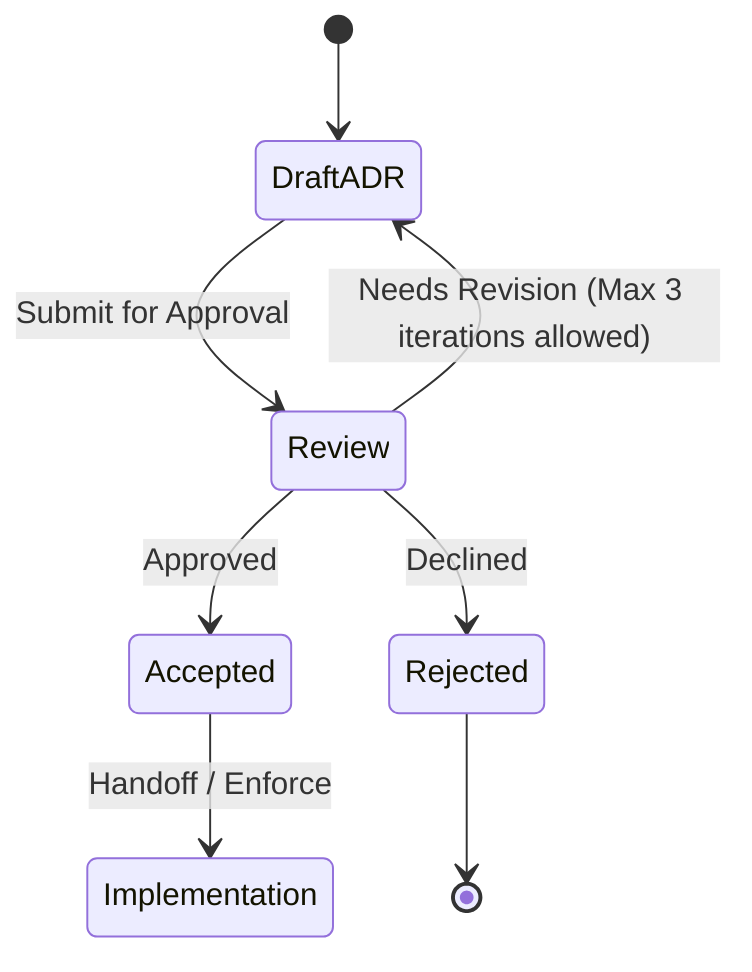

# ADR-0002: Tombstones for deletes, later edit wins, notes merge

## Status

Proposed. Needs approval by mjbvilhena.

This record answers the US-73 placeholder. It does not add acceptance criteria to that story. Drafting it is not acceptance.

## Context

The specification already says an item that exists on only one side is kept (US-20). Each item keeps one id and an updated time (E4, US-56). An edit or a second device must not fork that id. Concurrent edits and deletions are the open question US-73 was left to hold. The options written on that story, and not chosen there, are tombstones, per-field last-writer-wins, and merged notes. "A deleted item must not come back" is the same kind of option.

US-13 deletes locally, with undo, and does not delete the Drive copy. US-52 merges a zip the way US-20 merges one-sided items, and leaves a conflicting id to US-73. US-49's union-tags and append-note rule is for a second share of the same page, not for two phones. Drive stores one ciphertext copy in `appDataFolder` (US-36, US-78). Drive does not merge items.

Domain consultant: `docs/domain/vault/DOMAIN.md`. Layer consultant: `docs/layers/data/LAYER.md`.

Doing nothing lets the last phone to upload replace the other phone's vault.

## Decision

Recommended option: inside the ciphertext, keep one record per item id, plus a tombstone when a delete becomes final. Scalar fields follow the later `updatedAt`. Personal-note entries from both sides are kept. A tombstone wins over a later edit of that same id.

Rules, if this record is accepted:

- Sync payload is one opaque Drive file. After decrypt it is a set of item records and tombstones, not a second database Google can merge. Names stay opaque (US-36).
- Before upload, the phone downloads the current file, decrypts, merges, encrypts, and uploads. If the remote generation changed during that work, it merges again. It does not upload over a generation it has not merged.
- An id present on only one side, with no tombstone for that id, is kept (US-20). That rule is unchanged.
- The same id with two `updatedAt` values: the later `updatedAt` supplies title, body, sensitive mark, reminder, expiry, source URL, preview, and snapshot. The tag set is the set on that later record. US-56's single `updatedAt` stays the clock. This is last-writer-wins for those fields, not a second per-field clock.
- Personal-note entries are the merged-notes option. An entry is identified by its own timestamp and text. Both sides' entries are kept. The winner's `updatedAt` does not delete a note that exists only on the older side.
- A delete that has finished the US-13 undo window writes a tombstone for that id. Undo before that window ends writes nothing remote. US-66 trash duration is not decided here. Until a later story sets it, "final" means the undo window has ended.
- A tombstoned id is not recreated by the other phone, by an older record of that id, or by a zip import (US-52). A later `updatedAt` on the other phone does not resurrect it. He can save a new item, which gets a new id.
- The one-sided rule does not apply to an id that has a tombstone. The id is known. It is not an item the other side merely lacks.
- Old Drive revisions are not a sync source. Sync reads the current app-data file only (see ADR-0001).

Default: an unexpected duplicate id is a conflict, never a second item.

## Alternatives considered

| Option | Why it was plausible | Why it lost |
| --- | --- | --- |
| Whole-file last upload wins | One blob, no merge code | The other phone's items and edits disappear. That breaks US-20 and the stable id |
| Per-field clocks, and a tombstone per tag | A tag added on the older phone would survive, and a tag removal would stick without taking the whole tag set from the winner | US-56 and E4 give one `updatedAt` per item. A second clock is a schema the stories do not have. Tag-set last-writer-wins is the smaller rule |
| Merged notes only, and last-writer-wins for the rest, with no tombstone | Notes are safe, and deletes stay simple | Without a tombstone the other phone, or a zip of an older copy, puts the item back. That is the option US-73 names as "a deleted item must not come back", left unchosen until this record |
| Tombstone loses if the other side has a later `updatedAt` | An edit typed on the second phone before it saw the delete would survive | The story's deletion option is that the item must not come back. A later edit of a deleted id is how it comes back. The cost is called out below |

## Consequences

- **Positive.** One-sided items still merge. A finished delete stays finished. A note typed on the phone that loses the `updatedAt` race is not dropped. Two phones cannot replace the whole vault by uploading last.
- **Negative / accepted trade-offs.** The phone with the later `updatedAt` overwrites title, body, tags, and reminder from the other phone. A tag that existed only on the older side is gone. An edit that had not synced before the other phone's delete is dropped. Device clocks can be wrong, and there is no second clock to correct them. Trash lifetime stays undecided.
- **Follow-ups.** US-73 stays a placeholder until this record is accepted and criteria are added in a later edit. US-66 still owns how long trash keeps an item. He is the approver.

## Compliance

- [ ] A merge test keeps an id that exists on only one side and has no tombstone
- [ ] A merge test with two `updatedAt` values keeps the later scalar fields and the union of personal-note entries
- [ ] A tombstone removes the id from the other side and from a zip import, including when that side's `updatedAt` is later
- [ ] Upload retries when the remote generation moved
- [ ] The Drive file name still carries no title

## Related

- Domain consultant `vault`. Layer consultant `data`.
- US-13, US-20, US-49, US-52, US-56, US-73, US-36, US-78.
- ADR-0001 for which bytes are ciphertext, and for Drive revisions not being a second sync head.

## Anti-patterns

- Resolving the conflict by forking a new id.
- Treating a Proposed merge rule as implemented.
- Using Drive's revision list as the item merge.

## Skill State Machine (sdlc-adr-drafter)

Status: Proposed. Needs approval by mjbvilhena.
