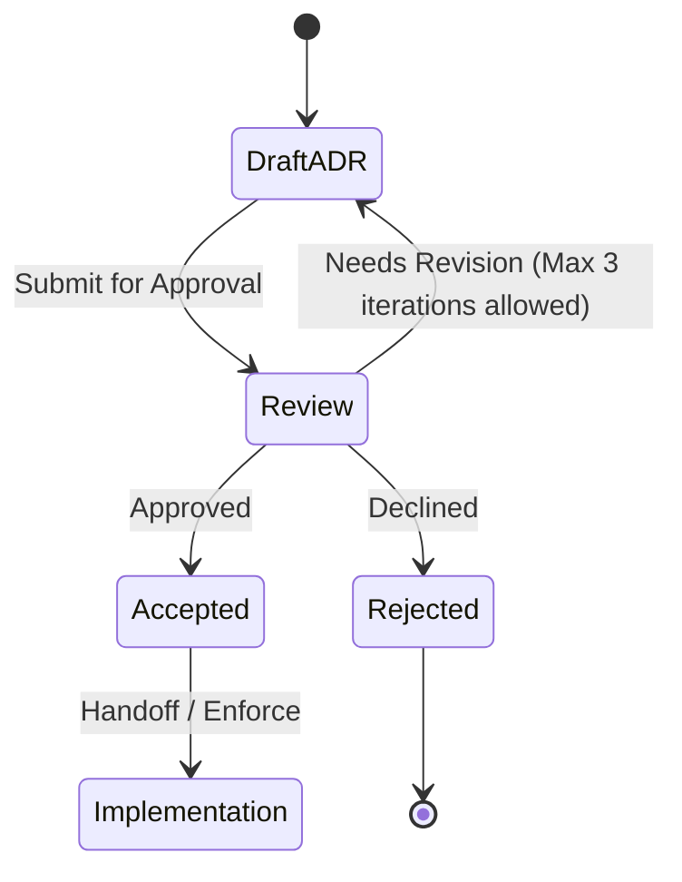

# ADR-0002: One records file per install

## Status

Accepted. Approved by mjbvilhena on 2026-10-20.

This record answers the US-73 placeholder. It does not add acceptance criteria to that story. Drafting it is not acceptance. Approved by mjbvilhena on 2026-10-20. Those decisions are the sensitive mark, the synced in-trash field, retiring a lost phone only through "Forget this phone", and US-66 as Must for v1. v1 does not ship without trash.

## Context

The specification already says an item that exists on only one side is kept (US-20). Each item keeps one id and an updated time (E4, US-56). An edit or a second device must not fork that id. Concurrent edits and deletions are the open question US-73 was left to hold. The options written on that story, and not chosen there, are tombstones, per-field last-writer-wins, and merged notes. "A deleted item must not come back" is the same kind of option.

US-13 deletes locally, with undo, and does not delete the Drive copy. US-52 merges a zip the way US-20 merges one-sided items, and leaves a conflicting id to US-73. US-49's union-tags and append-note rule is for a second share of the same page, not for two phones. Drive stores ciphertext in `appDataFolder` (US-36, US-78). Drive does not merge items.

US-55 already breaks equal check-ins by the lower install id, using plain string comparison. That compare is reused here for equal `updatedAt` values. Check-ins themselves stay per install.

The Drive v3 files API does not provide a conditional write this design can rely on. A single shared file with "retry if the generation changed" is not a guarantee. Two phones can still overwrite each other.

Domain consultant: `docs/domain/vault/DOMAIN.md`. Layer consultant: `docs/layers/data/LAYER.md`.

Doing nothing lets the last phone to upload replace the other phone's vault.

## Decision

Recommended option: each install writes only its own records file, as immutable generations of a full snapshot. Attachments are separate immutable files. Each install downloads the other installs' files and merges them locally. User fields merge by the later `userEditedAt`, and an equal `userEditedAt` is broken by the lower install id. Tags are a union unless a removal is recorded. Personal-note entries from both sides are kept.

The sensitive mark is not sticky across phones. It merges like any other user field, by the later `userEditedAt`. Approved by mjbvilhena on 2026-10-20. The in-trash state syncs. On every phone a trashed item is hidden and its reminders are silenced, and he can restore it from any phone. Only a user-initiated edit whose `userEditedAt` is later than `trashChangedAt` clears trash. In-trash state merges by the later `trashChangedAt`, not by `updatedAt`. The tombstone, which is the permanent delete, spreads only after 30 × 24 hours. US-66 is Must for v1. v1 does not ship without it, so a delete does not become a tombstone by skipping trash. Approved by mjbvilhena on 2026-10-20. A lost phone's Drive file is retired only through "Forget this phone", never automatically. Approved by mjbvilhena on 2026-10-20.

Rules, if this record is accepted:

- One records object per install. The name is opaque (US-36). The object is an ADR-0006 container. Generation means only the snapshot counter inside that file. Readers take the highest generation for that install id and ignore a lower one. An install uploads a new snapshot of its own file only. It does not write another install's file, except the re-key in the next bullet.
- Re-key exception. After a normal passphrase change, and after a forgotten-passphrase reset once the 24 hours end with no cancel, the phone doing the re-key merges every readable Drive file, then rewrites or deletes every current file under an older key version. That includes the other phones' records files, a dead phone's file, and attachment objects under the old key (ADR-0001). The merge happens first. During the 24 hours the resetting phone does not upload. Forgetting a phone, below, is a different action and does not by itself re-key.
- `updatedAt`, `userEditedAt`, `trashChangedAt`, the instant an item enters trash, and a tombstone timestamp are UTC instants, as epoch milliseconds. A local edit sets `updatedAt` to the later of now and one millisecond after that item's previous `updatedAt`. The value does not go backwards on that phone. A clock set ahead can still make an older edit look newer, and can set `trashChangedAt` or the tombstone early. That residual is T-28. No guard is chosen.
- If a new local snapshot cannot be written because the disk is full, the current snapshot is left untouched. Settings says the write did not fit. The phone does not replace the vault with a partial file.
- Attachments are separate immutable objects, named by the hash of their ciphertext, not by the item title. A records file points at those hashes. An attachment file is not rewritten in place.
- Fallback when there is no conditional write, which is the API this record assumes: do not use a shared file plus a generation precondition. If listing or download fails, keep the local vault, do not replace it with an empty set, and retry. A failed listing is not "the other phone deleted everything". The phone still uploads only its own file after a successful read of the others, or it skips the upload until that read works. US-20's one-sided keep is the local behaviour during that failure.
- If a later Drive API documents a conditional update this app can depend on, a successor ADR may collapse back to one shared file. Until then the per-install file is the design.
- An id present on only one side, with no tombstone for that id, is kept (US-20). That rule is unchanged.
- The same id on two phones. `updatedAt` says the snapshot changed. It does not, by itself, pick the user fields, and it does not decide trash. `userEditedAt` is a separate UTC instant, epoch milliseconds, one per item. It is not a clock for each field. A user-initiated edit sets `userEditedAt` and `updatedAt` to the same instant, the later of now and one millisecond after the previous `updatedAt`. The user fields are the title, body, personal notes, a tag he changes on that item, the reminder, the expiry, attachments, and the sensitive mark. A system write sets `updatedAt` and does not set `userEditedAt`. System writes are a US-29 rename or merge applied across items, a link-preview or snapshot refresh, OCR, topic links, an automatic reminder reschedule, and any other background write. Trash and restore set `updatedAt` and `trashChangedAt` and do not set `userEditedAt`. `trashChangedAt` is one UTC instant for that item. Only a trash write or a restore write sets it. A background write does not. In-trash state merges by the later `trashChangedAt`, and an equal `trashChangedAt` uses the lower install id. `updatedAt` does not decide trash. User fields merge by the later `userEditedAt`. An equal `userEditedAt` uses the record from the lower install id, compared as a plain string, the same comparison US-55 uses. System-owned values, the preview, the snapshot, OCR text, and topic links, may update from the system write. They do not replace the user fields. The sensitive mark is not sticky. A later user edit on another phone can clear it. There is no extra control. Approved by mjbvilhena on 2026-10-20.
- Tags on that id are the union of the tags from both sides, unless a removal of that tag on that item is recorded. A removal record is the item id, the tag, a timestamp, and the install id. A later add of the same tag beats an earlier removal. An equal timestamp uses the lower install id.
- Personal-note entries are the merged-notes option. Each entry has a stable id. Both sides' ids are kept. An entry is not identified by its timestamp and text, so two entries with the same text stay two entries, and an edit keeps the id. The winner's `updatedAt` does not delete a note that exists only on the other side.
- Topics are a union by topic id. A recorded removal of a topic stays removed. A suggestion is not confirmed by the merge. Suggestions are a union by name. A recorded decline of a name stays declined, and an older suggestion of that name does not reappear. Decline behaviour in the product is US-46, which is Draft. This bullet is only the merge.
- Topic provenance is part of the merge. For one item id, provenance entries are a union by the hash of the fields that were sent. The topic API key is not in that set (ADR-0003).
- Check-ins stay per install. They are not last-writer-wins. Each records file carries that install's check-in. US-55 reads those check-ins: newest posts, a sole signed-in install that holds the key always posts, and equal check-ins are broken by the lower install id.
- Settings. The topic API key and ML Kit acceptance stay on the install that stored them. They are not in the synced records. This record does not sync the topic key. Other non-secret settings (theme, reminder default, the topic switch, unmetered flags) follow the later `updatedAt`, with the same install-id tie-break.
- Attachments that exist on either side are both kept. A removal is a record (attachment id, timestamp, install id), not an in-place delete of the immutable file. An older records file does not put a removed attachment back. The file itself becomes eligible for garbage collection with the tombstone rules below.
- A receiving install applies a records file when that file is valid. It does not wait until every attachment the file names has been downloaded. The item is available from the records file. An attachment that is not local yet is shown as not downloaded, and it is fetched after. The item is not held back for that fetch.
- Undo. US-13 undo, before that window ends, writes nothing remote and does not start trash.
- Trash. Approved by mjbvilhena on 2026-10-20. US-66 is Must for v1. v1 does not ship without it. When the undo window ends, this install sets `inTrash`, `trashedAt`, and `trashChangedAt`. `trashedAt` and `trashChangedAt` are the UTC instant the undo window ended, in epoch milliseconds. `updatedAt` becomes the later of now and one millisecond after the previous `updatedAt`. Those fields sync in the records file. They are not local-only. `updatedAt` does not decide trash. No tombstone is written yet. A delete does not become a tombstone by skipping trash. Thirty days is 30 × 24 hours after `trashedAt`. Each phone reads that deadline on its own clock.
- The in-trash field merges by the later `trashChangedAt`, and a tie goes to the lower install id. A later `trashChangedAt` on a trash write beats an earlier restore. A later `trashChangedAt` on a restore beats an earlier trash. `updatedAt` does not decide trash. A background write does not set `trashChangedAt`, so it does not clear trash and it does not re-trash a restored item.
- On every phone that has merged `inTrash`, the item is hidden from the home list, search, Upcoming, tag views, the inbox, and topic views. Its reminders are silenced, including on the phone US-55 would pick. Its expiry notices are paused. A queued topic job for it is not sent. He can open Trash on any of those phones and restore it. Approved by mjbvilhena on 2026-10-20. Trash is opened from Settings. Topic notes written from it are hidden while it is in trash. v1 has no Delete forever, no Delete now, and no Empty trash.
- Restore. Any phone may restore it during those 30 days. Restore clears `inTrash` and `trashedAt`, sets `trashChangedAt` and `updatedAt` to the restore time, does not set `userEditedAt`, and uploads that record. The item returns on every phone that merges it. Reminders are scheduled again. No tombstone is written. Approved by mjbvilhena on 2026-10-20. The other fields are unchanged, including the sensitive mark. Expiry notices resume. Topic notes written from it show again. A reminder whose time passed while the item was in trash fires once, as soon as possible after restore, on the install US-55 picks. It is not fired twice. That once-only fire is a synced fired state. An expiry notice that came due while the item was in trash is shown once, right after restore. A topic job that was held back while the item was in trash is not sent on restore. It waits until he taps "Get topics". Approved by mjbvilhena on 2026-10-20.
- Proposed amendment. Needs approval by mjbvilhena. A phone that had already removed the item, and then receives a late restore, rebuilds what US-13 removes when the tombstone is written: the search index, reminders, with the one missed fire, topic links, the queued topic job rebuilt as held, pending suggestions, and the AI topic notes, and it re-fetches attachments from Drive. No topic call is sent.
- Proposed amendment. Needs approval by mjbvilhena. An expiry notice that came due while the item was in trash is shown once, right after restore, on the install US-55 picks. The 7-day notice and the day-of notice are each shown once if that notice came due in trash.
- A later user edit while the item is in trash. Approved by mjbvilhena on 2026-10-20. Only a user-initiated edit of that item, with `userEditedAt` later than `trashChangedAt`, clears `inTrash` and `trashedAt` and keeps the edited fields. The item leaves trash on every phone. Leaving trash this way schedules reminders again, fires a reminder that fell due in trash once on the install US-55 picks, resumes expiry notices, shows an expiry notice that came due in trash once, shows topic notes written from the item again, and does not send a topic job that was held back in trash. That job waits until he taps "Get topics". The once-only reminder fire is a synced fired state, and so is the once-only expiry notice. A system write does not, whatever its `updatedAt`, and it does not set `trashChangedAt`. A US-29 rename or merge, a link-preview or snapshot refresh, OCR, topic links, an automatic reminder reschedule, and any other background write do not set `userEditedAt`, do not clear `inTrash` or `trashedAt`, and do not bring the item back. They may still update their own values: the renamed tag, the preview, the snapshot, the OCR text, the topic link, or the rescheduled alarm. A background write on a phone that has not synced the trash leaves the item in trash when the trash record arrives. A background write that still carries an older trash does not re-trash an item whose restore has a later `trashChangedAt`. A zip import whose `userEditedAt` is later than `trashChangedAt`, and whose 30 × 24 hours after `trashedAt` have not already ended, is the same as that user edit. If the user edit's `userEditedAt` is earlier than `trashChangedAt`, trash stands and that edit is kept. It is present if the item is restored. The trash record's later `updatedAt` does not discard it. `updatedAt` does not decide trash. An equal `userEditedAt` and `trashChangedAt` uses the lower install id: if that id made the user edit, the item comes back; if that id set `trashChangedAt`, trash stands.
- Proposed amendment. Needs approval by mjbvilhena. That edit does not change `trashChangedAt`. The merge keeps the user fields from the later `userEditedAt`, then clears `inTrash` and `trashedAt` because that `userEditedAt` is later than the unchanged `trashChangedAt`.
- Proposed amendment. Needs approval by mjbvilhena. It shows each expiry notice that came due in trash once, on the install US-55 picks, including the 7-day notice and the day-of notice.
- Approved by mjbvilhena on 2026-10-20. One phone may restore while another trashes the same item again. The later `trashChangedAt` wins. An equal `trashChangedAt` uses the lower install id. A winning restore clears `inTrash` and `trashedAt`, and the item is out of trash. A winning re-trash sets `inTrash`, and sets `trashedAt` and `trashChangedAt` to that re-trash, so the item is in trash and the 30 × 24 hours start again from that instant. `updatedAt` does not choose either outcome.
- Approved by mjbvilhena on 2026-10-20. A zip export includes trashed items with `inTrash`, `trashedAt`, and `trashChangedAt`. An import of that record keeps those items in trash when 30 × 24 hours after `trashedAt` have not ended on the importing phone's clock. Carrying those trash fields is not, by itself, the content edit that clears trash. If those 30 × 24 hours have already ended, the import deletes that item for good and writes the tombstone, the permanent-delete record, at import. The item is not left in trash.
- Proposed amendment. Needs approval by mjbvilhena. That keep applies when this phone has no record of that id with a later `trashChangedAt`. A zip does not re-trash an item whose current `trashChangedAt` is later.
- Proposed amendment. Needs approval by mjbvilhena. That tombstone is written only when this phone has no record of that id with a later `trashChangedAt` and no user edit with a later `userEditedAt`. If the item was restored, or user-edited, after the export, the zip's trash state does not apply, no tombstone is written, and nothing changes. The item is not left in trash when that tombstone is written.
- Approved by mjbvilhena on 2026-10-20. The US-49 repeat-link match finds an item that is in trash and offers to restore it. If he accepts, that accept is a restore: `inTrash` and `trashedAt` are cleared, `trashChangedAt` is the restore time, `userEditedAt` is not set, the item's other fields are unchanged, and a second item is not created. If he declines, the share is saved as a new, separate item, and the trashed item stays in trash.
- A restore or a user edit that happened before the deadline is not lost if it arrives late. Approved by mjbvilhena on 2026-10-20.

  Proposed amendment. Needs approval by mjbvilhena.

  If a tombstone has already been written, and a restore then arrives whose `trashChangedAt` is after the `trashedAt` of the trash that the tombstone ended, and before the earliest tombstone timestamp when several phones wrote one, the item comes back on every phone and the tombstone is dropped. A phone that had already removed the item rebuilds what US-13 removes when the tombstone is written: the search index, reminders, with the one missed fire, topic links, the queued topic job rebuilt as held, pending suggestions, and the AI topic notes, and it re-fetches attachments from Drive. No topic call is sent. A user-initiated edit whose `userEditedAt` is after `trashChangedAt` and before that earliest tombstone timestamp does the same. A system write does not. `inTrash` is clear.
- Approved by mjbvilhena on 2026-10-20. An edit from a phone that was offline, for an id that is already permanently deleted, is dropped when it is not the late restore or the late user edit in the bullet above. The item stays deleted. The phone that held the edit shows a short notice that the edit couldn't be kept.

  Proposed amendment. Needs approval by mjbvilhena.

  That notice is in the app, not a system notification. It appears once, when the dropped user edit is merged, and not again after a restart or a later sync. It fires only for a dropped user edit, never for OCR, a preview, or another system write. The exact text waits for the UX artefact.
- Tombstone. Approved by mjbvilhena on 2026-10-20. Which phone writes it follows. Every phone that has merged `inTrash`, and that still has the item in trash, removes the item and writes a tombstone when 30 × 24 hours after `trashedAt` end on that phone's clock. Tombstones for the same id from several phones are one delete. A phone that never merged `inTrash` does not start that deadline. When a tombstone for that id arrives, that phone drops the item and does not keep the id as a one-sided item. A tombstone wins over a later `updatedAt` of that same id, over a background write, over an older record, and over a zip import, except for the late restore or user edit in the bullet above. `updatedAt` does not decide trash. The one-sided rule does not apply to an id that has a tombstone. The id is known. It is not an item the other side merely lacks. He can save a new item, which gets a new id.
- Proposed amendment. Needs approval by mjbvilhena. The tombstone carries the `trashedAt` and the `trashChangedAt` of the trash that it ended.
- Proposed amendment. Needs approval by mjbvilhena. If that phone holds a user edit whose `userEditedAt` is after `trashChangedAt` and before the earliest tombstone timestamp when several phones wrote one, it keeps the item, drops the tombstone, and that edit brings the item back on every phone. It shows no couldn't-be-kept notice.
- Tombstone lifetime. A tombstone is kept until every install that currently has a records file has merged a generation containing it, and at least 90 days have passed since the tombstone timestamp. Then garbage collection may drop the tombstone and any attachment objects that no remaining record references. After that collection, a zip or a phone that never merged can bring the item back. An install that still has a records file and has not merged keeps the tombstone alive past 90 days. Garbage collection does not run because a listing failed. The 90 days start at the tombstone, not at the start of trash.
- Old Drive revisions of an install's own file are not a second sync head. A lower generation of that same file is refused (ADR-0001, ADR-0006). Drive's own purge of revisions is ADR-0001.
- Forget this phone. Approved by mjbvilhena on 2026-10-20. A lost phone's records file is retired only when he chooses "Forget this phone" in Settings on a phone that still holds the vault. It is never retired because of age, silence, or a missed check-in.
- The action names one other install. It does not retire the install he is holding.
- File deletion. Forgetting deletes that install's records file from Drive. An attachment object that no remaining records file references becomes eligible for the same collection as any other unreferenced attachment. It is not deleted in that step while another file still points at it.
- Tombstone garbage collection. An install with no records file is not an install that currently has one. Tombstones no longer wait for the forgotten install to merge a file. Collection still waits for every install that still has a file, and for the 90 days after the tombstone timestamp.
- Re-keying. Forgetting does not change the passphrase and does not mint a key version. A re-key that happens later, or one already in progress, has no file left for that install to rewrite. The re-key rule still merges and then rewrites or deletes every current file under an older key version, including a phone he has not forgotten. If he forgets a phone whose file is already under the current key, that file is deleted and is not rewritten. A forgotten phone that later returns uploads a new records file under the current key version after he enters the passphrase. It does not restore the deleted file, and it does not bring back a tombstone that has already been collected.

Default: an unexpected duplicate id is a conflict, never a second item. A failed download does not become a deletion.

## Alternatives considered

| Option | Why it was plausible | Why it lost |
| --- | --- | --- |
| One shared Drive file, retry if the remote generation changed | One blob, and a read-merge-write loop looks like a conditional write | Drive v3 does not guarantee that conditional write. The last upload can still replace the other phone. Per-install files remove that race. The fallback when a conditional API appears later is a successor ADR |
| Whole-file last upload wins | One blob, no merge code | The other phone's items and edits disappear. That breaks US-20 and the stable id |
| The whole tag set comes from the later `updatedAt` | One clock, which US-56 already has | A tag that exists only on the older side disappears, and a removal cannot be told from "this snapshot never had the tag". A recorded removal plus a union keeps both the add and the removal |
| Per-field clocks | A tag and a title could move independently with a true last writer | US-56 and E4 give one `updatedAt` per item. `userEditedAt` is one extra instant for a user edit of that item. It is not a clock per field. The tie-break is the install id |
| Merged notes only, and last-writer-wins for the rest, with no tombstone | Notes are safe, and deletes stay simple | Without a tombstone the other phone, or a zip of an older copy, puts the item back after the delete was meant to be final. The 30-day trash is the window where a later edit still brings the item back. After that, the tombstone is what stops the item coming back |
| Tombstone as soon as undo ends, beating any later edit | A finished delete would stay finished immediately, including against an edit the other phone had not synced | That drops the other phone's content edit, and it deletes permanently before he has had 30 days to restore. The in-trash field syncs. The tombstone waits until the 30 days end |
| Keep trash only on the deleting phone | The other phone would keep a live copy | The in-trash field syncs. Every phone hides the item and silences its reminders. He can restore it from any phone |
| Ship the tombstone without trash | A finished delete would spread as soon as undo ends | US-66 is Must. v1 does not ship without the 30-day trash. A delete does not become a tombstone by skipping trash |
| A sticky sensitive mark | A mark set on one phone would survive a later edit that clears it | The mark merges like any other user field, by the later `userEditedAt`, and a tie goes to the lower install id. A later edit can clear the mark. That is accepted |

## Consequences

- **Positive.** One phone cannot replace the other phone's file. One-sided items still merge. Tags and attachments from both sides survive unless a removal was recorded. A failed listing does not wipe the phone.
- **Negative / accepted trade-offs.** Each install stores a full snapshot, so Drive holds one current file per install plus immutable attachments. Clocks can still be wrong, and an equal timestamp is the only place the install id steps in. A phone whose clock is ahead can write `trashChangedAt` or the tombstone before 30 × 24 hours of true time. No guard is chosen. For 30 days the item is hidden on every phone, and a user-initiated edit whose `userEditedAt` is later than `trashChangedAt` brings it back. In-trash state merges by `trashChangedAt`, not by `updatedAt`. A system write does not. An older user edit is kept while the item stays in trash. After the tombstone, a later write does not bring the item back, except a restore or a user edit that itself happened during the trash window and arrives late. Any other edit from an offline phone for that id is dropped, and the phone that held it shows a short notice that the edit couldn't be kept. An expiry notice that came due in trash is shown once when the item leaves trash. A topic job held back in trash waits until he taps "Get topics". A zip whose 30 × 24 hours have already ended writes the tombstone at import. Declining the restore of a re-shared trashed URL saves that share as a new item. Accepting it is a restore. Tombstones then live at least 90 days, and after garbage collection an old zip can resurrect an item. The topic API key does not travel with the vault; a new phone needs it typed again. A later edit on another phone can clear the sensitive mark. That is accepted. There is no extra control.
- Proposed amendment. Needs approval by mjbvilhena. That notice is in the app, once. The exact text waits for the UX artefact.
- Proposed amendment. Needs approval by mjbvilhena. That import writes the tombstone only when this phone has no later `trashChangedAt` and no later `userEditedAt`.
- **Follow-ups.** This record is accepted. Approved by mjbvilhena on 2026-10-20. US-73 stays a placeholder until criteria are added in a later edit. US-66 is Must for v1 and stays Proposed for story review. v1 does not ship without it.

  Proposed amendment. Needs approval by mjbvilhena.

  Open question, not a rule: attachment bytes still held by a phone forgotten with "Forget this phone", when that phone comes back after the tombstone was garbage-collected. This record says that phone does not bring back a collected tombstone. It does not say what happens to those bytes.

## Compliance

- [ ] Each install writes only its own records file, except the re-key that deletes old-key files after a merge, and readers use the highest generation per install id
- [ ] A local edit does not store an `updatedAt` earlier than the previous one. Note entries keep a stable id
- [ ] An item is available before every attachment has downloaded. A full disk leaves the current snapshot in place
- [ ] "Forget this phone" deletes that other install's records file, drops it from tombstone garbage collection, and does not re-key. No job retires a file for age or silence
- [ ] A failed listing or download leaves the local vault in place
- [ ] Equal `updatedAt` values resolve to the lower install id by plain string comparison
- [ ] Tags are the union minus recorded removals, and attachments present on either side are kept until a removal is recorded
- [ ] Check-ins are not overwritten by the other install's file
- [ ] The topic API key and ML Kit acceptance are absent from the synced records
- [ ] For 30 days after `trashedAt`, the upload contains the in-trash field and no tombstone. Every phone that merges it hides the item and silences its reminders. Any phone can restore it. v1 includes that trash. A delete does not skip it
- [ ] In-trash state merges by the later `trashChangedAt`, not by `updatedAt`. Only a user-initiated edit whose `userEditedAt` is later than `trashChangedAt` clears trash. A system write does not. An older user edit is kept and the item stays in trash. A restore made before the deadline that arrives after the tombstone brings the item back and drops the tombstone. A reminder that fell due in trash fires once on restore, on the install US-55 picks, and not twice. An expiry notice that came due in trash is shown once when the item leaves trash. Accepting a re-shared trashed URL is a restore. Declining it saves a new item and leaves the trashed item in trash. A zip whose 30 × 24 hours have already ended writes the tombstone at import. A topic job held back in trash waits until he taps "Get topics". An offline edit of an id that is already permanently deleted is dropped, with a short notice that the edit couldn't be kept, except the late restore or the late user edit from the trash window
- Proposed amendment. Needs approval by mjbvilhena. That import writes the tombstone only when this phone has no later `trashChangedAt` and no later `userEditedAt`.
- [ ] When the 30 days end with the item still in trash, every phone that has merged `inTrash` writes a tombstone on its own clock, those tombstones are one delete, and a phone that never merged the trash drops the item when the tombstone arrives
- [ ] A tombstone is not collected before 90 days after the tombstone timestamp, or while a known install has not merged it
- [ ] The sensitive mark follows the later `userEditedAt`, ties go to the lower install id, and a sticky mark is not implemented
- [ ] The Drive file name still carries no title

## Related

- Domain consultant `vault`. Layer consultant `data`.
- US-13, US-20, US-46, US-49, US-52, US-55, US-56, US-66, US-73, US-36, US-78.
- ADR-0001 and ADR-0006 for the container, the generation, and Drive revision purge.
- ADR-0003 for the key that this record does not sync.

## Anti-patterns

- A shared file with a hopeful if-match.
- Treating an empty listing as a delete.
- Resolving a conflict by forking a new id.
- Syncing the topic API key because the rest of Settings syncs.
- Using Drive's revision list as the item merge.
- Keeping the sensitive mark sticky across phones.
- Proposed amendment. Needs approval by mjbvilhena. Treating an accepted merge rule as implemented. Implementation has not started.
- Writing a tombstone before 30 × 24 hours after `trashedAt`.
- Shipping a delete that becomes a tombstone without the 30-day trash.
- Leaving a trashed item visible, or its reminder armed, on a phone that has merged `inTrash`.
- Treating a system write as the edit that clears trash.
- Deciding `inTrash` by `updatedAt`.
- Dropping an older user edit because the trash record has a later `updatedAt`.
- Firing a reminder that fell due in trash more than once after restore.
- Showing an expiry notice that came due in trash more than once, or scheduling a notice for a passed time he sets.
- Sending a topic job that was held in trash as soon as the item leaves trash.
- Keeping an offline edit of an id that already has a tombstone, except the late restore or the late user edit from the trash window.
- Leaving a zip item in trash after 30 × 24 hours from `trashedAt` have already ended.

## Skill State Machine (sdlc-adr-drafter)

Status: Accepted. Approved by mjbvilhena on 2026-10-20.
