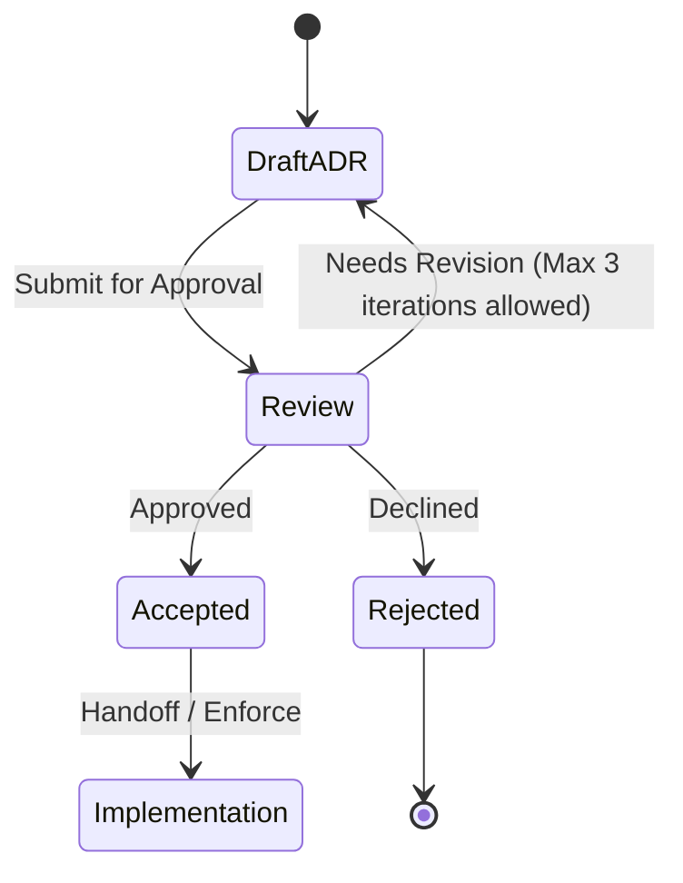

# ADR-0002: One records file per install

## Status

Proposed. Needs approval by mjbvilhena.

This record answers the US-73 placeholder. It does not add acceptance criteria to that story. Drafting it is not acceptance. Delete versus a later edit is decided below. The sensitive mark is decided below. This record is still Proposed.

## Context

The specification already says an item that exists on only one side is kept (US-20). Each item keeps one id and an updated time (E4, US-56). An edit or a second device must not fork that id. Concurrent edits and deletions are the open question US-73 was left to hold. The options written on that story, and not chosen there, are tombstones, per-field last-writer-wins, and merged notes. "A deleted item must not come back" is the same kind of option.

US-13 deletes locally, with undo, and does not delete the Drive copy. US-52 merges a zip the way US-20 merges one-sided items, and leaves a conflicting id to US-73. US-49's union-tags and append-note rule is for a second share of the same page, not for two phones. Drive stores ciphertext in `appDataFolder` (US-36, US-78). Drive does not merge items.

US-55 already breaks equal check-ins by the lower install id, using plain string comparison. That compare is reused here for equal `updatedAt` values. Check-ins themselves stay per install.

The Drive v3 files API does not provide a conditional write this design can rely on. A single shared file with "retry if the generation changed" is not a guarantee. Two phones can still overwrite each other.

Domain consultant: `docs/domain/vault/DOMAIN.md`. Layer consultant: `docs/layers/data/LAYER.md`.

Doing nothing lets the last phone to upload replace the other phone's vault.

## Decision

Recommended option: each install writes only its own records file, as immutable generations of a full snapshot. Attachments are separate immutable files. Each install downloads the other installs' files and merges them locally. Scalar fields use the later `updatedAt`, and an equal `updatedAt` is broken by the lower install id. Tags are a union unless a removal is recorded. Personal-note entries from both sides are kept.

The sensitive mark is decided. It is not sticky across phones. It merges like any other scalar field. Delete versus a later edit is decided. A delete stays in local trash for 30 days. A later edit during that time is kept, and the item comes back. Only after those 30 days does the delete become a tombstone.

Rules, if this record is accepted:

- One records object per install. The name is opaque (US-36). The object is an ADR-0006 container. Readers take the highest in-ciphertext generation for that install id and ignore a lower one. An install uploads a new generation of its own file only. It does not write another install's file.
- Attachments are separate immutable objects, named by the hash of their ciphertext, not by the item title. A records file points at those hashes. An attachment file is not rewritten in place.
- Fallback when there is no conditional write, which is the API this record assumes: do not use a shared file plus a generation precondition. If listing or download fails, keep the local vault, do not replace it with an empty set, and retry. A failed listing is not "the other phone deleted everything". The phone still uploads only its own file after a successful read of the others, or it skips the upload until that read works. US-20's one-sided keep is the local behaviour during that failure.
- If a later Drive API documents a conditional update this app can depend on, a successor ADR may collapse back to one shared file. Until then the per-install file is the design.
- An id present on only one side, with no tombstone for that id, is kept (US-20). That rule is unchanged.
- The same id with two `updatedAt` values: the later `updatedAt` supplies title, body, reminder, expiry, source URL, preview, snapshot, and the sensitive mark. An equal `updatedAt` uses the record from the lower install id, compared as a plain string, the same comparison US-55 uses. This is one clock plus that tie-break, not a second per-field clock. The sensitive mark is not sticky. A later edit on another phone can clear it. There is no extra control.
- Tags on that id are the union of the tags from both sides, unless a removal of that tag on that item is recorded. A removal record is the item id, the tag, a timestamp, and the install id. A later add of the same tag beats an earlier removal. An equal timestamp uses the lower install id.
- Personal-note entries are the merged-notes option. An entry is identified by its own timestamp and text. Both sides' entries are kept. The winner's `updatedAt` does not delete a note that exists only on the other side.
- Topics are a union by topic id. A recorded removal of a topic stays removed. A suggestion is not confirmed by the merge. Suggestions are a union by name. A recorded decline of a name stays declined, and an older suggestion of that name does not reappear. Decline behaviour in the product is US-46, which is Draft. This bullet is only the merge.
- Check-ins stay per install. They are not last-writer-wins. Each records file carries that install's check-in. US-55 reads those check-ins: newest posts, a sole signed-in install that holds the key always posts, and equal check-ins are broken by the lower install id.
- Settings. The Gemini API key, the billed-project confirmation, and ML Kit acceptance stay on the install that stored them. They are not in the synced records. This record does not sync the Gemini key. Other non-secret settings (theme, reminder default, the topic switch, unmetered flags) follow the later `updatedAt`, with the same install-id tie-break.
- Attachments that exist on either side are both kept. A removal is a record (attachment id, timestamp, install id), not an in-place delete of the immutable file. An older records file does not put a removed attachment back. The file itself becomes eligible for garbage collection with the tombstone rules below.
- Undo. US-13 undo, before that window ends, writes nothing remote and does not start trash.
- Trash. When the undo window ends, the item enters trash on this install only, for 30 days. Thirty days is 30 × 24 hours from the instant it entered trash, on this phone's clock. Trash is not uploaded. No tombstone is written. The records file this install uploads still carries the item as a live item, so another install does not see a delete. On this phone the item is absent from search and its reminders are paused (US-66). The other phone still has the live item. An id that is only in trash here, with no tombstone, is still a one-sided live item on the other phone and is kept (US-20).
- Restore. If he restores the item during those 30 days, it leaves trash on this phone. It returns to search, its reminders are scheduled again, and its `updatedAt` becomes the restore time. That later record syncs as a live item. No tombstone is written.
- A later edit while the item is in trash. If another install has the same id with an `updatedAt` later than the instant the item entered trash, that edit is kept. The item leaves trash and comes back, using the ordinary field rules (later `updatedAt`, tie broken by the lower install id). The edit is not dropped. The same is true of a zip import whose `updatedAt` is later than that instant. An equal `updatedAt` uses the lower install id: if that id is the other install, the item comes back; if it is this install, trash stands. A record older than the trash instant does not clear trash and does not remove the item from the other phone.
- An edit that happened during the 30 days is not lost if it arrives late. If a tombstone has already been written, and a record then arrives whose `updatedAt` is after the trash instant and before the tombstone timestamp, the item comes back and the tombstone is dropped. That record is merged with the ordinary field rules.
- Tombstone. If 30 days pass with no restore and no edit that brings the item back, this install writes a tombstone for that id and uploads it. The tombstone then spreads. Other installs drop the item. A tombstone wins over a later `updatedAt` of that same id, over an older record, and over a zip import, except for the late edit in the bullet above. The one-sided rule does not apply to an id that has a tombstone. The id is known. It is not an item the other side merely lacks. He can save a new item, which gets a new id.
- Tombstone lifetime. A tombstone is kept until every install that currently has a records file has merged a generation containing it, and at least 90 days have passed since the tombstone timestamp. Then garbage collection may drop the tombstone and any attachment objects that no remaining record references. After that collection, a zip or a phone that never merged can bring the item back. An install that still has a records file and has not merged keeps the tombstone alive past 90 days. Garbage collection does not run because a listing failed. The 90 days start at the tombstone, not at the start of trash.
- Old Drive revisions of an install's own file are not a second sync head. A lower generation is refused (ADR-0001, ADR-0006). Drive's own purge of revisions is ADR-0001.

Default: an unexpected duplicate id is a conflict, never a second item. A failed download does not become a deletion.

## Alternatives considered

| Option | Why it was plausible | Why it lost |
| --- | --- | --- |
| One shared Drive file, retry if the remote generation changed | One blob, and a read-merge-write loop looks like a conditional write | Drive v3 does not guarantee that conditional write. The last upload can still replace the other phone. Per-install files remove that race. The fallback when a conditional API appears later is a successor ADR |
| Whole-file last upload wins | One blob, no merge code | The other phone's items and edits disappear. That breaks US-20 and the stable id |
| The whole tag set comes from the later `updatedAt` | One clock, which US-56 already has | A tag that exists only on the older side disappears, and a removal cannot be told from "this snapshot never had the tag". A recorded removal plus a union keeps both the add and the removal |
| Per-field clocks | A tag and a title could move independently with a true last writer | US-56 and E4 give one `updatedAt` per item. The tie-break is the install id, not a second clock |
| Merged notes only, and last-writer-wins for the rest, with no tombstone | Notes are safe, and deletes stay simple | Without a tombstone the other phone, or a zip of an older copy, puts the item back after the delete was meant to be final. The 30-day trash is the window where a later edit still brings the item back. After that, the tombstone is what stops the item coming back |
| Tombstone as soon as undo ends, beating any later edit | A finished delete would stay finished immediately, including against an edit the other phone had not synced | That drops the other phone's edit, and it deletes remotely before he has had 30 days to restore. Trash stays local for 30 days. The tombstone waits until that time ends |
| A sticky sensitive mark | A mark set on one phone would survive a later edit that clears it | The mark merges like any other field. The later `updatedAt` wins, and a tie goes to the lower install id. A later edit can clear the mark. That is accepted |

## Consequences

- **Positive.** One phone cannot replace the other phone's file. One-sided items still merge. Tags and attachments from both sides survive unless a removal was recorded. A failed listing does not wipe the phone.
- **Negative / accepted trade-offs.** Each install stores a full snapshot, so Drive holds one current file per install plus immutable attachments. Clocks can still be wrong, and an equal timestamp is the only place the install id steps in. For 30 days the other phone still shows an item he deleted here. After the tombstone, a later edit does not bring the item back, except an edit that itself happened during the trash window and arrives late. Tombstones then live at least 90 days, and after garbage collection an old zip can resurrect an item. The Gemini key does not travel with the vault; a new phone needs it typed again. A later edit on another phone can clear the sensitive mark. That is accepted. There is no extra control.
- **Follow-ups.** US-73 stays a placeholder until this record is accepted and criteria are added in a later edit. US-66 carries the trash behaviour for story review. He is the approver. The sensitive-mark rule and the delete rule above are decided. Accepting this whole record is still open.

## Compliance

- [ ] Each install writes only its own records file, and readers use the highest generation per install id
- [ ] A failed listing or download leaves the local vault in place
- [ ] Equal `updatedAt` values resolve to the lower install id by plain string comparison
- [ ] Tags are the union minus recorded removals, and attachments present on either side are kept until a removal is recorded
- [ ] Check-ins are not overwritten by the other install's file
- [ ] The Gemini API key, billed-project confirmation, and ML Kit acceptance are absent from the synced records
- [ ] For 30 days after trash starts, the upload contains no tombstone for that id, and the other install still has the item
- [ ] A restore during those 30 days, or another install's `updatedAt` later than the trash instant, brings the item back and does not write a tombstone
- [ ] When the 30 days end with the item still in trash, a tombstone is written and the other install drops the item
- [ ] A tombstone is not collected before 90 days after the tombstone timestamp, or while a known install has not merged it
- [ ] The sensitive mark follows the later `updatedAt`, ties go to the lower install id, and a sticky mark is not implemented
- [ ] The Drive file name still carries no title

## Related

- Domain consultant `vault`. Layer consultant `data`.
- US-13, US-20, US-46, US-49, US-52, US-55, US-56, US-66, US-73, US-36, US-78.
- ADR-0001 and ADR-0006 for the container, the generation, and Drive revision purge.
- ADR-0003 for the key that this record does not sync.

## Anti-patterns

- A shared file with a hopeful if-match.
- Treating an empty listing as a delete.
- Resolving a conflict by forking a new id.
- Syncing the Gemini API key because the rest of Settings syncs.
- Using Drive's revision list as the item merge.
- Keeping the sensitive mark sticky across phones.
- Treating a Proposed merge rule as implemented.
- Writing a tombstone before the 30 days of local trash have ended.

## Skill State Machine (sdlc-adr-drafter)

Status: Proposed. Needs approval by mjbvilhena.
