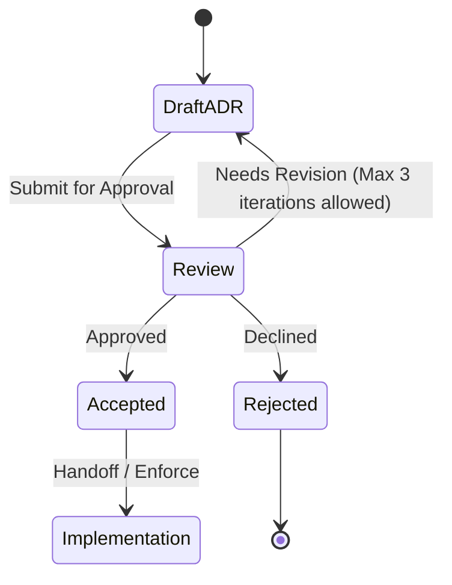

# ADR-0002: One records file per install

## Status

Proposed. Needs approval by mjbvilhena.

This record answers the US-73 placeholder. It does not add acceptance criteria to that story. Drafting it is not acceptance. Decided by mjbvilhena; this record is Proposed until he approves it. Those decisions are the sensitive mark, the synced in-trash field, and retiring a lost phone only through "Forget this phone". Whether US-66 is Must or Should is under Decision pending.

## Context

The specification already says an item that exists on only one side is kept (US-20). Each item keeps one id and an updated time (E4, US-56). An edit or a second device must not fork that id. Concurrent edits and deletions are the open question US-73 was left to hold. The options written on that story, and not chosen there, are tombstones, per-field last-writer-wins, and merged notes. "A deleted item must not come back" is the same kind of option.

US-13 deletes locally, with undo, and does not delete the Drive copy. US-52 merges a zip the way US-20 merges one-sided items, and leaves a conflicting id to US-73. US-49's union-tags and append-note rule is for a second share of the same page, not for two phones. Drive stores ciphertext in `appDataFolder` (US-36, US-78). Drive does not merge items.

US-55 already breaks equal check-ins by the lower install id, using plain string comparison. That compare is reused here for equal `updatedAt` values. Check-ins themselves stay per install.

The Drive v3 files API does not provide a conditional write this design can rely on. A single shared file with "retry if the generation changed" is not a guarantee. Two phones can still overwrite each other.

Domain consultant: `docs/domain/vault/DOMAIN.md`. Layer consultant: `docs/layers/data/LAYER.md`.

Doing nothing lets the last phone to upload replace the other phone's vault.

## Decision

Recommended option: each install writes only its own records file, as immutable generations of a full snapshot. Attachments are separate immutable files. Each install downloads the other installs' files and merges them locally. Scalar fields use the later `updatedAt`, and an equal `updatedAt` is broken by the lower install id. Tags are a union unless a removal is recorded. Personal-note entries from both sides are kept.

The sensitive mark is not sticky across phones. It merges like any other scalar field. Decided by mjbvilhena; this record is Proposed until he approves it. The in-trash state syncs like a field, with later-edit-wins. On every phone a trashed item is hidden and its reminders are silenced, and he can restore it from any phone. A later content edit brings it back. The tombstone, which is the permanent delete, spreads only after 30 days. Decided by mjbvilhena; this record is Proposed until he approves it. A lost phone's Drive file is retired only through "Forget this phone", never automatically. Decided by mjbvilhena; this record is Proposed until he approves it.

Rules, if this record is accepted:

- One records object per install. The name is opaque (US-36). The object is an ADR-0006 container. Generation means only the snapshot counter inside that file. Readers take the highest generation for that install id and ignore a lower one. An install uploads a new snapshot of its own file only. It does not write another install's file, except the re-key in the next bullet.
- Re-key exception. After a normal passphrase change, and after a forgotten-passphrase reset once the 24 hours end with no cancel, the phone doing the re-key merges every readable Drive file, then rewrites or deletes every current file under an older key version. That includes the other phones' records files, a dead phone's file, and attachment objects under the old key (ADR-0001). The merge happens first. During the 24 hours the resetting phone does not upload. Forgetting a phone, below, is a different action and does not by itself re-key.
- `updatedAt`, the instant an item enters trash, and a tombstone timestamp are UTC instants, as epoch milliseconds. A local edit sets `updatedAt` to the later of now and one millisecond after that item's previous `updatedAt`. The value does not go backwards on that phone. A clock set far ahead can still make an older edit look newer. That residual is T-28.
- If a new local snapshot cannot be written because the disk is full, the current snapshot is left untouched. Settings says the write did not fit. The phone does not replace the vault with a partial file.
- Attachments are separate immutable objects, named by the hash of their ciphertext, not by the item title. A records file points at those hashes. An attachment file is not rewritten in place.
- Fallback when there is no conditional write, which is the API this record assumes: do not use a shared file plus a generation precondition. If listing or download fails, keep the local vault, do not replace it with an empty set, and retry. A failed listing is not "the other phone deleted everything". The phone still uploads only its own file after a successful read of the others, or it skips the upload until that read works. US-20's one-sided keep is the local behaviour during that failure.
- If a later Drive API documents a conditional update this app can depend on, a successor ADR may collapse back to one shared file. Until then the per-install file is the design.
- An id present on only one side, with no tombstone for that id, is kept (US-20). That rule is unchanged.
- The same id with two `updatedAt` values: the later `updatedAt` supplies title, body, reminder, expiry, source URL, preview, snapshot, and the sensitive mark. An equal `updatedAt` uses the record from the lower install id, compared as a plain string, the same comparison US-55 uses. This is one clock plus that tie-break, not a second per-field clock. The sensitive mark is not sticky. A later edit on another phone can clear it. There is no extra control.
- Tags on that id are the union of the tags from both sides, unless a removal of that tag on that item is recorded. A removal record is the item id, the tag, a timestamp, and the install id. A later add of the same tag beats an earlier removal. An equal timestamp uses the lower install id.
- Personal-note entries are the merged-notes option. Each entry has a stable id. Both sides' ids are kept. An entry is not identified by its timestamp and text, so two entries with the same text stay two entries, and an edit keeps the id. The winner's `updatedAt` does not delete a note that exists only on the other side.
- Topics are a union by topic id. A recorded removal of a topic stays removed. A suggestion is not confirmed by the merge. Suggestions are a union by name. A recorded decline of a name stays declined, and an older suggestion of that name does not reappear. Decline behaviour in the product is US-46, which is Draft. This bullet is only the merge.
- Topic provenance is part of the merge. For one item id, provenance entries are a union by the hash of the fields that were sent. The topic API key is not in that set (ADR-0003).
- Check-ins stay per install. They are not last-writer-wins. Each records file carries that install's check-in. US-55 reads those check-ins: newest posts, a sole signed-in install that holds the key always posts, and equal check-ins are broken by the lower install id.
- Settings. The topic API key and ML Kit acceptance stay on the install that stored them. They are not in the synced records. This record does not sync the topic key. Other non-secret settings (theme, reminder default, the topic switch, unmetered flags) follow the later `updatedAt`, with the same install-id tie-break.
- Attachments that exist on either side are both kept. A removal is a record (attachment id, timestamp, install id), not an in-place delete of the immutable file. An older records file does not put a removed attachment back. The file itself becomes eligible for garbage collection with the tombstone rules below.
- A receiving install applies a records file when that file is valid. It does not wait until every attachment the file names has been downloaded. The item is available from the records file. An attachment that is not local yet is shown as not downloaded, and it is fetched after. The item is not held back for that fetch.
- Undo. US-13 undo, before that window ends, writes nothing remote and does not start trash.
- Trash. Decided by mjbvilhena; this record is Proposed until he approves it. When the undo window ends, this install sets `inTrash` and `trashedAt`. `trashedAt` is the UTC instant the undo window ended, in epoch milliseconds. `updatedAt` becomes the later of now and one millisecond after the previous `updatedAt`. Those fields sync in the records file. They are not local-only. No tombstone is written yet. Thirty days is 30 × 24 hours after `trashedAt`. Each phone reads that deadline on its own clock.
- The in-trash field merges like any other scalar: the later `updatedAt` wins, and a tie goes to the lower install id. A later trash mark beats an earlier restore. A later restore beats an earlier trash mark.
- On every phone that has merged `inTrash`, the item is hidden from the home list, search, Upcoming, tag views, the inbox, and topic views. Its reminders are silenced, including on the phone US-55 would pick. Its expiry notices are paused. A queued topic job for it is not sent. He can open Trash on any of those phones and restore it.
- Restore. Any phone may restore it during those 30 days. Restore clears `inTrash` and `trashedAt`, sets `updatedAt` to the restore time, and uploads that record. The item returns on every phone that merges it. Reminders are scheduled again. No tombstone is written.
- A later content edit while the item is in trash. A content edit is a change to the title, body, personal notes, tags, reminder, expiry, attachments, or the sensitive mark. It is not a write that only sets or clears `inTrash`. If that edit's `updatedAt` is later than `trashedAt`, the merge clears `inTrash` and `trashedAt` and keeps the edited fields. The item leaves trash on every phone, and the edit is not dropped. The same is true of a zip import whose content `updatedAt` is later than `trashedAt`. If the content edit's `updatedAt` is earlier than `trashedAt`, trash stands, and the other fields follow the ordinary later-`updatedAt` rule. An equal `updatedAt` uses the lower install id: if that id made the content edit, the item comes back; if that id set trash, trash stands. A record older than `trashedAt` does not clear trash.
- A content edit that happened during the 30 days is not lost if it arrives late. If a tombstone has already been written, and a content edit then arrives whose `updatedAt` is after `trashedAt` and before the tombstone timestamp, the item comes back and the tombstone is dropped. That record is merged with the ordinary field rules, and `inTrash` is clear.
- Tombstone. If 30 days pass with no restore and no edit that brings the item back, this install writes a tombstone for that id and uploads it. The tombstone then spreads. Other installs drop the item. A tombstone wins over a later `updatedAt` of that same id, over an older record, and over a zip import, except for the late edit in the bullet above. The one-sided rule does not apply to an id that has a tombstone. The id is known. It is not an item the other side merely lacks. He can save a new item, which gets a new id.
- Tombstone lifetime. A tombstone is kept until every install that currently has a records file has merged a generation containing it, and at least 90 days have passed since the tombstone timestamp. Then garbage collection may drop the tombstone and any attachment objects that no remaining record references. After that collection, a zip or a phone that never merged can bring the item back. An install that still has a records file and has not merged keeps the tombstone alive past 90 days. Garbage collection does not run because a listing failed. The 90 days start at the tombstone, not at the start of trash.
- Old Drive revisions of an install's own file are not a second sync head. A lower generation of that same file is refused (ADR-0001, ADR-0006). Drive's own purge of revisions is ADR-0001.
- Forget this phone. Decided by mjbvilhena; this record is Proposed until he approves it. A lost phone's records file is retired only when he chooses "Forget this phone" in Settings on a phone that still holds the vault. It is never retired because of age, silence, or a missed check-in.
- The action names one other install. It does not retire the install he is holding.
- File deletion. Forgetting deletes that install's records file from Drive. An attachment object that no remaining records file references becomes eligible for the same collection as any other unreferenced attachment. It is not deleted in that step while another file still points at it.
- Tombstone garbage collection. An install with no records file is not an install that currently has one. Tombstones no longer wait for the forgotten install to merge a file. Collection still waits for every install that still has a file, and for the 90 days after the tombstone timestamp.
- Re-keying. Forgetting does not change the passphrase and does not mint a key version. A re-key that happens later, or one already in progress, has no file left for that install to rewrite. The re-key rule still merges and then rewrites or deletes every current file under an older key version, including a phone he has not forgotten. If he forgets a phone whose file is already under the current key, that file is deleted and is not rewritten. A forgotten phone that later returns uploads a new records file under the current key version after he enters the passphrase. It does not restore the deleted file, and it does not bring back a tombstone that has already been collected.

Default: an unexpected duplicate id is a conflict, never a second item. A failed download does not become a deletion.

## Decision pending: mjbvilhena

This is not decided.

### US-66 as Must or Should

Current recommendation: keep Should. The story stays in v1 as a Should until he promotes it.

| Option | Trade-off |
| --- | --- |
| Should | Recommendation. v1 can still drop the story. If it is dropped, the 30-day wait has no trash to wait in, and the tombstone rule in this record has nothing to attach to |
| Must | Delete propagation cannot ship without trash. That matches "trash is in v1", and it removes the option to cut the story |

## Alternatives considered

| Option | Why it was plausible | Why it lost |
| --- | --- | --- |
| One shared Drive file, retry if the remote generation changed | One blob, and a read-merge-write loop looks like a conditional write | Drive v3 does not guarantee that conditional write. The last upload can still replace the other phone. Per-install files remove that race. The fallback when a conditional API appears later is a successor ADR |
| Whole-file last upload wins | One blob, no merge code | The other phone's items and edits disappear. That breaks US-20 and the stable id |
| The whole tag set comes from the later `updatedAt` | One clock, which US-56 already has | A tag that exists only on the older side disappears, and a removal cannot be told from "this snapshot never had the tag". A recorded removal plus a union keeps both the add and the removal |
| Per-field clocks | A tag and a title could move independently with a true last writer | US-56 and E4 give one `updatedAt` per item. The tie-break is the install id, not a second clock |
| Merged notes only, and last-writer-wins for the rest, with no tombstone | Notes are safe, and deletes stay simple | Without a tombstone the other phone, or a zip of an older copy, puts the item back after the delete was meant to be final. The 30-day trash is the window where a later edit still brings the item back. After that, the tombstone is what stops the item coming back |
| Tombstone as soon as undo ends, beating any later edit | A finished delete would stay finished immediately, including against an edit the other phone had not synced | That drops the other phone's content edit, and it deletes permanently before he has had 30 days to restore. The in-trash field syncs. The tombstone waits until the 30 days end |
| Keep trash only on the deleting phone | The other phone would keep a live copy | The in-trash field syncs. Every phone hides the item and silences its reminders. He can restore it from any phone |
| A sticky sensitive mark | A mark set on one phone would survive a later edit that clears it | The mark merges like any other field. The later `updatedAt` wins, and a tie goes to the lower install id. A later edit can clear the mark. That is accepted |

## Consequences

- **Positive.** One phone cannot replace the other phone's file. One-sided items still merge. Tags and attachments from both sides survive unless a removal was recorded. A failed listing does not wipe the phone.
- **Negative / accepted trade-offs.** Each install stores a full snapshot, so Drive holds one current file per install plus immutable attachments. Clocks can still be wrong, and an equal timestamp is the only place the install id steps in. A phone whose clock is ahead can write the tombstone before 30 × 24 hours of true time. For 30 days the item is hidden on every phone, and a content edit later than `trashedAt` brings it back. After the tombstone, a later edit does not bring the item back, except a content edit that itself happened during the trash window and arrives late. Tombstones then live at least 90 days, and after garbage collection an old zip can resurrect an item. The topic API key does not travel with the vault; a new phone needs it typed again. A later edit on another phone can clear the sensitive mark. That is accepted. There is no extra control.
- **Follow-ups.** US-73 stays a placeholder until this record is accepted and criteria are added in a later edit. US-66 carries the trash behaviour for story review and stays Should until the pending choice above. He is the approver. Decided by mjbvilhena; this record is Proposed until he approves it.

## Compliance

- [ ] Each install writes only its own records file, except the re-key that deletes old-key files after a merge, and readers use the highest generation per install id
- [ ] A local edit does not store an `updatedAt` earlier than the previous one. Note entries keep a stable id
- [ ] An item is available before every attachment has downloaded. A full disk leaves the current snapshot in place
- [ ] "Forget this phone" deletes that other install's records file, drops it from tombstone garbage collection, and does not re-key. No job retires a file for age or silence
- [ ] A failed listing or download leaves the local vault in place
- [ ] Equal `updatedAt` values resolve to the lower install id by plain string comparison
- [ ] Tags are the union minus recorded removals, and attachments present on either side are kept until a removal is recorded
- [ ] Check-ins are not overwritten by the other install's file
- [ ] The topic API key and ML Kit acceptance are absent from the synced records
- [ ] For 30 days after `trashedAt`, the upload contains the in-trash field and no tombstone. Every phone that merges it hides the item and silences its reminders. Any phone can restore it
- [ ] A restore, or a content edit whose `updatedAt` is later than `trashedAt`, clears trash on every phone and does not write a tombstone. A content edit older than `trashedAt` does not clear it
- [ ] When the 30 days end with the item still in trash, a tombstone is written and the other install drops the item
- [ ] A tombstone is not collected before 90 days after the tombstone timestamp, or while a known install has not merged it
- [ ] The sensitive mark follows the later `updatedAt`, ties go to the lower install id, and a sticky mark is not implemented
- [ ] The Drive file name still carries no title

## Related

- Domain consultant `vault`. Layer consultant `data`.
- US-13, US-20, US-46, US-49, US-52, US-55, US-56, US-66, US-73, US-36, US-78.
- ADR-0001 and ADR-0006 for the container, the generation, and Drive revision purge.
- ADR-0003 for the key that this record does not sync.

## Anti-patterns

- A shared file with a hopeful if-match.
- Treating an empty listing as a delete.
- Resolving a conflict by forking a new id.
- Syncing the topic API key because the rest of Settings syncs.
- Using Drive's revision list as the item merge.
- Keeping the sensitive mark sticky across phones.
- Treating a Proposed merge rule as implemented.
- Writing a tombstone before 30 × 24 hours after `trashedAt`.
- Leaving a trashed item visible, or its reminder armed, on a phone that has merged `inTrash`.

## Skill State Machine (sdlc-adr-drafter)

Status: Proposed. Needs approval by mjbvilhena.
