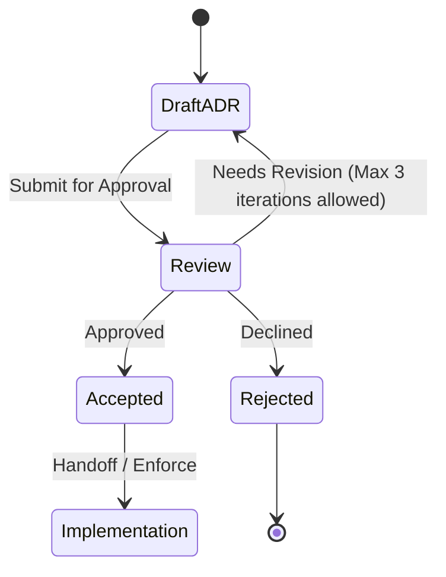

# ADR-0003: Send ordinary text to the paid Gemini API

## Status

Proposed. Needs approval by mjbvilhena.

This record answers the US-76 placeholder. It does not add acceptance criteria to that story. Drafting it is not acceptance. Which provider to use, and what happens to the topic backlog when a key is added, stay open under Decision pending.

## Context

E11 and US-41 already say a cloud model may read ordinary item text, topic extraction starts on, there is no per-item opt-out, sensitive items are excluded, and there is no cap on how many suggestions come back. The APK must not contain the API key in plaintext (US-41). The query and fragment of a token-looking URL are not sent (US-79). Provenance stores the item id, the fields sent, the timestamp, and the model or prompt version (US-41). A failed call leaves the item (US-47). Drive sync is not this call.

US-76 asks which provider, what it retains and whether it trains, how a sideloaded APK gets a credential, and what is sent. The specification forbids cloud OCR and cloud vision.

Published Gemini API terms, [Gemini API Additional Terms](https://ai.google.dev/gemini-api/terms):

- The terms say use of the Gemini API is for professional or business purposes, not for consumer use.
- Unpaid Services, outside the regions in the next bullet: Google uses submitted content and responses to improve products, and human reviewers may read them.
- In the European Economic Area, Switzerland, and the United Kingdom, the paid "How Google uses Your Data" terms apply to all Services, including unpaid quota, and the terms say you may use only Paid Services when making API Clients available to users in those regions.
- Paid Services, meaning the Gemini API is called through a Cloud project with an active billing account: Google does not use prompts or responses to improve its products. It logs them for a limited time for abuse monitoring and legal disclosures. That data may be stored transiently or cached in any country where Google or its agents maintain facilities. The terms do not promise a region. The abuse-monitoring page says that period is 55 days, and that flagged content may be reviewed by authorized staff for policy enforcement. [Abuse monitoring](https://ai.google.dev/gemini-api/docs/usage-policies).
- Grounding with Google Search stores prompts and output for 30 days and cannot be turned off while grounding is on. The File API stores uploads until deleted. Those are on the [zero data retention](https://ai.google.dev/gemini-api/docs/zdr) page, which also says guaranteed zero data retention is Vertex AI, not the default Gemini API log.

Domain consultant: `docs/domain/vault/DOMAIN.md`. Layer consultant: `docs/layers/data/LAYER.md`.

Doing nothing leaves the call unspecified, so the first implementation would pick a provider in code.

## Decision

The current recommendation is the paid Gemini API, text in and text out, with a key he types into Settings. The key is stored only as vault ciphertext on that install. Images are out. Vertex AI and delaying topics are the other options under Decision pending. They are not rejected by this record.

Rules, if this record is accepted, for whichever provider he picks, and for the paid Gemini path if that remains the recommendation:

- The Contributor tier, and any other unpaid quota, is ruled out. In the EEA, Switzerland, and the UK the terms allow only Paid Services for an API client offered to users, and the paid data-use terms apply there even to unpaid quota. Elsewhere, unpaid quota is the tier whose content is used to improve products. Neither is this call.
- He must confirm, before the first call, that the key belongs to a billed Cloud project. The app cannot prove the project is billed. The confirmation is stored on the device. A missing confirmation, or a missing key, means no call, and the item stays. ADR-0002 does not sync the key or the confirmation.
- The key is entered in Settings. It is stored inside the encrypted vault on that phone. It is not in the APK, `BuildConfig`, assets, logs, WorkManager inputs, or the URL. It is sent in the `x-goog-api-key` header. In Google Cloud the key is restricted to the Generative Language API. If that console offers an Android restriction (package name and signing certificate), the restriction is applied. Clearing the field removes the key. It is not the Drive OAuth token.
- If the provider is the paid Gemini API, the endpoint is the one Google documents for that API. The default model is `gemini-2.5-flash`, a low-cost text model. He can change the model id in Settings. Provenance records the id that was called, not a frozen constant (US-41).
- Payload is text: title, body, personal-note entries, extracted text, OCR text, and snapshot text. No image, PDF, thumbnail, or other attachment bytes. A token-looking URL has its query and fragment removed before send (US-79). Other URLs may be sent as text already in those fields.
- A sensitive item is not sent (US-75). "Get topics" is not offered on one (US-41). Content already sent is not recalled when he marks an item sensitive later (US-75).
- No Google Search grounding, no Maps grounding, no File API upload, no context cache, no dataset sharing. Those change retention or training use.
- The request body is at most 100000 characters of that text. If the item is longer, the call sends a truncated prefix and provenance records the truncation. This bounds the upload. It does not cap how many topic names may be stored (US-41).
- Each install allows at most 100 topic calls per calendar month. The count is local. It is not synced. A call that was not sent does not increment it.
- Two phones must not both call for the same item. Before a call, if synced provenance for that item id already records the same hash of the fields that would be sent, the call is skipped. A changed hash may call again, still inside the monthly count. Provenance is part of the records merge (ADR-0002). The API key is not.
- The call uses HTTPS, a 60-second timeout, and at most one retry on a failure where the request was not sent. A failure after that follows US-47. The topic unmetered setting still applies (US-44). The sync preference does not.
- What to do with items that were saved while no key was stored is Decision pending. Until he decides, a new key does not by itself flush a backlog.

Default: if a new field is added to an item, it is not sent until this record, or a successor, names it.

## Decision pending: mjbvilhena

These are not decided. The current recommendation is what this draft would keep.

### Gemini, Vertex, or delaying topics

Current recommendation: the paid Gemini API, as the rules above describe. Vertex is not the recommendation. Dropping topics from v1 is not the recommendation.

| Option | Trade-off |
| --- | --- |
| Paid Gemini API | Current recommendation. A key he can type into a sideloaded app. Prompts are not used to improve products. They are logged for about 55 days, flagged content may be read by staff, and there is no residency promise. The terms say the API is not for consumer use. The app cannot prove the project is billed |
| Vertex AI with zero data retention | The Gemini docs point there when the abuse log is unacceptable. A personal sideload then needs a GCP workload credential, which is a harder credential than a key in Settings |
| Delay topics | No vault text leaves the phone for this call. E11's topic outcome is not in v1. US-41 is already approved, so delaying is a product cut he would be making against that story |

### Topic backlog when a key is added

Current recommendation: do not auto-flush. Items saved while the key was missing stay unsent until he uses per-item "Get topics", the same gesture US-41 uses for an item saved while the Settings switch was off.

| Option | Trade-off |
| --- | --- |
| No auto-flush. Per-item "Get topics" | Current recommendation. A new key does not upload the whole vault. He has to ask per item. Easy to forget an item |
| Flush every ordinary item that has no provenance yet | He does not have to remember. The first session can spend the monthly call count, and two phones that both see an empty provenance can race before sync. The de-dupe rule only helps after one provenance record has synced |
| Flush only items saved after the key was added | Older items stay quiet. Items saved on the other phone before this phone's key existed still wait |

## Alternatives considered

| Option | Why it was plausible | Why it lost |
| --- | --- | --- |
| Unpaid Gemini API, including a Contributor tier | A personal app with no bill | Ruled out above. Outside the EEA, Switzerland, and the UK, unpaid content is used to improve products. Inside those regions the terms allow only Paid Services for a client offered to users. This row is a rejection of unpaid quota, not a choice of Gemini versus Vertex. That choice is pending |
| Bake the key into the signed APK, or reuse the Drive OAuth token | No Settings field | US-41 forbids a plaintext key in the APK. The Drive token is scoped to `drive.appdata` (US-78) and is the wrong credential for a generative API |
| Send the key in the query string | Some examples do | The key then lands in URLs and in server access logs. A header avoids that |
| Send page images or PDF bytes | The model might read a scan better | E7 keeps OCR on device. Cloud vision is out of the specification. Sensitive pages would be easy to include by mistake |

## Consequences

- **Positive.** Retention, the region rule, the header, the default model, the monthly count, and de-duplication are named. Sensitive items and images stay off the call. The key can move to a new phone only if he types it again, because ADR-0002 does not sync it.
- **Negative / accepted trade-offs.** Paid Gemini still logs prompts and responses for abuse monitoring for up to 55 days, and flagged content may be reviewed by a person. That is not zero retention and not a residency promise. The terms say the API is not for consumer use. A key he confirms by mistake on an unpaid project, outside the EEA, Switzerland, and the UK, would fall under the unpaid terms, and the app cannot detect that. He pays the API bill. The provider and the backlog flush are not decided. No per-item suggestion cap is added.
- **Follow-ups.** US-76 stays a placeholder until this record is accepted. UX still writes the confirmation sentence, including the not-for-consumer-use fact and the human-review fact. He decides the pending items. He is the approver.

## Compliance

- [ ] Release APK inspection finds no topic API key (US-41)
- [ ] The key is sent in `x-goog-api-key` and does not appear in the URL
- [ ] A sensitive item and an image fixture produce no topic request
- [ ] A token-looking URL fixture leaves query and fragment out of the body
- [ ] Provenance stores item id, field names, the field hash, timestamp, model id, and truncation, and does not store the key
- [ ] A second install with the same item id and field hash does not call
- [ ] The 101st call in a calendar month on one install does not leave the phone
- [ ] Requests do not set grounding, file upload, or cache fields
- [ ] The first call is blocked until the billed-project confirmation is stored
- [ ] Adding a key does not flush a backlog unless Decision pending has been resolved that way
- [ ] The disclosure he sees states: not for consumer use; paid terms in the EEA, Switzerland, and the UK; possible human review of flagged content; no residency promise

## Related

- Domain consultant `vault`. Layer consultant `data`.
- US-41, US-44, US-47, US-75, US-76, US-79.
- [Gemini API Additional Terms](https://ai.google.dev/gemini-api/terms), [Abuse monitoring](https://ai.google.dev/gemini-api/docs/usage-policies), [Zero data retention](https://ai.google.dev/gemini-api/docs/zdr).
- ADR-0001 (the key that encrypts the stored API key), ADR-0002 (the key is not synced; provenance is), and ADR-0004 (ML Kit is a different Google channel).

## Anti-patterns

- Using Firebase or the Drive token as the topic credential.
- Treating the billed-project checkbox as proof of Google's account state.
- Sending the OCR image as well as the OCR text.
- Putting the API key in the query string.
- Treating Gemini-versus-Vertex, or a backlog flush, as already chosen.
- Offering the Contributor tier because the app is personal.

## Skill State Machine (sdlc-adr-drafter)

Status: Proposed. Needs approval by mjbvilhena.
