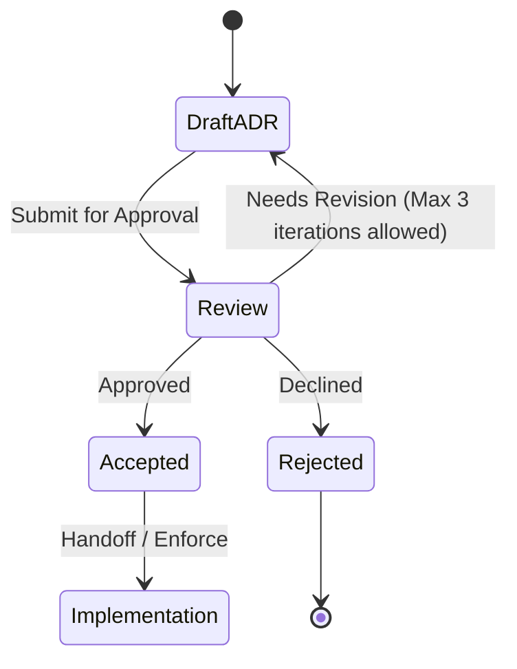

# ADR-0003: Send ordinary text to the paid Gemini API

## Status

Proposed. Needs approval by mjbvilhena.

This record answers the US-76 placeholder. It does not add acceptance criteria to that story. Drafting it is not acceptance.

## Context

E11 and US-41 already say a cloud model may read ordinary item text, topic extraction starts on, there is no per-item opt-out, sensitive items are excluded, and there is no cap on how many suggestions come back. The APK must not contain the API key in plaintext (US-41). The query and fragment of a token-looking URL are not sent (US-79). Provenance stores the item id, the fields sent, the timestamp, and the model or prompt version (US-41). A failed call leaves the item (US-47). Drive sync is not this call.

US-76 asks which provider, what it retains and whether it trains, how a sideloaded APK gets a credential, and what is sent. The specification forbids cloud OCR and cloud vision.

Published Gemini API terms, read for this record:

- Unpaid Services, including unpaid Gemini API quota: Google uses submitted content and responses to improve products, and human reviewers may read them. [Gemini API Additional Terms](https://ai.google.dev/gemini-api/terms).
- Paid Services, meaning the API is called through a Cloud project with an active billing account: Google does not use prompts or responses to improve its products. It logs them for a limited time for abuse monitoring and legal disclosures. The abuse-monitoring page says that period is 55 days. [Abuse monitoring](https://ai.google.dev/gemini-api/docs/usage-policies).
- Grounding with Google Search stores prompts and output for 30 days and cannot be turned off while grounding is on. The File API stores uploads until deleted. Those are on the [zero data retention](https://ai.google.dev/gemini-api/docs/zdr) page, which also says guaranteed zero data retention is Vertex AI, not the default Gemini API log.

Domain consultant: `docs/domain/vault/DOMAIN.md`. Layer consultant: `docs/layers/data/LAYER.md`.

Doing nothing leaves the call unspecified, so the first implementation would pick a provider in code.

## Decision

Recommended option: the paid Gemini API, text in and text out, with a key he types into Settings. The key is stored only as vault ciphertext. Unpaid quota is out. Images are out. Vertex AI is the zero-retention alternative and is not the recommendation.

Rules, if this record is accepted:

- Provider is the Gemini API (`generativelanguage.googleapis.com` or the endpoint Google documents for that API). The model id is a Settings value, not a constant frozen here. Provenance records the model id that was called (US-41).
- He must confirm, before the first call, that the key belongs to a billed Cloud project. The app cannot prove the project is billed. The confirmation is stored on the device. A missing confirmation, or a missing key, means no call, and the item stays.
- The key is entered in Settings. It is stored inside the encrypted vault, so the Drive copy holds only ciphertext. It is not in the APK, `BuildConfig`, assets, logs, or WorkManager inputs. Clearing the field removes it. It is not the Drive OAuth token, and it is not sent to Drive as a separate file.
- Payload is text: title, body, personal-note entries, extracted text, OCR text, and snapshot text. No image, PDF, thumbnail, or other attachment bytes. A token-looking URL has its query and fragment removed before send (US-79). Other URLs may be sent as text already in those fields.
- A sensitive item is not sent (US-75). "Get topics" is not offered on one (US-41). Content already sent is not recalled when he marks an item sensitive later (US-75).
- No Google Search grounding, no Maps grounding, no File API upload, no context cache, no dataset sharing. Those change retention or training use.
- The request body is at most 100000 characters of that text. If the item is longer, the call sends a truncated prefix and provenance records the truncation. This bounds the upload. It does not cap how many topic names may be stored (US-41).
- The call uses HTTPS, a 60-second timeout, and at most one retry on a failure where the request was not sent. A failure after that follows US-47. The topic unmetered setting still applies (US-44). The sync preference does not.

Default: if a new field is added to an item, it is not sent until this record, or a successor, names it.

## Alternatives considered

| Option | Why it was plausible | Why it lost |
| --- | --- | --- |
| Unpaid Gemini API or AI Studio | A personal app with no bill | The terms say unpaid content is used to improve products and may be read by reviewers. That is the wrong retention for vault text |
| Vertex AI with zero data retention | The Gemini docs point there when the 55-day abuse log is unacceptable | A personal sideload then needs a GCP workload credential. The specification already accepts a cloud topic call in principle. The 55-day abuse log on the paid Gemini API is the residual this record names, not a hidden one |
| A provider-agnostic OpenAI-compatible URL | He could point at any vendor | US-76 asks for a provider and its retention terms. An empty adapter would not answer that. A later ADR can add a second provider |
| Bake the key into the signed APK, or reuse the Drive OAuth token | No Settings field | US-41 forbids a plaintext key in the APK. The Drive token is scoped to `drive.appdata` (US-78) and is the wrong credential for a generative API |
| Send page images or PDF bytes | The model might read a scan better | E7 keeps OCR on device. Cloud vision is out of the specification. Sensitive pages would be easy to include by mistake |

## Consequences

- **Positive.** The provider, the training rule, the credential path, and the payload are named. Sensitive items and images stay off the call. The key can move to a new phone only as vault ciphertext, after the passphrase re-creates the vault key.
- **Negative / accepted trade-offs.** Paid Gemini still logs prompts and responses for abuse monitoring for up to 55 days. That is not zero retention. A key he confirms by mistake on an unpaid project would fall under the unpaid terms, and the app cannot detect that. He pays the API bill. No per-item suggestion cap is added.
- **Follow-ups.** US-76 stays a placeholder until this record is accepted. UX still writes the confirmation sentence. He is the approver.

## Compliance

- [ ] Release APK inspection finds no topic API key (US-41)
- [ ] A sensitive item and an image fixture produce no topic request
- [ ] A token-looking URL fixture leaves query and fragment out of the body
- [ ] Provenance stores item id, field names, timestamp, model id, and truncation, and does not store the key
- [ ] Requests do not set grounding, file upload, or cache fields
- [ ] The first call is blocked until the billed-project confirmation is stored

## Related

- Domain consultant `vault`. Layer consultant `data`.
- US-41, US-44, US-47, US-75, US-76, US-79.
- [Gemini API Additional Terms](https://ai.google.dev/gemini-api/terms), [Abuse monitoring](https://ai.google.dev/gemini-api/docs/usage-policies), [Zero data retention](https://ai.google.dev/gemini-api/docs/zdr).
- ADR-0001 (the key that encrypts the stored API key) and ADR-0004 (ML Kit is a different Google channel).

## Anti-patterns

- Using Firebase or the Drive token as the topic credential.
- Treating the billed-project checkbox as proof of Google's account state.
- Sending the OCR image "as well as" the OCR text.

## Skill State Machine (sdlc-adr-drafter)

Status: Proposed. Needs approval by mjbvilhena.
