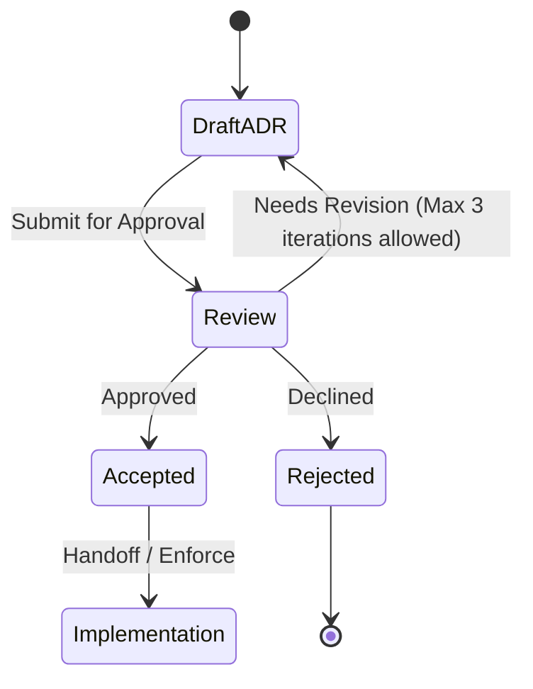

# ADR-0003: Send ordinary text to the xAI Grok API

## Status

Proposed. Needs approval by mjbvilhena.

This record answers the US-76 placeholder. It does not add acceptance criteria to that story. Drafting it is not acceptance. Which of the two providers below to use, and what happens to the topic backlog when a key is added, stay open under Decision pending.

## Context

E11 and US-41 already say a cloud model may read ordinary item text, topic extraction starts on, there is no per-item opt-out, sensitive items are excluded, and there is no cap on how many suggestions come back. The APK must not contain the API key in plaintext (US-41). The query and fragment of a token-looking URL are not sent (US-79). Provenance stores the item id, the fields sent, the timestamp, and the model or prompt version (US-41). A failed call leaves the item (US-47). Drive sync is not this call.

US-76 asks which provider, what it retains and whether it trains, how a sideloaded APK gets a credential, and what is sent. The specification forbids cloud OCR and cloud vision.

The comparison is only the xAI Grok API at `api.x.ai`, and the Cursor API. The paid Gemini API was ruled out.

Domain consultant: `docs/domain/vault/DOMAIN.md`. Layer consultant: `docs/layers/data/LAYER.md`.

Doing nothing leaves the call unspecified, so the first implementation would pick a provider in code.

### xAI Grok API

Sources: [API reference](https://docs.x.ai/developers/rest-api-reference/inference), [Security FAQ](https://docs.x.ai/developers/faq/security), [Structured outputs](https://docs.x.ai/developers/model-capabilities/text/structured-outputs), [Models](https://docs.x.ai/developers/models), [Pricing](https://docs.x.ai/developers/pricing), [Rate limits](https://docs.x.ai/developers/rate-limits), [Regional endpoints](https://docs.x.ai/developers/advanced-api-usage/regions), [Grok Build 0.1](https://docs.x.ai/developers/models/grok-build-0.1), [Consumer terms](https://x.ai/legal/terms-of-service), [Enterprise terms](https://x.ai/legal/terms-of-service-enterprise), [Data processing addendum](https://x.ai/legal/data-processing-addendum).

- Direct call. The inference API base is `https://api.x.ai`, authenticated with `Authorization: Bearer` and a key created in the xAI console. The security FAQ says to store that key like a password and not to commit it to source. A phone can call `https://api.x.ai/v1` with a key he types. The key can live as vault ciphertext and need not ship in the APK. The docs do not describe an Android package restriction on the key.
- Retention, training, review, logging, zero retention. The security FAQ says xAI does not train on API inputs or outputs without explicit permission. By default, requests and responses are stored encrypted for 30 days for auditing suspected abuse or misuse, then deleted. Zero data retention is a team-wide console setting. It is not per key. While it is on, prompts and outputs are not persisted, and every API response includes `x-zero-data-retention` set to `true` or `false`. The enterprise terms say that, except when zero data retention is on, xAI may create de-identified aggregated data that cannot be re-identified and does not contain user content. The same terms license processing of user content to provide the service and for fraud, abuse, and safety or compliance operations. They also say user content is deleted no later than 30 days after the interaction unless a different period is agreed, required by law, or kept as the minimum needed for safety, security, compliance, or an abuse investigation. The security FAQ does not say that a person reads every API prompt. The consumer FAQ's sentence about staff reading Grok conversations is about the consumer service, not this API.
- EU handling. The regional-endpoints page says `https://api.x.ai` does not guarantee a processing region. It documents a US endpoint, `https://us.api.x.ai/v1`, for `grok-4.7` and `grok-4.6` only, at a 10% token premium, covering request handling, inference, moderation, and retained request data. It does not document an EU endpoint. The data-processing addendum says personal data may be transferred and processed outside Europe, including in the United States, and incorporates the EU standard contractual clauses for a restricted transfer, with the UK and Swiss addenda.
- Consumer use. The consumer terms say they govern Grok for individuals, and that the enterprise terms govern the APIs. The enterprise terms grant access solely for the customer's business purposes. They allow a customer to put the API inside the customer's own product for that customer's end users. They do not describe a personal, non-business app as a permitted consumer use of the API.
- Price. The pricing page does not publish a fixed price for one short prompt. For a prompt under 200k, the non-reasoning grok-4.20 release 0309 costs $1.25 per million on input and $2.50 per million on output. grok-4.7 at that same threshold is $2.00 and $6.00. grok-build-0.1 is $1.00 and $2.00, and its model page describes it as a coding model. A prompt that reaches 200k is billed at the long-context rate for the whole request. The US endpoint adds 10% and does not serve that 0309 release. The model id is grok-4.20-0309-non-reasoning.
- Rate limits. Limits are requests per second and tokens per minute, by model and by spend tier. Tier 0 is the default at $0 spend. For `grok-4.20-0309-non-reasoning`, tier 0 is 37 requests per second and 10M tokens per minute. A limit returns HTTP 429. The rate-limit page says tiers do not downgrade once reached.
- Structured output. The structured-outputs page says `response_format.type` of `json_schema` returns JSON that matches the supplied schema when the schema uses the supported subset, and `json_object` returns well-formed JSON without a schema.

### Cursor API

Sources: [Cursor APIs overview](https://cursor.com/docs/api), [Cloud Agents API](https://cursor.com/docs/cloud-agent/api/endpoints), [Cloud agent security](https://cursor.com/docs/cloud-agent/security), [Privacy and data governance](https://cursor.com/docs/enterprise/privacy-and-data-governance), [Data processing addendum](https://cursor.com/terms/dpa).

- What it offers. The overview lists the Admin API, Analytics API, AI Code Tracking API, Bugbot API, Cloud Agents API, Origin API, and agent SDKs. It says the Cloud Agents API and the SDKs run agent workflows and are not a standalone model-inference or chat-completions API. Admin, analytics, code-tracking, and Bugbot are team or enterprise data APIs. This catalog has no general text-completion endpoint an app can call for a topic suggestion. It does not fit.
- Direct call. Cloud Agents accept a user or service-account API key as Bearer or Basic auth, so a key can be typed and stored as vault ciphertext and need not ship in the APK. Creating an agent takes a task prompt and is for work on a repository. That is not this call.
- Retention, training, review. The cloud-agent security page says a run's prompts and responses are conversation state, kept indefinitely by default, deletable on demand, and that enterprise teams can cap that at 90 days. VM snapshots roll for 30 days of inactivity. The same page says Cloud Agents run in Privacy Mode and that, with Privacy Mode on, Cursor does not train on cloud-agent code, prompts, or responses. It also says most models run under zero-data-retention agreements with providers, with named exceptions that are not this topic call. The privacy page says some named models store inputs for human harm-prevention review. It does not say that every agent transcript is read by a person.
- EU handling. The Cursor data-processing addendum includes the EU standard contractual clauses for a restricted transfer, and the UK addendum. The cloud-agent security page does not document an EU-only endpoint.
- Consumer use. The overview marks the Cloud Agents API as beta and available on all plans. It marks the Admin, Analytics, AI Code Tracking, and Bugbot APIs as enterprise. It does not state a separate "not for consumer use" ban on the Cloud Agents API.
- Price. The overview does not publish a token price for a general text completion, because it does not offer that call.
- Rate limits. The overview says that unless an endpoint documents a different limit, the default is 20 requests per minute. The Cloud Agents row says "Standard rate limiting" and does not publish a separate number.
- Structured output. The Cloud Agents endpoint page documents `prompt.text` and a result `text`. It does not document a JSON Schema response format.

## Decision

The current recommendation is the xAI Grok API, text in and JSON out, with a key he types into Settings. The key is stored only as vault ciphertext on that install. Images are out. The Cursor API does not fit, because it has no general text-completion endpoint. The provider is still Decision pending. Accepting this record would not by itself choose it.

Rules, if this record is accepted, for the Grok path:

- The endpoint is the text API at `https://api.x.ai/v1`. The key is sent as `Authorization: Bearer`. It is not in the URL.
- The default model is `grok-4.20-0309-non-reasoning`. That is the low-cost text model on the pricing page that is not described as a coding model. He can change the model id in Settings. Provenance records the id that was called (US-41). `grok-build-0.1` is cheaper and is not this default. The US regional endpoint is not used for this default, because that endpoint does not serve this model.
- Before any vault text is sent, the app makes one request that contains no item text and reads `x-zero-data-retention`. If the value is not `true`, no topic call is sent and the item stays. Zero data retention is turned on in the xAI console. The app cannot turn it on. The enterprise terms say personal data is submitted through the zero-data-retention API.
- The key is entered in Settings. It is stored inside the encrypted vault on that phone. It is not in the APK, `BuildConfig`, assets, logs, or WorkManager inputs. Clearing the field removes the key. It is not the Drive OAuth token. ADR-0002 does not sync the key.
- Payload is text: title, body, personal-note entries, extracted text, OCR text, and snapshot text. No image, PDF, thumbnail, or other attachment bytes. A token-looking URL has its query and fragment removed before send (US-79). Other URLs may be sent as text already in those fields. The response uses `response_format` type `json_schema`.
- A sensitive item is not sent (US-75). "Get topics" is not offered on one (US-41). Content already sent is not recalled when he marks an item sensitive later (US-75).
- No server-side tools, no file upload, no image input, and no stored-response id. Those are outside the retention and region statements this record relies on.
- The request body is at most 100000 characters of that text. If the item is longer, the call sends a truncated prefix and provenance records the truncation. This bounds the upload. It does not cap how many topic names may be stored (US-41).
- Each install allows at most 100 topic calls per calendar month. The count is local. It is not synced. A call that was not sent does not increment it. The no-vault probe does not increment it.
- Two phones must not both call for the same item. Before a call, if synced provenance for that item id already records the same hash of the fields that would be sent, the call is skipped. A changed hash may call again, still inside the monthly count. Provenance is part of the records merge (ADR-0002). The API key is not.
- The call uses HTTPS, a 60-second timeout, and at most one retry on a failure where the request was not sent. A failure after that follows US-47. The topic unmetered setting still applies (US-44). The sync preference does not.
- The Cursor API is not called.
- What to do with items that were saved while no key was stored is Decision pending. Until he decides, a new key does not by itself flush a backlog.

Default: if a new field is added to an item, it is not sent until this record, or a successor, names it.

## Decision pending: mjbvilhena

These are not decided. The current recommendation is what this draft would keep.

### xAI Grok API or the Cursor API

Current recommendation: the xAI Grok API, as the rules above describe. The Cursor API does not fit this call.

| Option | Trade-off |
| --- | --- |
| xAI Grok API | Current recommendation. A phone can call `https://api.x.ai/v1` with a key he types, stored as vault ciphertext. The security FAQ says API inputs are not used for training without permission. The default log is 30 days unless zero data retention is on, which the app can see on `x-zero-data-retention` and cannot switch on itself. There is no documented EU endpoint. The enterprise terms grant the API for business purposes. Short-context price for `grok-4.20-0309-non-reasoning` is $1.25 / $2.50 per 1M input / output tokens. `json_schema` is documented |
| Cursor API | Does not fit. [Cursor APIs overview](https://cursor.com/docs/api) offers cloud agents, admin, analytics, and related team APIs, and says the agent API is not a chat-completions API. A topic suggestion has no general text-completion call to make |

### Topic backlog when a key is added

Current recommendation: do not auto-flush. Items saved while the key was missing stay unsent until he uses per-item "Get topics", the same gesture US-41 uses for an item saved while the Settings switch was off.

| Option | Trade-off |
| --- | --- |
| No auto-flush. Per-item "Get topics" | Current recommendation. A new key does not upload the whole vault. He has to ask per item. Easy to forget an item |
| Flush every ordinary item that has no provenance yet | He does not have to remember. The first session can spend the monthly call count, and two phones that both see an empty provenance can race before sync. The de-dupe rule only helps after one provenance record has synced |
| Flush only items saved after the key was added | Older items stay quiet. Items saved on the other phone before this phone's key existed still wait |

## Alternatives considered

| Option | Why it was plausible | Why it lost |
| --- | --- | --- |
| Paid Gemini API | A key he could type, with a documented JSON response | Ruled out. It is not one of the two options in this record |
| Use a Cloud Agent prompt as if it were a completion | The agent body has a text prompt and a text result | The Cursor overview says that API is not a chat-completions API. The agent stores the prompt as conversation state, kept indefinitely by default. That is a different product |
| `grok-build-0.1` as the default | Lowest text rate on the pricing page, $1.00 / $2.00 per 1M tokens | Its model page describes a coding model. The topic default is `grok-4.20-0309-non-reasoning` |
| Bake the key into the signed APK, or reuse the Drive OAuth token | No Settings field | US-41 forbids a plaintext key in the APK. The Drive token is scoped to `drive.appdata` (US-78) and is the wrong credential |
| Send the key in the query string | Some examples do | The key then lands in URLs and in server access logs. A header avoids that |
| Send page images or PDF bytes | The model might read a scan better | E7 keeps OCR on device. Cloud vision is out of the specification. Sensitive pages would be easy to include by mistake |

## Consequences

- **Positive.** The two options are named from their own docs. The recommendation can be called from the phone with a key that is not in the APK. Sensitive items and images stay off the call. Zero data retention is checked on a response header before vault text is sent. The monthly count and the cross-phone de-dupe stay. The key can move to a new phone only if he types it again, because ADR-0002 does not sync it.
- **Negative / accepted trade-offs.** With zero data retention off, the security FAQ says prompts and responses are stored for 30 days. The app refuses the call in that case, so a team that has not enabled zero data retention gets no topics. The enterprise terms still grant the API for business purposes, and this app is personal. There is no documented EU endpoint, and the low-cost model is not on the US endpoint. He pays the token bill. The provider and the backlog flush are not decided. No per-item suggestion cap is added.
- **Follow-ups.** US-76 stays a placeholder until this record is accepted. He decides the pending items. He is the approver.

## Compliance

- [ ] Release APK inspection finds no topic API key (US-41)
- [ ] The key is sent as `Authorization: Bearer` and does not appear in the URL
- [ ] A request that contains vault text is not sent unless a prior response's `x-zero-data-retention` header was `true`
- [ ] A sensitive item and an image fixture produce no topic request
- [ ] A token-looking URL fixture leaves query and fragment out of the body
- [ ] The topic response is requested with `response_format` type `json_schema`
- [ ] Provenance stores item id, field names, the field hash, timestamp, model id, and truncation, and does not store the key
- [ ] A second install with the same item id and field hash does not call
- [ ] The 101st call in a calendar month on one install does not leave the phone
- [ ] Requests do not set tools, file upload, or image input
- [ ] Adding a key does not flush a backlog unless Decision pending has been resolved that way
- [ ] The Cursor API is not called

## Related

- Domain consultant `vault`. Layer consultant `data`.
- US-41, US-44, US-47, US-75, US-76, US-79.
- xAI: [Security FAQ](https://docs.x.ai/developers/faq/security), [Enterprise terms](https://x.ai/legal/terms-of-service-enterprise), [Data processing addendum](https://x.ai/legal/data-processing-addendum), [Regional endpoints](https://docs.x.ai/developers/advanced-api-usage/regions), [Pricing](https://docs.x.ai/developers/pricing), [Structured outputs](https://docs.x.ai/developers/model-capabilities/text/structured-outputs).
- Cursor: [Cursor APIs overview](https://cursor.com/docs/api), [Cloud agent security](https://cursor.com/docs/cloud-agent/security).
- ADR-0001 (the key that encrypts the stored API key) and ADR-0002 (the key is not synced; provenance is).

## Anti-patterns

- Using the Drive token as the topic credential.
- Treating a missing `x-zero-data-retention` header as permission to send vault text.
- Sending the OCR image as well as the OCR text.
- Putting the API key in the query string.
- Calling the Cursor Cloud Agents API as a substitute completion.
- Treating the provider choice, or a backlog flush, as already chosen.

## Skill State Machine (sdlc-adr-drafter)

Status: Proposed. Needs approval by mjbvilhena.
