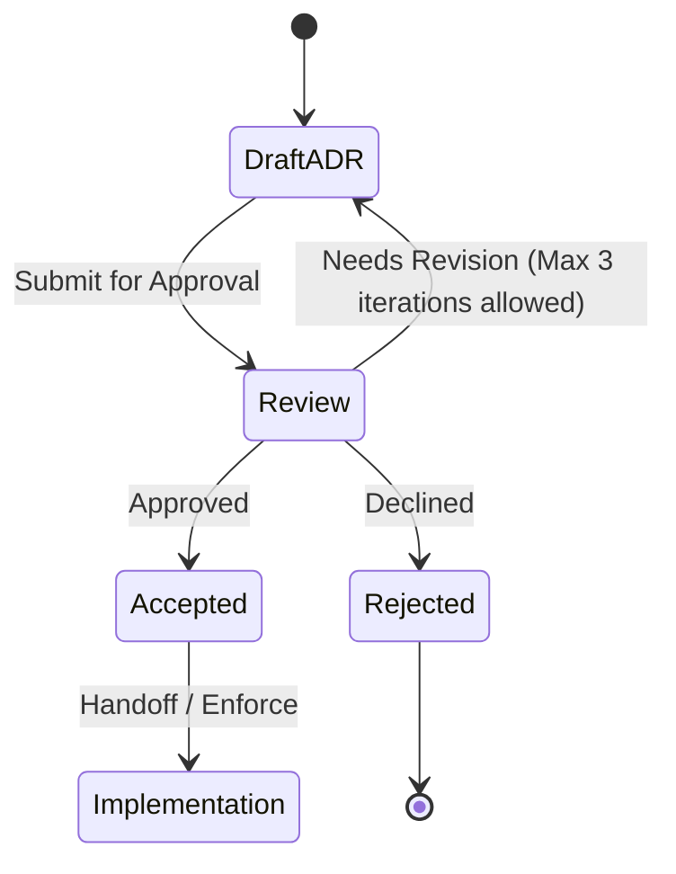

# ADR-0003: Send ordinary text to the xAI Grok API

## Status

Accepted. Approved by mjbvilhena on 2026-10-20.

This record answers the US-76 placeholder. It does not add acceptance criteria to that story. Drafting it is not acceptance. Approved by mjbvilhena on 2026-10-20. Those decisions are the xAI Grok API with zero data retention turned on for his team, the one-time question about earlier items, no monthly cap, and the enterprise terms, including the business-purposes grant, for this personal vault.

## Context

E11 and US-41 already say a cloud model may read ordinary item text, topic extraction starts on, there is no per-item opt-out, sensitive items are excluded, and there is no cap on how many suggestions come back. The APK must not contain the API key in plaintext (US-41). The query and fragment of a token-looking URL are not sent (US-79). Provenance stores the item id, the fields sent, the timestamp, and the model or prompt version (US-41). A failed call leaves the item (US-47). Drive sync is not this call.

US-76 asks which provider, what it retains and whether it trains, how a sideloaded APK gets a credential, and what is sent. The specification forbids cloud OCR and cloud vision.

The comparison is only the xAI Grok API at `api.x.ai`, and the Cursor API. The paid Gemini API was ruled out.

Domain consultant: `docs/domain/vault/DOMAIN.md`. Layer consultant: `docs/layers/data/LAYER.md`.

Doing nothing leaves the call unspecified, so the first implementation would pick a provider in code.

### xAI Grok API

Sources: [API reference](https://docs.x.ai/developers/rest-api-reference/inference), [Security FAQ](https://docs.x.ai/developers/faq/security), [Structured outputs](https://docs.x.ai/developers/model-capabilities/text/structured-outputs), [Models](https://docs.x.ai/developers/models), [Pricing](https://docs.x.ai/developers/pricing), [Rate limits](https://docs.x.ai/developers/rate-limits), [Regional endpoints](https://docs.x.ai/developers/advanced-api-usage/regions), [Grok Build 0.1](https://docs.x.ai/developers/models/grok-build-0.1), [Consumer terms](https://x.ai/legal/terms-of-service), [Enterprise terms](https://x.ai/legal/terms-of-service-enterprise), [Data processing addendum](https://x.ai/legal/data-processing-addendum).

- Direct call. The inference API base is `https://api.x.ai`, authenticated with `Authorization: Bearer` and a key created in the console. The security FAQ still calls that credential an xAI API key and the console the xAI console. The same page, and the enterprise terms, name the provider SpaceXSI. The contracting entity in the enterprise terms is SpaceXAI LLC ("SpaceXSI"). The host in this record stays `https://api.x.ai`. The security FAQ says to store that key like a password and not to commit it to source. A phone can call `https://api.x.ai/v1` with a key he types. The key can live as vault ciphertext and need not ship in the APK. The docs do not describe an Android package restriction on the key. A leaked key's spend is limited by a console spend limit or prepaid credit, which this app cannot set.
- Retention, training, review, logging, zero retention. The security FAQ says SpaceXSI does not train on API inputs or outputs without explicit permission. By default, requests and responses are stored encrypted for 30 days for auditing suspected abuse or misuse, then deleted. Zero data retention is a team-wide console setting. It is not per key. While it is on, prompts and outputs are not persisted, and every API response includes `x-zero-data-retention` set to `true` or `false`. That header arrives with the response, after the request has been sent. The enterprise terms say that, except when zero data retention is on, the provider may create de-identified aggregated data that cannot be re-identified and does not contain user content. The same terms license processing of user content to provide the service and for fraud, abuse, and safety or compliance operations. They also say user content is deleted no later than 30 days after the interaction unless a different period is agreed, required by law, or kept as the minimum needed for safety, security, compliance, or an abuse investigation. The security FAQ does not say that a person reads every API prompt. The consumer FAQ's sentence about staff reading Grok conversations is about the consumer service, not this API.
- EU handling. The regional-endpoints page says `https://api.x.ai` does not guarantee a processing region. It documents a US endpoint, `https://us.api.x.ai/v1`, for `grok-4.7` and `grok-4.6` only, at a 10% token premium, covering request handling, inference, moderation, and retained request data. It does not document an EU endpoint. The data-processing addendum says personal data may be transferred and processed outside Europe, including in the United States, and incorporates the EU standard contractual clauses for a restricted transfer, with the UK and Swiss addenda.
- Consumer use. The consumer terms say they govern Grok for individuals, and that the enterprise terms govern the APIs. Enterprise terms §1.1 grant access solely for the customer's business purposes. They allow a customer to put the API inside the customer's own product for that customer's end users. They do not describe a personal, non-business app as a permitted use. §11.2 is an obligation on the customer: he must not intentionally submit personal data, and he must use reasonable efforts to stop others submitting it, except through the zero-data-retention API. A failure is a material breach, and the terms say the provider then has no responsibility for that personal data. The section does not say that personal data is automatically sent through that API. The enterprise terms, including that business-purposes grant, are accepted for this personal vault's topic call. Governing law is Texas. A transfer of personal data is under the standard contractual clauses. There is no EU region. Approved by mjbvilhena on 2026-10-20. Sources: [Enterprise terms](https://x.ai/legal/terms-of-service-enterprise) §1.1 and §11.2. The page names the provider SpaceXSI and the contracting entity SpaceXAI LLC.
- Price. The pricing page does not publish a fixed price for one short prompt. For a prompt under 200k, the non-reasoning grok-4.20 release 0309 costs $1.25 per million on input and $2.50 per million on output. grok-4.7 at that same threshold is $2.00 and $6.00. grok-build-0.1 is $1.00 and $2.00, and its model page describes it as a coding model. A prompt that reaches 200k is billed at the long-context rate for the whole request. The US endpoint adds 10% and does not serve that 0309 release. The model id is grok-4.20-0309-non-reasoning.
- Rate limits. Limits are requests per second and tokens per minute, by model and by spend tier. Tier 0 is the default at $0 spend. For `grok-4.20-0309-non-reasoning`, tier 0 is 37 requests per second and 10M tokens per minute. A limit returns HTTP 429. The rate-limit page says tiers do not downgrade once reached.
- Structured output. The structured-outputs page says `response_format.type` of `json_schema` returns JSON that matches the supplied schema when the schema uses the supported subset, and `json_object` returns well-formed JSON without a schema.

### Cursor API

Sources: [Cursor APIs overview](https://cursor.com/docs/api), [Cloud Agents API](https://cursor.com/docs/cloud-agent/api/endpoints), [Cloud agent security](https://cursor.com/docs/cloud-agent/security), [Privacy and data governance](https://cursor.com/docs/enterprise/privacy-and-data-governance), [Data processing addendum](https://cursor.com/terms/dpa).

- What it offers. The overview lists the Admin API, Analytics API, AI Code Tracking API, Bugbot API, Cloud Agents API, Origin API, and agent SDKs. It says the Cloud Agents API and the SDKs run agent workflows and are not a standalone model-inference or chat-completions API. Admin, analytics, code-tracking, and Bugbot are team or enterprise data APIs. This catalog has no general text-completion endpoint an app can call for a topic suggestion. It does not fit.
- Direct call. Cloud Agents accept a user or service-account API key as Bearer or Basic auth, so a key can be typed and stored as vault ciphertext and need not ship in the APK. Creating an agent takes a task prompt and is for work on a repository. That is not this call.
- Retention, training, review. The cloud-agent security page says a run's prompts and responses are conversation state, kept indefinitely by default, deletable on demand, and that enterprise teams can cap that at 90 days. VM snapshots roll for 30 days of inactivity. The same page says Cloud Agents run in Privacy Mode and that, with Privacy Mode on, Cursor does not train on cloud-agent code, prompts, or responses. It also says most models run under zero-data-retention agreements with providers, with named exceptions that are not this topic call. The privacy page says some named models store inputs for human harm-prevention review. It does not say that every agent transcript is read by a person.
- EU handling. The Cursor data-processing addendum includes the EU standard contractual clauses for a restricted transfer, and the UK addendum. The cloud-agent security page does not document an EU-only endpoint.
- Consumer use. The overview marks the Cloud Agents API as beta and available on all plans. It marks the Admin, Analytics, AI Code Tracking, and Bugbot APIs as enterprise. It does not state a separate "not for consumer use" ban on the Cloud Agents API.
- Price. The overview does not publish a token price for a general text completion, because it does not offer that call.
- Rate limits. The overview says that unless an endpoint documents a different limit, the default is 20 requests per minute. The Cloud Agents row says "Standard rate limiting" and does not publish a separate number.
- Structured output. The Cloud Agents endpoint page documents `prompt.text` and a result `text`. It does not document a JSON Schema response format.

## Decision

The topic call uses the xAI Grok API at `https://api.x.ai`, text in and JSON out, with a key he types into Settings. The security FAQ names the provider SpaceXSI. Zero data retention is turned on for his team. Approved by mjbvilhena on 2026-10-20. The key is stored only as vault ciphertext on that install. Images are out. The default low-cost model is grok-4.20-0309-non-reasoning. The Cursor API does not fit, because it has no general text-completion endpoint. When the key is first added, he is asked once whether to send earlier ordinary items, and the default is No. There is no monthly cap. The enterprise terms, including the business-purposes grant, are accepted for this personal vault. Governing law is Texas. Data transfer is under the standard contractual clauses. There is no EU region. Approved by mjbvilhena on 2026-10-20.

Rules, if this record is accepted, for the Grok path:

- The enterprise terms, including the business-purposes grant in §1.1, are accepted for this personal vault's topic call. Governing law is Texas. Personal data may be transferred under the standard contractual clauses. There is no EU region. Approved by mjbvilhena on 2026-10-20. The consumer terms do not govern this API.
- The endpoint is the text API at `https://api.x.ai/v1`. The key is sent as `Authorization: Bearer`. It is not in the URL.
- The default low-cost model is `grok-4.20-0309-non-reasoning`. That is the low-cost text model on the pricing page that is not described as a coding model. He can change the model id in Settings. Provenance records the id that was called (US-41). `grok-build-0.1` is cheaper and is not this default. The US regional endpoint is not used for this default, because that endpoint does not serve this model.
- Zero data retention is turned on for his team. It is a team-wide console setting. The app cannot turn it on. Enterprise terms §11.2 obliges him not to submit personal data except through that API. It does not submit the data for him.
- The `x-zero-data-retention` header arrives with the response, after the request body has been sent. It is a detection control, not a prevention control. The app can see only what the most recent response said. Before the first request that would contain vault text, the app sends one request that contains no item text and reads the header. Later vault text is sent only while that most recent response had the header set to `true`. If zero data retention is turned off after that response, one request that contains vault text can still leave the phone. Discarding the response does not unsend that prompt.
- If a response does not include `x-zero-data-retention` set to `true`, the app discards that response and stores no suggestion from it. Topic calls on this install pause until he checks Settings. Settings says topics are paused because the call did not confirm zero data retention. He resumes from Settings. The next request contains no item text. The pause is local and is not synced.
- The key is entered in Settings. It is stored inside the encrypted vault on that phone. It is not in the APK, `BuildConfig`, assets, logs, or WorkManager inputs. Clearing the field removes the key. It is not the Drive OAuth token. ADR-0002 does not sync the key. On a phone that has no key stored, Settings says the key is not copied from the other phone and must be typed again.
- Payload is text: title, body, personal-note entries, extracted text, OCR text, and snapshot text. No image, PDF, thumbnail, or other attachment bytes. A token-looking URL has its query and fragment removed before send (US-79). Other URLs may be sent as text already in those fields. The response uses `response_format` type `json_schema`.
- A sensitive item is not sent (US-75). "Get topics" is not offered on one (US-41). Content already sent is not recalled when he marks an item sensitive later (US-75).
- No server-side tools, no file upload, no image input, and no stored-response id. Those are outside the retention and region statements this record relies on.
- The request body is at most 100000 characters of that text. If the item is longer, the call sends a truncated prefix and provenance records the truncation. This bounds one upload. It does not cap how many topic names may be stored, and it is not a monthly cap (US-41).
- There is no monthly cap. Approved by mjbvilhena on 2026-10-20. Settings shows how many topic calls this install has made in the current calendar month. The count is local and is not synced. A call that was not sent does not increment it. The no-text probe does not increment it.
- Two phones must not both call for the same item. Before a call, if synced provenance for that item id already records the same hash of the fields that would be sent, the call is skipped. A changed hash may call again. Provenance is part of the records merge (ADR-0002). The API key is not.
- The response is accepted only as JSON that matches the requested schema. It is not executed and it is not treated as instructions to the app. A suggestion is stored only after he confirms it (E11). Prompt text from a captured page cannot become a tool call, because this request sets no tools.
- The call uses HTTPS, a 60-second timeout, and at most one retry on a failure where the request was not sent. A failure after that follows US-47. The topic unmetered setting still applies (US-44). The sync preference does not.
- The Cursor API is not called.
- N is defined here, and only here. N is the number of earlier ordinary items on this install that have no topic provenance. A sensitive item is not counted in N and is not sent. When the key is first added on this install, and N is at least 1, Lagoon asks once: "Send N earlier items for topics?" The default is No. Topics are not sent unless he chooses Yes. No, or leaving the question, sends nothing. The question is not shown again on this install, including when the key is replaced. If N is zero, the question is not shown.
- If he chooses Yes, those ordinary items are sent under the same rules as any other topic call: the provenance de-dupe, the zero-data-retention check, and the unmetered setting. There is no monthly cap. An item skipped by de-dupe can still be sent later with per-item "Get topics" (US-41). That per-item control stays. A sensitive item is never offered it and is never sent.

Default: if a new field is added to an item, it is not sent until this record, or a successor, names it.

## Alternatives considered

| Option | Why it was plausible | Why it lost |
| --- | --- | --- |
| Paid Gemini API | A key he could type, with a documented JSON response | Ruled out. It is not one of the two options in this record |
| Use a Cloud Agent prompt as if it were a completion | The agent body has a text prompt and a text result | The Cursor overview says that API is not a chat-completions API. The agent stores the prompt as conversation state, kept indefinitely by default. That is a different product |
| `grok-build-0.1` as the default | Lowest text rate on the pricing page, $1.00 / $2.00 per 1M tokens | Its model page describes a coding model. The topic default is `grok-4.20-0309-non-reasoning` |
| Bake the key into the signed APK, or reuse the Drive OAuth token | No Settings field | US-41 forbids a plaintext key in the APK. The Drive token is scoped to `drive.appdata` (US-78) and is the wrong credential |
| Send the key in the query string | Some examples do | The key then lands in URLs and in server access logs. A header avoids that |
| Send page images or PDF bytes | The model might read a scan better | E7 keeps OCR on device. Cloud vision is out of the specification. Sensitive pages would be easy to include by mistake |
| Send every earlier ordinary item as soon as the key is stored | He does not have to answer | He is asked once, and the default is No. An automatic send can upload the whole vault |
| Never ask, and leave every earlier item to per-item "Get topics" only | Nothing is sent until he remembers each item | He is asked once. No still leaves each ordinary item to "Get topics" |
| Refuse the enterprise terms | The personal-use mismatch would go away | The terms, including the business-purposes grant, are accepted. Without them there is no topic call on this API, because the consumer terms do not govern it |

## Consequences

- **Positive.** The two options are named from their own docs. The call can be made from the phone with a key that is not in the APK. Sensitive items and images stay off the call. The zero-data-retention header is checked on the response, which is a detection control. De-duplication across phones stays. There is no monthly cap, and Settings shows this month's count. When the key is first added he is asked once, and the default is No. The key can move to a new phone only if he types it again, and Settings says so, because ADR-0002 does not sync it.
- **Negative / accepted trade-offs.** Zero data retention is on for his team. A response that does not confirm it is discarded, and topics pause until he checks. One request can still leave the phone if the setting was turned off after the previous response, and that prompt is not unsent. The security FAQ says that, without that setting, prompts and responses are stored for 30 days. The enterprise terms, including the business-purposes grant, are accepted for this personal vault. Governing law is Texas. Data transfer is under the standard contractual clauses. There is no EU region. That is accepted. Approved by mjbvilhena on 2026-10-20. The low-cost model is not on the US endpoint. He pays the bill. A leaked key is limited by a console spend limit, not by an in-app cap. A No on the one-time question leaves earlier items unsent until he uses "Get topics" on each one. No per-item suggestion cap is added.
- **Follow-ups.** US-76 stays a placeholder until this record is accepted. He is the approver.

## Compliance

- [ ] Release APK inspection finds no topic API key (US-41)
- [ ] The key is sent as `Authorization: Bearer` and does not appear in the URL
- [ ] Vault text is sent only while the most recent response had `x-zero-data-retention` set to `true`. The header is not treated as a guarantee that the request itself was unsent
- [ ] A response whose `x-zero-data-retention` header is missing or not `true` stores no suggestion and pauses topic calls until he resumes in Settings
- [ ] A topic response that is not schema-valid JSON is discarded and is not executed
- [ ] A sensitive item and an image fixture produce no topic request
- [ ] A token-looking URL fixture leaves query and fragment out of the body
- [ ] The topic response is requested with `response_format` type `json_schema`
- [ ] Provenance stores item id, field names, the field hash, timestamp, model id, and truncation, and does not store the key
- [ ] A second install with the same item id and field hash does not call
- [ ] There is no monthly cap. Settings shows this month's call count. A skipped de-dupe does not increment it
- [ ] Requests do not set tools, file upload, or image input
- [ ] Adding a key asks once, with No as the default, and does not send earlier items unless he chooses Yes. N counts only earlier ordinary items on this install that have no topic provenance. A sensitive item is not counted and is not sent. "Get topics" still sends one ordinary item, still subject to de-dupe
- [ ] A phone with no stored key tells him the key must be typed again
- [ ] The enterprise terms, including the business-purposes grant, are the terms for this call. The app does not claim an EU region
- [ ] The Cursor API is not called

## Related

- Domain consultant `vault`. Layer consultant `data`.
- US-41, US-44, US-47, US-75, US-76, US-79.
- xAI: [Security FAQ](https://docs.x.ai/developers/faq/security), [Enterprise terms](https://x.ai/legal/terms-of-service-enterprise), [Data processing addendum](https://x.ai/legal/data-processing-addendum), [Regional endpoints](https://docs.x.ai/developers/advanced-api-usage/regions), [Pricing](https://docs.x.ai/developers/pricing), [Structured outputs](https://docs.x.ai/developers/model-capabilities/text/structured-outputs).
- Cursor: [Cursor APIs overview](https://cursor.com/docs/api), [Cloud agent security](https://cursor.com/docs/cloud-agent/security).
- ADR-0001 (the key that encrypts the stored API key) and ADR-0002 (the key is not synced; provenance is).

## Anti-patterns

- Using the Drive token as the topic credential.
- Treating a missing `x-zero-data-retention` header as permission to send vault text.
- Treating that header as proof the prompt was never sent. It arrives afterwards.
- Executing a topic response, or storing it without the confirmation E11 requires.
- Imposing a monthly call cap. There is none. The visible count is not a cap.
- Sending the OCR image as well as the OCR text.
- Putting the API key in the query string.
- Calling the Cursor Cloud Agents API as a substitute completion.
- Treating the enterprise terms, or the business-purposes grant, as still open.
- Storing a suggestion from a response that did not confirm zero data retention.
- Continuing topic calls after a response lacked that confirmation.
- Sending earlier items when the key is added without the one-time question, or counting a sensitive item in that question.

## Skill State Machine (sdlc-adr-drafter)

Status: Accepted. Approved by mjbvilhena on 2026-10-20.
