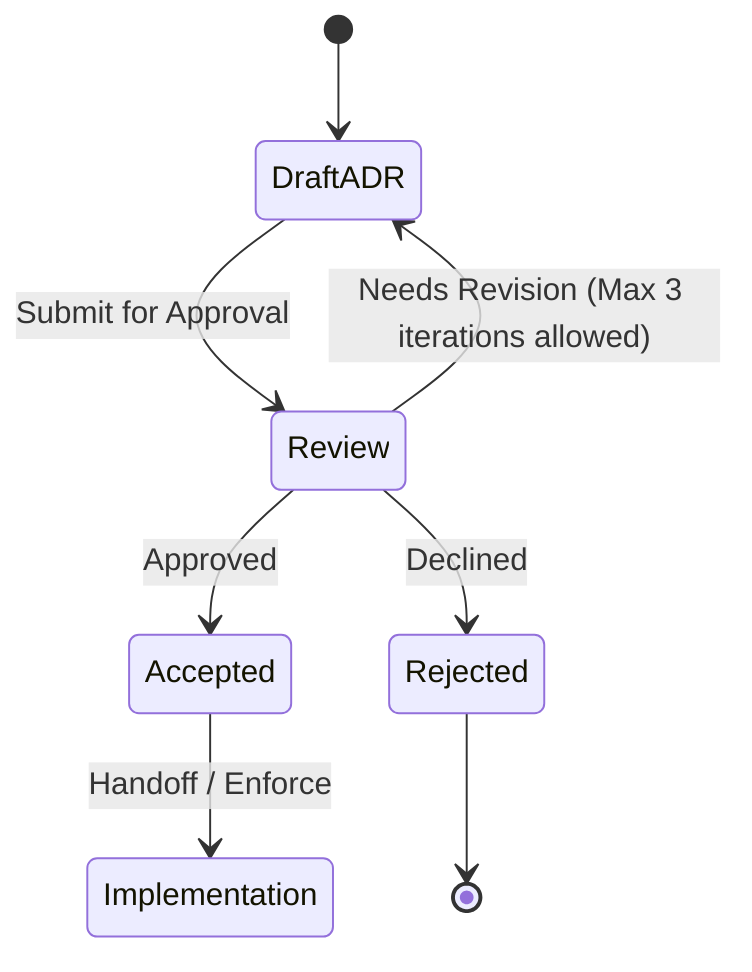

# ADR-0004: Disclose ML Kit metrics and gate the first OCR use

## Status

Accepted. Approved by mjbvilhena on 2026-10-20.

This record turns the research note `docs/adr/inputs/2026-10-17-ml-kit-telemetry.md` into a decision. The note is not an ADR. Drafting this record is not acceptance.

## Context

US-31 requires on-device English OCR with the bundled model `com.google.mlkit:text-recognition`, and forbids the Play services text-recognition artifact. The specification forbids an analytics product the app chooses. ML Kit's own metrics are a different channel. US-07 and the specification already require a disclosure and an acceptance before the first OCR use, because the docs do not provide an off switch. Decline means OCR does not run and ML Kit is not started. He can withdraw acceptance in Settings.

The research note, citing ML Kit terms and the Android data-disclosure page (both last modified May 14, 2025) and the text-recognition guide, found:

- The APIs send performance and utilization metrics to Google. The developer must inform users. No disable API is documented.
- Data listed for every feature includes device information, application information, identifiers, performance metrics, API configuration, input and output size, feature version, event type, and error codes.
- Input images and recognized text are processed on device. The terms say that input and those outputs are not sent to Google.
- The bundled model uses per-installation identifiers that are not meant to identify a person or a device. The thin Play services model collects a device identifier. US-31 keeps the thin artifact absent.
- Removing `com.google.mlkit.common.internal.MlKitInitProvider` changes startup only. It is not a telemetry switch. The terms also say the APIs may contact Google for bug fixes, updated models, and hardware-accelerator compatibility.

Domain consultant: `docs/domain/vault/DOMAIN.md`. Layer consultant: `docs/layers/data/LAYER.md`.

Doing nothing leaves a later change free to add a fake off switch or to start ML Kit at process start.

## Decision

Recommended option: keep the bundled recognizer, do not ship a metrics toggle, and do not start ML Kit until he accepts the US-07 disclosure.

Rules, if this record is accepted:

- OCR uses `com.google.mlkit:text-recognition` only. `com.google.android.gms:play-services-mlkit-text-recognition` stays absent (US-31).
- The manifest removes `com.google.mlkit.common.internal.MlKitInitProvider` with `tools:node="remove"`. `MlKit.initialize` runs only after he accepts. Decline, no answer, or a withdrawn acceptance means the app does not call `initialize` (US-07).
- `MlKit.initialize` can be called only once per process. A withdrawal later in that process does not un-initialize it. The next cold start, if acceptance is still withdrawn, does not call `initialize`. Acceptance stored during a process that already initialized does not imply a second call.
- ML Kit brings datatransport components (`com.google.android.datatransport`, including transport-runtime and transport-backend-cct). US-80 already says any permission a merged ML Kit manifest adds is named on that allowlist or removed with `tools:node="remove"`. Those datatransport components are in that set. This record does not edit US-80. A build that leaves them unnamed and unremoved fails the US-80 check.
- The disclosure states the facts US-07 already lists: image and recognized text stay on the device; the metrics categories go to Google over HTTPS; ML Kit does not transfer those metrics to third parties; ML Kit may contact Google for model updates and bug fixes; the docs do not give the app an off switch.
- There is no Settings control that claims to disable the metrics. Firebase `setAnalyticsCollectionEnabled` and Crashlytics flags are not this control, and those products stay absent (US-07).
- Acceptance is stored on the device so a later OCR use does not ask again. Logs do not gain an analytics event for that acceptance.

Default: any new ML Kit feature (barcode, face, or another recognizer) is out until a successor ADR. This record covers text recognition only.

## Alternatives considered

| Option | Why it was plausible | Why it lost |
| --- | --- | --- |
| A Settings toggle that disables the metrics | It would let him keep OCR and refuse the metrics | The terms and the Android data-disclosure page do not document a developer switch. A toggle that does not call one would say the metrics are off when the SDK still sends them. Trade-off of the recommended option: he can refuse OCR, and he cannot refuse the metrics while using OCR |
| Drop ML Kit | No ML Kit metrics at all | It removes English on-device OCR, which E7 and US-31 require. The research note already rejected this |
| Ship the Play services recognizer | Smaller install, model downloaded later | That thin artifact collects a device identifier. US-31 requires the bundled artifact and forbids the Play services one. The trade-off of bundling is a larger APK and per-installation identifiers that the disclosure must mention |

## Consequences

- **Positive.** OCR stays on device. The metrics channel is described the way the docs describe it. ML Kit does not start on a decline.
- **Negative / accepted trade-offs.** While OCR is in use, usage and diagnostic metrics still go to Google. Init removal does not block a later call he has accepted. Pre-first-call behavior is undocumented, which is why the provider is removed rather than trusted.
- **Follow-ups.** UX writes the exact sentences. The disclosure facts stay the US-07 list. He is the approver.

## Compliance

- [ ] Classpath and manifest checks match US-07 and US-31: bundled artifact present, Play services text-recognition artifact absent, init provider removed, no Firebase Analytics or Crashlytics
- [ ] A test that has not accepted does not call `MlKit.initialize`
- [ ] A second `MlKit.initialize` in the same process is not called
- [ ] A cold start after withdrawal does not call `MlKit.initialize`
- [ ] Datatransport components from ML Kit are named on the US-80 allowlist or removed with `tools:node="remove"`
- [ ] Settings has no control labelled as a metrics off switch
- [ ] Logs from an OCR run do not add an analytics product

## Related

- Domain consultant `vault`. Layer consultants `ui` and `data`.
- US-07, US-31, US-59.
- Research input `docs/adr/inputs/2026-10-17-ml-kit-telemetry.md`.
- ADR-0003, which is the topic call and does send ordinary vault text. It is not ML Kit.

## Anti-patterns

- Claiming that removing the init provider turns metrics off.
- Calling ML Kit "analytics" and deleting OCR to satisfy the no-analytics rule.
- Marking this record Accepted because the research note recommended the same option.

## Skill State Machine (sdlc-adr-drafter)

Status: Accepted. Approved by mjbvilhena on 2026-10-20.
