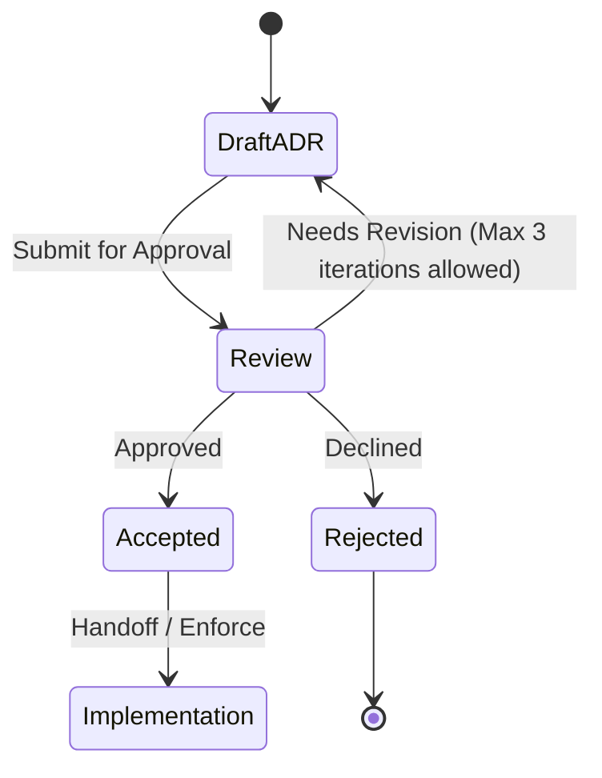

# ADR-0005: Bundle PDF rendering on API 26–29, in an isolated process

## Status

Proposed. Needs approval by mjbvilhena.

US-85 leaves this choice to the design gate. Drafting this record is not acceptance. What "password-protected" means is decided below. The full-screen refusal in US-85 is Could, not a Must, and this record does not promote it. Nothing in this record stays under Decision pending.

## Context

`minSdk` is 26. US-04 stores a PDF and extracts a text layer with a library that works on that minimum, naming PdfBox-Android as an example, not as an ADR. Pages with no text layer go to on-device OCR (US-31). A password-protected PDF is stored, marked "text not extracted", and v1 stores no PDF password (US-04). US-85, which is approved, opens a page full-screen and says a password-protected PDF does not open full-screen, no password is asked for or stored, and no plaintext decoded image or rendered page is written to disk.

US-85 also states the platform constraint: `PdfRenderer` needs a seekable file descriptor. On API 26–29, rendering a decrypted PDF without a plaintext file needs a bundled renderer. `memfd` is an option on API 30+.

Platform facts used here:

- `android.system.Os.memfd_create` is API 30.
- `PdfRenderer(ParcelFileDescriptor, LoadParams)` and `LoadParams.Builder.setPassword` are API 35 (also S Extensions 13). Before that, the single-argument constructor throws `SecurityException` when the file requires a password or the scheme is not supported. [PdfRenderer](https://developer.android.com/reference/android/graphics/pdf/PdfRenderer), [LoadParams.Builder](https://developer.android.com/reference/android/graphics/pdf/LoadParams.Builder).
- The same class doc says an untrusted file should be rendered in a separate isolated process with minimal permissions.
- On API 27 and below, opening one password-protected file can make a later unprotected file throw "password required". That bug was not backported ([issuetracker 63867014](https://issuetracker.google.com/issues/63867014)).

The vault file on disk is ciphertext (US-35). A temp plaintext PDF would be a derived file written in the clear, which US-85 and US-35 both refuse. Share intake is untrusted input.

Domain consultant: `docs/domain/vault/DOMAIN.md`. Layer consultant: `docs/layers/data/LAYER.md`.

## Decision

Recommended option: on API 26–29, render and extract with a bundled library (PdfBox-Android, the library US-04 already allows as the example). On API 30 and newer, render with platform `PdfRenderer` backed by an anonymous memfd. Both renderers run in a service with `android:isolatedProcess="true"`. On every API level, including 35 and newer, do not ask for, store, or pass a PDF password. A password-protected PDF means only a PDF that needs a password to open. A PDF restricted only by an owner password opens, renders, and is searchable as normal.

Rules, if this record is accepted:

- Both `PdfRenderer` and PdfBox run in a service declared with `android:isolatedProcess="true"`. A plain `android:process` is a separate process with the same UID, and it can still read the vault. An isolated process cannot. Decrypted bytes reach it through the binder call or a descriptor that process can read, not through a vault path. The service is not exported (US-80).
- Render a page at full resolution, the page's own pixel size, with no preview downscale. A barcode on that page has to be readable from that bitmap. The UI may scale a copy for display. The bitmap used for a scan is the full-resolution one. One page is rendered at a time (the platform renderer already allows only one open page). Bitmaps stay in memory (US-85).
- Before US-85 implementation is treated as done, one text page and one scanned page are timed on a phone running API 26, 27, 28, or 29. The record names the model and the API level, and it says whether a barcode on the fixture page decodes. This record sets no pass or fail duration. A slow phone is not a reason to drop full resolution without a new ADR.
- API 26–29 does not call platform `PdfRenderer` at all. That avoids a plaintext file, and it avoids the API 27 sticky `SecurityException`.
- API 30+ may call `PdfRenderer` only with a seekable anonymous descriptor (`memfd`) filled from the decrypted bytes. The descriptor is closed with the renderer. Nothing is written to a file for the renderer.
- If the decrypted PDF cannot be held in that anonymous memory, or the full-resolution bitmap cannot be allocated, rendering fails and the stored ciphertext stays. The failure must not fall back to a cache file.
- Text-layer extraction on every API uses the bundled library, so API 26 and API 35 share one extractor. Pages with a text layer are not OCR'd (US-04, US-31).
- `setPassword` is not called. `write(..., removePasswordProtection)` is not called. No PDF password is asked for or stored (US-04, US-85).
- A password-protected PDF means only a PDF that needs a password to open. A PDF restricted only by an owner password opens, renders, and is searchable as a normal PDF. Its text layer is extracted. It is not marked "text not extracted" because of that owner password. A PDF that needs a password to open is stored as the original bytes, marked "text not extracted", not OCR'd, and not opened full-screen. He is told it needs a password and offered Open with another app (US-64). No PDF password is asked for or stored. US-85's full-screen scenario for that file stays Could. This record does not make it a Must.

Default: a PDF whose encryption cannot be classified is not passed to a renderer.

## Alternatives considered

| Option | Why it was plausible | Why it lost |
| --- | --- | --- |
| Write a temp plaintext file on API 26–29 and pass it to `PdfRenderer` | It is the only seekable descriptor the platform offers before `memfd` | US-85 forbids a plaintext rendered page on disk. US-35 treats temp copies as vault files that must be encrypted. A kill mid-render leaves the file. Trade-off of the bundle: a second renderer and a larger APK on old phones |
| Refuse in-app PDF view below API 30 | One code path, platform renderer only | US-85 is in v1 at `minSdk` 26 and includes a PDF page. Dropping those phones is a product cut |
| Use `LoadParams.setPassword` on API 35 | The platform can open files that need a password there | US-04 and US-85 forbid asking for or storing a PDF password. Calling `setPassword` needs a password. A file that needs a password to open stays closed |
| Treat every encryption dictionary as password-protected, including an owner password only | A literal reading that closes every encrypted file | A password-protected PDF means only a PDF that needs a password to open. An owner-password PDF opens, renders, and is searchable as normal |
| Platform `PdfRenderer` for every unprotected file, including API 26–29, inside the app process | Fewer moving parts | Below API 30 it needs a real file. The platform doc says to isolate an untrusted PDF. A plain `android:process` can still read the vault. The API 27 bug is process-wide |
| `androidx.pdf` | A Jetpack renderer instead of PdfBox | Minimum SDK 28, and the library is still beta. v1 includes API 26 and 27, so this alternative drops those phones or keeps a second renderer anyway |

## Consequences

- **Positive.** API 26–29 never needs a plaintext PDF file. Both renderers are isolated from the vault. A barcode is scanned from a full-resolution bitmap. API 35 does not grow a password prompt the stories forbid.
- **Negative / accepted trade-offs.** Two renderers, both in an isolated process, which means a binder or a descriptor instead of a file path. memfd rendering and a full-resolution bitmap can fail closed on a very large page. Full-screen quality may differ between PdfBox and Pdfium. A PDF that needs a password to open is stored and is not searchable. An owner password does not make a file password-protected.
- **Follow-ups.** The isolated service must stay inside the US-80 export rules. The API 26–29 benchmark is evidence, not a threshold. He is the approver.

## Compliance

- [ ] An API 26–29 test renders a text-layer page with no file under the cache or files directory created for the renderer
- [ ] The renderer service is `android:isolatedProcess="true"` for both PdfRenderer and PdfBox, and it is not exported
- [ ] A barcode fixture is decoded from the full-resolution bitmap, not from a downscaled preview
- [ ] A phone on API 26, 27, 28, or 29 has a recorded model, API level, render time, and barcode result
- [ ] No test calls `setPassword` or stores a PDF password
- [ ] API 30+ renderer input is an anonymous descriptor
- [ ] A failure to allocate that descriptor or the full-resolution bitmap does not create a fallback file
- [ ] A PDF that needs a password to open is not rendered and is not searchable. A PDF restricted only by an owner password opens, renders, and is searchable. No PDF password is asked for or stored

## Related

- Domain consultant `vault`. Layer consultants `data` and `ui`.
- US-04, US-11, US-31, US-35, US-64, US-80, US-85.
- [PdfRenderer](https://developer.android.com/reference/android/graphics/pdf/PdfRenderer), [LoadParams.Builder](https://developer.android.com/reference/android/graphics/pdf/LoadParams.Builder).
- `androidx.pdf`, minimum SDK 28, beta, listed above as an alternative that lost.

## Anti-patterns

- A password field "only on API 35".
- Copying the decrypted PDF into `cacheDir` for the renderer.
- Treating PdfBox-Android in US-04's story text as already accepted. This record is the acceptance point, and it is still Proposed.
- Using `android:process` and calling it isolated. The same UID can read the vault.
- Downscaling the only bitmap and then expecting a barcode to scan.
- Treating an owner-password PDF as password-protected.
- Asking for a password so a PDF that needs one can open.

## Skill State Machine (sdlc-adr-drafter)

Status: Proposed. Needs approval by mjbvilhena.
