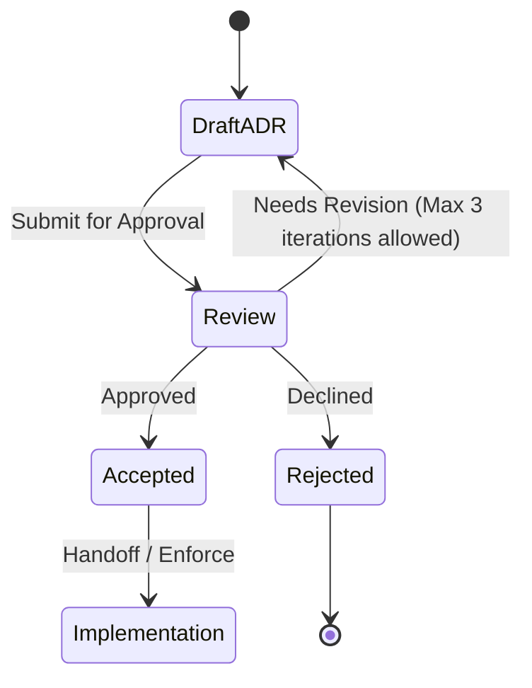

# ADR-0006: AES-GCM containers and SQLCipher for the vault key

## Status

Proposed. Needs approval by mjbvilhena.

This record is a prerequisite for implementing US-35. It does not add acceptance criteria to that story, and it does not edit it. Drafting it is not acceptance. The specification still says the cipher waits for an ADR. This is that proposal. It is not approval of the specification sentence.

## Context

US-35 requires the database, attachment files, and derived files to be encrypted with the vault key. US-36 and US-21 require the Drive copy and the zip to be ciphertext under that same key. The specification left the algorithm, mode, and key size for an ADR. ADR-0001, once accepted, supplies a 32-byte key from Argon2id and forbids a second wrapped key on Drive. US-57 still has to show that search and encryption work together. US-86 requires a crash during re-encryption to leave the phone vault and the Drive copy each readable under exactly one passphrase.

Drive file names stay opaque (US-36). A temp plaintext PDF or a plaintext SQLite file is a derived file US-35 and US-85 refuse.

Domain and layer consultants: `docs/domain/vault/DOMAIN.md`, `docs/layers/data/LAYER.md`. Both are Proposed.

Doing nothing leaves every implementation free to pick a different cipher for the database, the files, and the zip.

## Decision

Recommended option: one 32-byte vault key from ADR-0001. The database uses SQLCipher 4 with that key as a raw key and with SQLCipher's own KDF reduced to a single iteration. Files, attachments, Drive records, and zip payloads use AES-256-GCM. The clear KDF header is authenticated data. A generation number inside the ciphertext detects rollback.

Rules, if this record is accepted:

- Database. SQLCipher 4 page encryption, which is AES-256-CBC with HMAC-SHA512, not GCM. The 32-byte vault key is passed as a raw hex key. `kdf_iter` is 1, so Argon2id is not stacked under a second slow KDF. The SQLCipher file has no second passphrase.
- Files and attachments, including thumbnails, previews, snapshots, OCR cache, and export temp copies: AES-256-GCM, a 12-byte nonce, and a 16-byte tag. One nonce per encryption. A nonce is not reused under the same key.
- Drive records files and the zip payload use the same AES-256-GCM container as files. The zip is not a second cipher. Each encrypted entry is one container.
- Header, cleartext, and authenticated as additional data on that container: magic `LAGOON` plus a NUL, version as a 16-bit integer (version 1 is this layout), KDF id, salt, memory, iterations, parallelism, and output length, as ADR-0001 stores them. A reader that does not implement the version refuses the file. It does not guess a migration.
- The salt and the Argon2 parameters are inside that authenticated data. Changing them fails the tag. ADR-0001's floor and ceiling are checked before the KDF runs. A failed tag or an out-of-range header does not produce plaintext.
- Plaintext layout inside the container: an unsigned 64-bit generation, then the payload. The generation is not only in the clear header, so editing a clear field cannot move it without failing the tag. The phone stores the highest generation it has accepted for that vault. A lower generation does not replace a higher one. A new install stores the generation it accepts.
- Key create. The first passphrase runs ADR-0001, writes the header, wraps the 32-byte key, and encrypts an empty vault at generation 1.
- Key wrap and use. The wrap stays on the phone (ADR-0001). Use unwraps into process memory for the SQLCipher raw key and for file AEAD. The raw key is not written to disk, not logged, and not placed in WorkManager input. Process memory is wiped after the call that needed it. The wrap remains so a later use, after the first unlock since boot, does not ask for the passphrase (US-35).
- Key rotate. US-86 mints a new salt and a new key, increments the generation, and re-encrypts. The old local files are replaced only after the new generation is complete on that store. A crash leaves the phone and the Drive copy each under exactly one passphrase (US-86).
- Key destroy. Uninstall or clear storage deletes app-private files and the app's Keystore keys (US-81). There is no remote copy of the key to destroy. Drive still holds ciphertext. Opening it needs the passphrase on a phone that can derive the key. Sign-out does not delete the phone vault (US-78).
- Zip reading rejects a path that is absolute, contains `..`, or would extract outside the destination directory. It stops at 10000 entries, at 2 GiB of uncompressed bytes in total, and at a single entry whose uncompressed size is more than 100 times its compressed size. A stop leaves the vault unchanged.
- Attachment bytes on Drive are separate immutable objects, named by the hash of the ciphertext, as ADR-0002 describes. They use this same file container. Replacing an object does not rewrite an old hash.

Default: a container whose magic, version, or tag is not this layout is not decrypted and is not imported.

## Alternatives considered

| Option | Why it was plausible | Why it lost |
| --- | --- | --- |
| AES-256-GCM for the database pages as well | One primitive everywhere | SQLCipher 4's page format is CBC plus HMAC. Replacing it means a custom database. US-57 is a spike on SQLCipher, not a custom pager. The file and container format can still be GCM |
| Leave SQLCipher's default KDF in front of Argon2id | The library's own delay | Two slow KDFs, and the second password would have to be stored or derived again. `kdf_iter` 1 keeps a single memory-hard step, which is ADR-0001 |
| A cleartext generation in the header only | Easier to read without decrypt | A header edit could present an old generation as a new one. Putting the generation inside the ciphertext means a rollback is an older authentic message, which the local mark can refuse |
| Zip encryption built into the zip format (ZipCrypto or a library AES mode) | One zip library call | Those modes are a second design, and ZipCrypto is not this key. An entry that is already an AES-GCM container stays one cipher |

## Consequences

- **Positive.** Database, files, Drive, and zip name a cipher a test can assert. Header tampering and a rolled-back generation have a defined refusal. Passphrase change is a new generation, which is the crash boundary US-86 already states.
- **Negative / accepted trade-offs.** Two constructions (SQLCipher CBC-HMAC, and GCM everywhere else) share one key. A nonce reuse under that key breaks GCM. The zip caps can refuse a vault he really did export if it is larger than the caps; raising the caps is a successor ADR. US-57 can still fail, in which case the specification's Room 2 FTS4 fallback applies and this database paragraph has to be revisited. This record does not decide that spike.
- **Follow-ups.** US-35 implementation waits on this record and on ADR-0001 being accepted. US-57 remains the search spike. He is the approver.

## Compliance

- [ ] The database is SQLCipher 4 with a raw 32-byte key and `kdf_iter` 1
- [ ] File, Drive, and zip payloads are AES-256-GCM with a 12-byte nonce and a 16-byte tag, and the header is additional authenticated data
- [ ] A mutated salt or KDF parameter fails decryption
- [ ] A lower generation does not replace the vault
- [ ] A zip entry with `..`, an absolute path, or an uncompressed size past the caps is refused and does not change the vault
- [ ] Uninstall or clear storage removes the Keystore wrap, and the Drive payload still contains no key
- [ ] The raw key is absent from logs and from WorkManager input

## Related

- Domain consultant `vault`. Layer consultant `data`.
- US-21, US-35, US-36, US-57, US-81, US-85, US-86.
- ADR-0001 (key, header, floor, ceiling, wrap). ADR-0002 (which Drive objects exist). ADR-0005 (no plaintext PDF file for a renderer).

## Anti-patterns

- A second passphrase for SQLCipher.
- Reusing a GCM nonce under the vault key.
- Writing the generation only in a clear field and trusting it.
- Extracting a zip entry before checking its path.
- Treating this Proposed record as permission to implement, or editing US-35 to cite it before he accepts it.

## Skill State Machine (sdlc-adr-drafter)

Status: Proposed. Needs approval by mjbvilhena.
