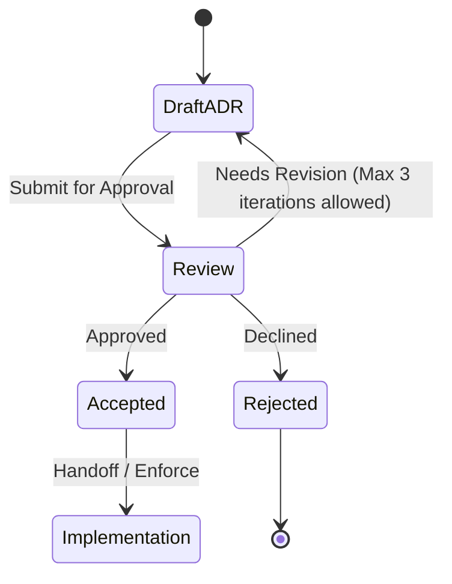

# ADR-0006: AES-GCM containers and SQLCipher for the vault key

## Status

Accepted. Approved by mjbvilhena on 2026-10-20.

This record is a prerequisite for implementing US-35. It does not add acceptance criteria to that story, and it does not edit it. Drafting it is not acceptance. The specification still says the cipher waits for an ADR. This is that record. It is not approval of the specification sentence.

## Context

US-35 requires the database, attachment files, and derived files to be encrypted with the vault key. US-36 and US-21 require the Drive copy and the zip to be ciphertext under that same key. The specification left the algorithm, mode, and key size for an ADR. Accepted ADR-0001 supplies a 32-byte key from Argon2id and forbids a second wrapped key on Drive. US-57 still has to show that search and encryption work together. US-86 requires a crash during re-encryption to leave the phone vault and the Drive copy each readable under exactly one passphrase.

Drive file names stay opaque (US-36). A temp plaintext PDF or a plaintext SQLite file is a derived file US-35 and US-85 refuse.

Domain and layer consultants: `docs/domain/vault/DOMAIN.md`, `docs/layers/data/LAYER.md`. Both are approved. Approved by mjbvilhena on 2026-10-20.

Doing nothing leaves every implementation free to pick a different cipher for the database, the files, and the zip.

## Decision

Recommended option: one 32-byte root from ADR-0001. HKDF-SHA256 derives a subkey per purpose from that root. The database uses SQLCipher 4 with its subkey as raw key data, so SQLCipher does not run PBKDF2 on it. Files, attachments, Drive records, and zip payloads use AES-256-GCM under their own subkeys. The clear header is authenticated data. Generation means only the per-install snapshot counter inside the ciphertext.

Rules, if this record is accepted:

- Subkeys. HKDF-SHA256 derives one subkey each for the database, files, records, and zip from the Argon2id root. A subkey is not stored. The Keystore wraps the root. One purpose's subkey is not used for another purpose.
- Database. SQLCipher 4 page encryption, which is AES-256-CBC with HMAC-SHA512. HMAC stays on. The database subkey is passed as raw key data: `PRAGMA key = "x'<64 hex>'"`. That form skips PBKDF2 for the encryption key ([SQLCipher API, Example 2](https://www.zetetic.net/sqlcipher/sqlcipher-api/)). `kdf_iter` applies when the secret is a passphrase. It is not what turns derivation off, and this record does not set it to 1 as a substitute. The hex string is not passed as a passphrase. The SQLCipher file has no second passphrase.
- `PRAGMA temp_store = MEMORY`, or the compile-time equivalent `SQLITE_TEMP_STORE=3`, so SQLCipher does not write temporary files unencrypted.
- Files and attachments, including thumbnails, previews, snapshots, OCR cache, and export temp copies: AES-256-GCM, a 96-bit nonce from `SecureRandom`, and a 16-byte tag. A nonce is not reused under the same subkey. NIST SP 800-38D §8.3 bounds a random nonce at about 2^32 encryptions per key. The key version rotates when the passphrase changes. If a per-subkey count would reach 2^32, that encryption is refused.
- A single GCM seal that buffers the whole object can hold a large file more than once. The file container is fixed-size segments. Each segment is one GCM encryption, and the segment index is part of the nonce. A segment whose tag fails fails the object. The phone does not hold the whole object twice in order to seal it.
- Drive records files and the zip payload use the same AES-256-GCM container as files. The zip is not a second cipher. Each encrypted entry is one container. Zip entry names are opaque ids, not titles.
- Header, cleartext, and authenticated as additional data: magic `LAGOON` plus a NUL, version as a 16-bit integer (version 1 is this layout), KDF id, salt, memory, iterations, parallelism, output length, and the key version, as ADR-0001 stores them. The additional data also binds the install id and the object kind: records file, attachment, zip entry, or Keystore wrap. A reader that does not implement the version refuses the file. It does not guess a migration.
- The salt, the Argon2 parameters, and the key version are inside that authenticated data. Changing them fails the tag. ADR-0001's floor and ceiling are checked before the KDF runs. A header outside those bounds is damaged, and the KDF does not run. A tag failure on a header that passes the bounds is reported as a wrong passphrase, and nothing changes. A tampered body under a header that passes the bounds is not distinguishable from a wrong passphrase.
- Generation means only the per-install snapshot counter. It is an unsigned 64-bit integer inside the ciphertext, then the payload. It is not the key version, and it is not only in the clear header. The phone stores the highest generation it has accepted for each install's records file. A lower generation of that same file does not replace it. Another install's lower counter is not a rollback of this file. A zip import is a merge under ADR-0002 and is not refused only because a counter inside it is lower. Only a whole-vault replacement of that install's file is refused for a lower generation. A new install stores the generation it accepts. A cancelled reset writes the restored file at a generation higher than the new-key copy it discards (ADR-0001).
- Key create. The first passphrase runs ADR-0001, writes the header, wraps the root, and encrypts an empty vault at generation 1.
- Key wrap and use. The wrap stays on the phone (ADR-0001). `setInvalidatedByBiometricEnrollment` is not set. Use unwraps the root into process memory and derives the subkey that call needs. Byte arrays this app owns are zeroed after that use. SQLCipher holds its key while the database is open. `cipher_memory_security` is off by default and is not a JVM wipe. This record does not say process memory is wiped. The wrap remains so a later use, after the first unlock since boot, does not ask for the passphrase (US-35). If the wrap is gone and the passphrase is known, the phone derives the root again and wraps a new key. That is not the forgotten-passphrase reset.
- Key rotate. US-86 mints a new salt, a new key version, and a new root, and re-encrypts. The old local files are replaced only after the new generation is complete on that store. A crash leaves the phone and the Drive copy each under exactly one passphrase (US-86). A normal change re-encrypts the phone and then re-keys Drive as ADR-0001 states. A forgotten-passphrase reset is the exception in ADR-0001: the phone re-encrypts when the local generation is complete, and during the 24 hours it does not upload.
- Key destroy. Uninstall or clear storage deletes app-private files and the app's Keystore keys (US-81). There is no remote copy of the key to destroy. Drive still holds ciphertext. Opening it needs the passphrase on a phone that can derive the key. Sign-out does not delete the phone vault (US-78).
- Zip reading rejects a path that is absolute, contains `..`, or would extract outside the destination directory. It stops at 10000 entries, at 2 GiB of uncompressed bytes in total, and at a single entry whose uncompressed size is more than 100 times its compressed size. A stop leaves the vault unchanged. Export uses that same 2 GiB uncompressed cap and splits the export rather than writing a zip the importer would refuse.
- Attachment bytes on Drive are separate immutable objects, named by the hash of the ciphertext, as ADR-0002 describes. They use this same file container. Replacing an object does not rewrite an old hash.

Proposed amendment. Needs approval by mjbvilhena. For file, attachment, derived-file, Drive records, and zip payloads, this proposal replaces the accepted sentences that give each segment a fresh 96-bit nonce from `SecureRandom` with the segment index inside that nonce, and the accepted sentences that authenticate the clear header as GCM additional authenticated data. The replacement is Tink `AES256_GCM_HKDF_1MB` from `com.google.crypto.tink:tink-android:1.24.0`, class `com.google.crypto.tink.subtle.AesGcmHkdfStreaming`, parameters `PredefinedStreamingAeadParameters.AES256_GCM_HKDF_1MB`. It does not replace SQLCipher 4, the purpose HKDF, Argon2id, or the Keystore wrap. The proposal is `docs/adr/ADR-0007-tink-streaming-aead.md`. This paragraph does not change the Accepted status of this record.

The replacement, if this amendment is approved:

- Parameters: 32-byte IKM, HKDF HMAC-SHA256, a 32-byte derived AES-GCM key, ciphertext segment size 1048576, and a 16-byte GCM tag. On the key-manager path `firstSegmentOffset` is 0.
- Header, 40 bytes: a length byte whose value is 40, a 32-byte random salt, and a 7-byte random nonce prefix. The salt and the prefix are chosen once per stream.
- One HKDF-SHA256 per stream: `Hkdf.computeHkdf("HmacSha256", ikm, salt, associatedData, 32)`. That 32-byte key encrypts every segment. HKDF does not run again for each segment.
- Nonce, 12 bytes, big-endian: the 7-byte prefix, the segment number as a 32-bit unsigned integer, and one flag byte that is 1 on the last segment and 0 otherwise. `Cipher.doFinal` is called with no GCM associated data.
- Associated data is the HKDF info. The clear header (magic `LAGOON` and NUL, version, KDF parameters, key version, install id, and object kind) is that associated data. Changing it changes the derived key, so decryption fails. It is not a GCM tag over the header.
- Segments after the first are 1048576 ciphertext bytes when they are full. The first segment's ciphertext is 1048536 bytes, which is 1048576 minus the 40-byte header, including its tag. The last segment may be shorter.

The accepted sentences above stay in this record until this amendment is approved.

Default: a container whose magic, version, or tag is not this layout is not decrypted and is not imported.

## Alternatives considered

| Option | Why it was plausible | Why it lost |
| --- | --- | --- |
| AES-256-GCM for the database pages as well | One primitive everywhere | SQLCipher 4's page format is CBC plus HMAC. Replacing it means a custom database. US-57 is a spike on SQLCipher, not a custom pager. The file and container format can still be GCM |
| Leave SQLCipher's default KDF in front of Argon2id, or set `kdf_iter` to 1 | The library's own delay, or a way to make that delay tiny | The raw-key form skips PBKDF2. `kdf_iter` is the control for a passphrase, not the control that turns derivation off. Passing the hex string as a passphrase would still run the KDF |
| A cleartext generation in the header only | Easier to read without decrypt | A header edit could present an old generation as a new one. Putting the generation inside the ciphertext means a rollback is an older authentic message, which the local mark can refuse |
| Zip encryption built into the zip format (ZipCrypto or a library AES mode) | One zip library call | Those modes are a second design, and ZipCrypto is not this key. An entry that is already an AES-GCM container stays one cipher |

## Consequences

- **Positive.** Database, files, Drive, and zip name a cipher a test can assert. Header tampering and a rolled-back generation have a defined refusal. Passphrase change is a new generation, which is the crash boundary US-86 already states.
- **Negative / accepted trade-offs.** Two constructions (SQLCipher CBC-HMAC, and GCM everywhere else) share one root through separate subkeys. A nonce reuse under one subkey breaks that GCM. Byte arrays this app owns are zeroed, and SQLCipher still holds its key while the database is open. The zip cap can split an export, and a zip past the cap is refused on import. US-57 can still fail, in which case the specification's Room 2 FTS4 fallback applies and this database paragraph has to be revisited. This record does not decide that spike.
- **Follow-ups.** US-35 implementation waits on this record and on ADR-0001 being accepted. US-57 remains the search spike. He is the approver.

## Compliance

- [ ] The database is SQLCipher 4. The subkey is passed as `PRAGMA key = "x'<64 hex>'"`. HMAC stays on. `temp_store` is `MEMORY`
- [ ] File, Drive, and zip payloads are AES-256-GCM in fixed-size segments, with a 96-bit nonce and a 16-byte tag. The header, the install id, and the object kind are additional authenticated data
- [ ] A header outside the Argon2 bounds does not run the KDF. A tag failure on an in-bounds header is reported as a wrong passphrase
- [ ] A lower generation of one install's file does not replace that file. A zip import is not refused only for a lower counter
- [ ] A zip entry with `..`, an absolute path, or an uncompressed size past the caps is refused and does not change the vault
- [ ] Uninstall or clear storage removes the Keystore wrap, and the Drive payload still contains no key
- [ ] The raw key is absent from logs and from WorkManager input

## Related

- Domain consultant `vault`. Layer consultant `data`.
- US-21, US-35, US-36, US-57, US-81, US-85, US-86.
- ADR-0001 (key, header, floor, ceiling, wrap). ADR-0002 (which Drive objects exist). ADR-0005 (no plaintext PDF file for a renderer).

## Anti-patterns

- A second passphrase for SQLCipher, or passing the hex key as a passphrase and calling `kdf_iter` 1 a raw key.
- Saying process memory is wiped. Byte arrays this app owns are zeroed. SQLCipher holds its key while the database is open.
- Reusing a GCM nonce under one subkey.
- Writing the generation only in a clear field and trusting it.
- Extracting a zip entry before checking its path.
- Amendment approved by mjbvilhena on 2026-10-22. Treating acceptance of this record as permission to start implementation, or editing the approved text of US-35. Implementation has not started.

## Skill State Machine (sdlc-adr-drafter)

Status: Accepted. Approved by mjbvilhena on 2026-10-20.
