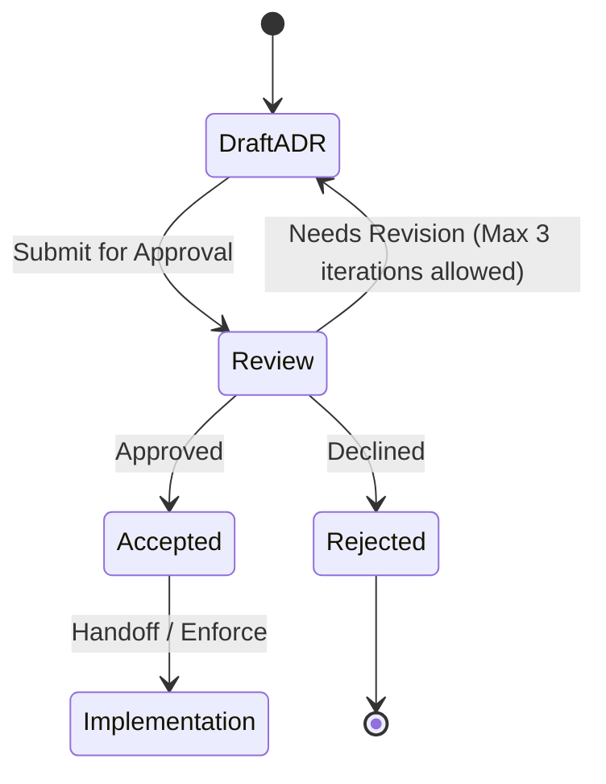

# ADR-0008: Use sqlcipher-android 4.6.1 for the vault database

## Status

Accepted. Approved by mjbvilhena on 2026-11-28.

On 2026-11-28 at 05:01 GMT, mjbvilhena typed "E1-E6 approved as recommended". That accepts the six answers recorded under Open questions. It does not accept the specification amendment. This record does not change the Accepted status of ADR-0006. It does not edit ADR-0006. It does not change any story status.

## Context

US-57 asked whether FTS5 and SQLCipher can run together on this product's minimum phone before search and at-rest encryption are built on that pair. The note `docs/technical_design/us-57-fts5-sqlcipher-spike.md` records pass. Pass means every check in that note held on both targets.

The two targets are an API 26 emulator (`system-images;android-26;google_apis;x86_64`, ABI `x86_64`) on 2026-11-21, and Miguel's samsung SM-S911B on 2026-11-27. That phone's ABI list starts with `arm64-v8a`. Android on that phone is 17, API 37. An arm64 emulator was not used in place of the phone. The phone screen showed the success sentence only after `FtsSqlCipherProbe.runChecks` returned.

The library under test was `net.zetetic:sqlcipher-android:4.6.1`. The database opened with `PRAGMA key = "x'<64 hex>'"` as raw key data. `PRAGMA temp_store` was MEMORY (`2`). An FTS5 table using `unicode61 remove_diacritics 2` was created and filled, with columns `title`, `tags`, `note`, `body`, `extracted`, `ocr`, and `snapshot`. A prefix match on `caf*` and on `cafe*` returned the row that contained "café". `bm25` with weights `10.0, 5.0, 3.0, 1.0, 1.0, 1.0, 1.0` ordered a title match, then a tags match, then a body match. `snippet()` and `highlight()` wrapped the matched word. The file did not open with the wrong key. It opened again with the right key.

Accepted ADR-0006 already chooses SQLCipher 4 page encryption, that raw-key pragma, and `temp_store = MEMORY`. It says the spike can still fail, and that this database paragraph then has to be revisited. The spike note says it does not choose or change that cipher. The product modules do not depend on the library. `:data` opens an in-memory Room database in `openInMemoryVault`. Vault bytes stay off disk until a vault key exists.

Doing nothing leaves US-15, US-50, and US-92 without an engine, and leaves the specification's fallback (Room 2 FTS4 plus app-side ranking) available even though the spike's failure condition did not happen.

Non-goals: Argon2id and the Keystore wrap (ADR-0001), file and zip containers (ADR-0006 and accepted ADR-0007), a second cipher, a Room version bump, an `abiFilters` change, and any edit to a story, the specification, the data layer, or the threat model.

Domain consultant `vault`. Layer consultant `data`. Both files stay as they are. The data layer still says not to treat FTS5 plus SQLCipher as proven before the spike, and its allowed-dependency row still says the spike has to show FTS with SQLCipher. Those sentences are not edited here.

This is a new record, not an amendment pasted into ADR-0006. The harness template is one decision per ADR. ADR-0006's accepted sentences stay. ADR-0007 is the existing pattern for a later record that narrows one open part of ADR-0006 without rewriting it. No amendment line was added to ADR-0006.

## Decision

The on-device vault database library is `net.zetetic:sqlcipher-android:4.6.1`, the artifact the passing spike ran.

Where it applies: the vault database file, once a vault key exists, in the data layer. Full-text search of that database is FTS5 with `tokenize = 'unicode61 remove_diacritics 2'`. The database subkey from ADR-0006 is passed as raw key data, `PRAGMA key = "x'<64 hex>'"`. `PRAGMA temp_store = MEMORY`. HMAC stays on, as ADR-0006 already requires. The SQLite that serves this database is the SQLite bundled in that artifact. Room remains the local store the data layer already requires, and it opens this library. Room's own bundled SQLite is not the encrypted vault database.

What this stops: building vault search on Room 2 FTS4 with app-side ranking. That fallback stays written in the specification until a later amendment. It is not the engine this record proposes. Keeping the product database in memory after the vault key exists is also not this decision.

Default: a new on-device vault database uses this same artifact, this tokenizer, and the ADR-0006 raw key. A later `sqlcipher-android` release is not adopted by silence. It needs the same two-target checks.

## Alternatives considered

| Option | Why it was plausible | Why it lost |
| --- | --- | --- |
| Room 2 FTS4, with ranking done in the app | The specification names this fallback. Stock SQLite on `minSdk` 26 has no FTS5. Room 2 has FTS4. It avoids this native library and its APK size | The fallback is for a spike that cannot run. The spike passed on both targets, including `unicode61 remove_diacritics 2`, weighted `bm25`, `snippet()`, and `highlight()`. Those are the US-15 and US-50 behaviours the fallback would have reimplemented |
| `net.zetetic:sqlcipher-android:4.20.0` | Maven metadata for this coordinate, `lastUpdated` `20261027150321`, lists `latest` and `release` as `4.20.0`. That is newer than the tested artifact. GitHub release `v4.6.1` was published `2025-12-08` | `4.20.0` was not the artifact that passed on the API 26 emulator or on the SM-S911B. This record does not treat a newer release as tested |
| SQLCipher Commercial Edition | The publisher sells a separate commercial package. The community licence page distinguishes it from the Community Edition | The passing coordinate is the community artifact `net.zetetic:sqlcipher-android:4.6.1`. No commercial grant is in the repository. This record does not switch packages |
| Leave the product on the in-memory Room database | That is what `:data` opens today, and it keeps vault bytes off disk before a key exists | US-35 requires the database to be encrypted once the key exists. An in-memory database does not survive as the vault, and it does not provide the FTS5 index US-15, US-50, and US-92 wait on |

## Consequences

- **Positive.** The engine US-15, US-50, and US-92 were waiting on is named, and it is the engine the spike ran. Accent folding, prefix match, weighted `bm25`, snippet, and highlight held on API 26 `x86_64` and on arm64. The database subkey stays the ADR-0006 raw key. Argon2id, the Keystore wrap, and the Tink streams are unchanged.
- **Negative / accepted trade-offs.** Licence. The `LICENSE` file at `sqlcipher-android` tag `v4.6.1` is a 3-clause BSD licence, copyright 2008–2023 ZETETIC LLC. Source redistributions keep the notice. Binary redistributions reproduce the notice in the documentation or other materials provided with the distribution. The ZETETIC LLC name is not used to endorse a product without written permission. The publisher's licence page, which the Maven POM links, says the Community Edition also needs that attribution in a user-accessible place. This record does not add a screen.
- **Negative / accepted trade-offs.** APK size. The spike note measures three files. The master `:app` debug APK at `483d5891359942e640697c0665626e1d23532ee1` is 2,374,931 bytes. The spike debug APK built locally with the on-screen runner is 23,450,558 bytes. The spike debug APK packaged by CI is 22,563,778 bytes, which is about 22.6 MB and 20,188,847 bytes larger than that master debug APK. The product app was not rebuilt with this dependency. The spike module sets no `abiFilters`. The 4.6.1 AAR contains `libsqlcipher.so` for `arm64-v8a` (5,797,528 bytes), `armeabi-v7a` (4,035,640), `x86` (5,403,136), and `x86_64` (6,372,968), uncompressed. An arm64-only product APK was not measured. The specification already says sideloaded APKs use `arm64` `abiFilters` or per-ABI APKs. This record does not change that packaging rule.
- **Negative / accepted trade-offs.** Maintenance. The tested release is `4.6.1`. The Maven catalog's listed release on the metadata above is `4.20.0`. Lagoon does not fork the native library. A later version is a new spike, not a silent bump. The AAR manifest sets `minSdkVersion` 21. The product `minSdk` is 26. The API 26 emulator passed, so the library does not raise the product minimum. FTS5 on that minimum comes from the bundled SQLite, which is why the spike exists.
- **Negative / accepted trade-offs.** 16 KB page size and arm64. Each of the four `libsqlcipher.so` files in the 4.6.1 AAR has PT_LOAD alignment 16384, which is 16 KB. The phone result shows the library loaded on `arm64-v8a`. The spike did not record that phone's page size, so the phone pass is not a 16 KB-page-device run. `armeabi-v7a` and `x86` were not named targets.
- **Negative / accepted trade-offs.** Dependency scan. On master `57d39ebf38710fdd2b8f4fb6ea2e3ebbad8458c5`, Dependency scan job `140791362182` in run `46084678220` succeeded. The resolver ran `:spike:captureSpikeRuntime` and wrote 174 modules. `scripts/ci/resolve-classpaths.init.gradle.kts` captures `:spike` `releaseRuntimeClasspath`, and `spike/build.gradle.kts` declares `net.zetetic:sqlcipher-android:4.6.1`. The job log does not print the module list or the OSV report. The job fails closed on a high finding. A low finding would not fail it. `docs/sdlc/vulnerability-exceptions.md` is not in the tree, so there is no exception line. `:app` and `:data` do not declare this coordinate. Moving it onto `:data` is a new resolved graph. This record adds no exception.
- **US-35.** The database file, once the key exists, uses this library under the database subkey. Attachment files and derived files stay on the Tink streams in ADR-0007. The vault key stays the Argon2id root in ADR-0001. US-35's text is not edited. This record does not implement US-35. The empty-vault Drive scenario stays where the pipeline map already puts it.
- **US-15 and US-50.** The spike showed prefix match, accent folding, the US-50 weights for a title match then a tags match then a body match, and snippet and highlight on the title column. It did not show a match in every US-15 field, punctuation treated as plain words, an empty query, exact-phrase rank, the OCR-equals-body tie, or the recency tie-break. Those remain the stories' acceptance criteria. Ranking weights stay in the domain. This record does not copy them into a DAO.
- **US-92.** The story stays Draft. This record does not change that status. The index it describes is the FTS5 table above, rebuilt from the edited text. This record does not implement that rebuild.
- **Migration from the in-memory database.** `openInMemoryVault` uses `Room.inMemoryDatabaseBuilder`. There is no on-disk vault file to convert, and there is no plaintext database file to re-encrypt. ADR-0006 already says key create encrypts an empty vault at generation 1. Rows that exist only in a running in-memory process are not copied into that file. A share that arrives before the key exists stays in memory until setup, as US-35 already requires, and is then written into the new encrypted database. Room schema version 2 and `ITEM_MIGRATION_1_2` stay the in-memory schema. They are not a dump of debug rows.
- **Follow-ups.** The Community Edition notice must be readable on an open-source licences screen in Settings. That screen is not built here. US-59 stays Draft. The product APK size is measured when the US-35 vault key is built. The spike sizes stay the evidence until that measurement. A later amendment can name `net.zetetic:sqlcipher-android:4.6.1` on the data-layer allowed-dependency row and retire the sentence that FTS5 plus SQLCipher is not yet proven. The data layer is not edited here. The specification amendment for the Room 3 sentence is drafted beside that sentence and is Proposed. It is not accepted. The current data module depends on `androidx.room:room-runtime:2.7.2`. This record does not change that version. US-15, US-35, US-50, and US-92 are not started by this file.

## Open questions

mjbvilhena answered these six questions on 2026-11-28 at 05:01 GMT with "E1-E6 approved as recommended". Each answer is recorded against its question.

1. Do you want the vault database library to be `net.zetetic:sqlcipher-android` version 4.6.1, the version the spike ran, and to leave Maven's listed release 4.20.0 unused until the same API 26 emulator and arm64 phone checks pass on it? E1: use `net.zetetic:sqlcipher-android` 4.6.1, and keep 4.20.0 unused until it passes the same API 26 emulator and arm64 phone checks. Approved by mjbvilhena on 2026-11-28.
2. Do you accept the Community Edition licence in the `LICENSE` file at `sqlcipher-android` tag `v4.6.1` (3-clause BSD, copyright 2008–2023 ZETETIC LLC) for the Lagoon app, and where should a person be able to read that notice? E2: accept the Community Edition 3-clause BSD licence (ZETETIC LLC). The notice must be readable on an open-source licences screen in Settings. That screen is a follow-up and is not built here. Approved by mjbvilhena on 2026-11-28.
3. Do you accept the spike size as the size evidence we have: the CI spike APK is 22,563,778 bytes (about 22.6 MB), 20,188,847 bytes larger than the master debug app APK of 2,374,931 bytes? The product app was not rebuilt with this library, and an arm64-only product APK was not measured. E3: accept the spike size evidence for now (spike APK 22,563,778 bytes, 20,188,847 bytes larger than the master debug APK), and measure the real app's size when the US-35 vault key is built. Approved by mjbvilhena on 2026-11-28.
4. Do you accept the 16 KB page-size evidence we have: each `libsqlcipher.so` in the 4.6.1 AAR has PT_LOAD alignment 16384? The spike did not record the phone's page size. E4: accept the 16 KB page-size evidence (PT_LOAD alignment 16384 in each `libsqlcipher.so`). Approved by mjbvilhena on 2026-11-28.
5. Do you accept the dependency-scan status we have: on master `57d39eb` the Dependency scan job succeeded after resolving the spike release classpath, and there is no vulnerability-exception file? `:app` and `:data` do not declare this library yet, and the job log does not include the OSV report. E5: accept the dependency-scan status (green on master `57d39eb`, with no vulnerability-exception file). Approved by mjbvilhena on 2026-11-28.
6. Do you accept that vault full-text search uses the SQLite bundled inside this SQLCipher library, opened later by Room, and that Room's own bundled SQLite is not the encrypted database? The data module today is Room 2.7.2. The specification still says FTS5 needs Room 3 with the bundled SQLite driver. This record does not change that sentence. E6: accept that vault full-text search uses the SQLite bundled inside SQLCipher, opened by Room, and not Room's bundled SQLite. This answer depends on a separate specification amendment, because the spec says FTS5 needs Room 3 with the bundled driver. That amendment is Proposed. This line does not approve it. Approved by mjbvilhena on 2026-11-28.

## Compliance

How a reviewer checks later work against this record, once it is accepted. Nothing below is implemented by this file.

- [ ] The vault database dependency is `net.zetetic:sqlcipher-android:4.6.1`. A later version is not introduced without the same two-target checks.
- [ ] The database subkey is passed as `PRAGMA key = "x'<64 hex>'"`. HMAC stays on. `temp_store` is `MEMORY`.
- [ ] The FTS5 tokenizer is `unicode61 remove_diacritics 2`. Ranking weights stay the US-50 weights.
- [ ] Vault bytes are not opened with Room's bundled SQLite, and they are not indexed with FTS4.
- [ ] The raw key is absent from logs and from WorkManager input.
- [ ] No vulnerability-exception line is added for this coordinate unless mjbvilhena has accepted that line.

## Related

- Domain consultant `vault`. Layer consultant `data`.
- `docs/technical_design/us-57-fts5-sqlcipher-spike.md`. US-15, US-35, US-50, US-57, US-92.
- Accepted ADR-0001 (Argon2id root and Keystore wrap). Accepted ADR-0002 (which records exist). Accepted ADR-0006 (SQLCipher 4, raw key, `temp_store`). Accepted ADR-0007 (Tink streams, not the database).
- `docs/technical_design/test-plan.md` rows TP-06 and TP-08. `docs/technical_design/threat-model.md` row T-1. `docs/product/specification.md` search paragraph. `data/src/main/kotlin/com/mjbvilhena/lagoon/data/item/VaultDatabase.kt`.

## Anti-patterns

- Calling this record Accepted, or writing an approval mark, before mjbvilhena accepts it.
- Editing ADR-0006, a story, the specification, or the data layer inside this proposal.
- Treating the spike note, or a green Dependency scan, as acceptance of the library.
- Passing the hex key as a passphrase, or setting `kdf_iter` to 1 and calling that a raw key.
- Adopting `4.20.0`, or any later release, without the two-target checks.
- Copying in-memory debug rows into the new vault file and calling that the US-35 migration.
- Adding a vulnerability-exception line in this pull request.

## Skill State Machine (sdlc-adr-drafter)

Status: Accepted. Approved by mjbvilhena on 2026-11-28.
