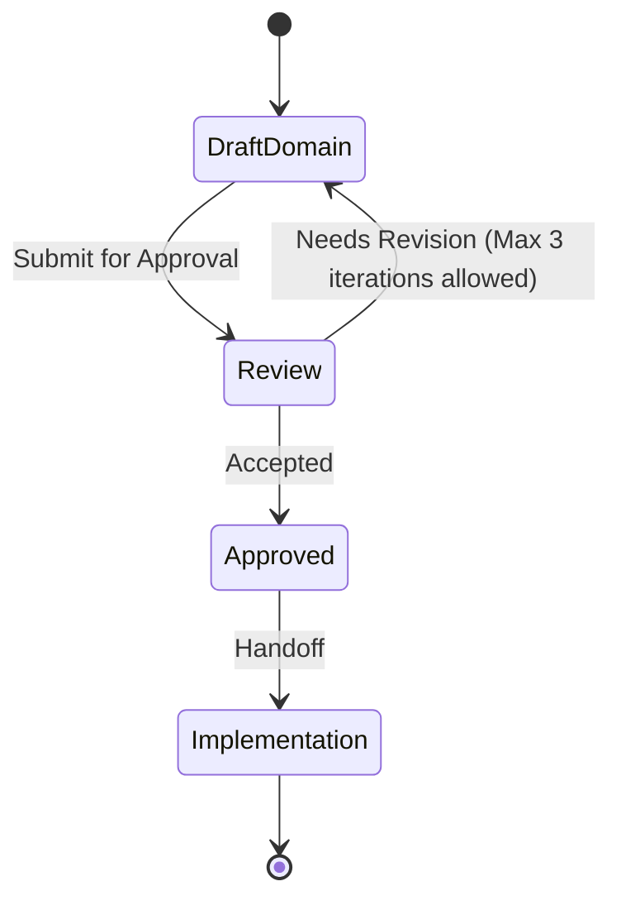

# Vault domain

This file is a **Domain Consultant** payload. The MCP tool `get_domain_consultant` discovers it as `DOMAIN.md` under a domain directory. Other skills treat MUST/NEVER as hard constraints. Write for agents: short, testable, unambiguous.

**Quality bar:** An agent can decide whether a change belongs in this domain, which entities it may touch, and which integrations are forbidden — without reading application code.

**Status: Proposed. Needs approval by mjbvilhena.**

One bounded context: the vault. Capture, search, sync, reminders, and topics are capabilities of this context. They are not separate domains. `get_domain_consultant("capture")` and `get_domain_consultant("knowledge")` have no payload of their own.

Package `com.mjbvilhena.lagoon`. Actor: Miguel. No other persona is named.

MUST and NEVER below restate rules already in the approved specification, the approved epics, or an approved story. A Proposed ADR is not a MUST. See Change control.

## Bounded context

- **Owns:** items and their attachments, personal notes, tags, topics and suggestions, the one reminder or the one expiry, the sensitive mark, vault-header salt and KDF parameters, and the rules for what may leave the phone.
- **Does not own:** Google Drive's file store (this context sends ciphertext only), the topic provider's retention (proposed in ADR-0003, not a MUST here), Android Keystore hardware, or another app that receives a share. Call those systems at the boundary. Do not treat their models as vault entities.
- **Published language:** item, attachment, personal note, tag, topic, suggestion, reminder, expiry, sensitive, vault key, passphrase, salt. A code is text already in a title. It is not a field.
- **Actors:** Miguel. He captures, edits, searches, marks sensitive, and sets the passphrase. No second role is named.

## Core entities and invariants

The item is the aggregate root for its attachments, personal-note entries, tag links, sensitive mark, and its one reminder or one expiry. A tag is its own aggregate: one case-insensitive name, referenced by many items. A topic is its own aggregate: confirmed name, notes, and links to items. A suggestion is not a topic. The vault header is a value object, not an item.

| Entity | Meaning | Invariants (always true) |
| --- | --- | --- |
| Item | One saved link, note, image, or PDF. | Stable id across edit, sync, and a repeat of the same link (E4, US-56). `createdAt` does not move when `updatedAt` does (US-56). An empty title fills from the page title or the file name, including a screenshot, image, or scan, and is capped at 120 characters (spec, US-40). |
| Attachment | A file on an item. | An item may hold more than one (E1, US-32). Bytes are vault content, encrypted at rest with the vault key (US-35). |
| Personal note entry | Dated text on an item, separate from the body. | On a repeat of the same page, existing text is not overwritten and the new note is appended under `YYYY-MM-DD` (spec, US-49). US-64 "note text" means the body, not this entry. |
| Tag | A label Miguel applies. | A rename applies to every item. A case-insensitive clash asks, then merges (spec, US-29). The Untagged inbox is a view, not a stored tag (E3, US-38). A tag is not a topic (US-41). |
| Topic | A subject he has confirmed. | Created only after he confirms (E11, US-43). Every stored result is marked AI-generated (US-41). A quote is kept as grounded only when it appears word for word in the text that was sent (US-41). |
| Suggestion | A topic name not yet confirmed. | Decline, rename, or merge of a suggestion does not create a topic he refused (US-46). No cap on how many suggestions may be offered (spec, US-41). |
| Reminder | The optional alarm instant on an item. | At most one. Default 09:00 in the phone's current local zone. Inexact. Lagoon never requests `SCHEDULE_EXACT_ALARM` or `USE_EXACT_ALARM` (spec, US-34, US-77). |
| Expiry | The optional expiry date on an item. | Notifies 7 days before and on the day (E9, US-54). Upcoming shows the one reminder or the one expiry, not a return-by date or a warranty end (spec, US-62). |
| Vault header | Non-secret salt and KDF parameters. | The vault key is derived from his passphrase. No copy of the key, wrapped or otherwise, is stored off the phone (spec, US-35). The header is readable before the key exists. Method and parameters are proposed in ADR-0001, not fixed here. |

### Value objects

- **Item id.** Assigned once. Never reused for a different item (US-56).
- **Normalised URL.** Match ignores scheme, a leading `www.`, a trailing slash, the fragment, host case, and the tracking parameters named in US-49. Any other query parameter, including an order id, stays a different item (spec, US-49). The stored source URL remains the first one.
- **Passphrase.** Derives the vault key. It is not the vault key. It is never stored and never logged (US-35).
- **Sensitive mark.** A boolean on the item, not a tag (US-37, US-75).

### Aggregates

- **Item.** Consistency boundary for attachments, notes, tags on that item, the sensitive mark, and the one reminder or expiry. Deleting it removes its FTS row, reminders, topic links, queued topic job, pending suggestions, and topic notes written from it, once undo has ended (US-13). How that delete reaches another phone is proposed in ADR-0002.
- **Tag.** The name is the identity, compared case-insensitively (US-29).
- **Topic.** Links and notes. Unlink and merge of a saved topic are US-48. Sensitive topic notes stay hidden until the US-37 unlock (US-75).

## Ubiquitous language

- Item → the saved record. Do not call the whole record a note.
- Body → the item text US-64 can share. Personal note → the dated "why it matters" entries.
- Tag → his label. Topic → a confirmed AI subject. Never call a topic a tag.
- Inbox → the untagged view. Never persist an Inbox tag.
- Vault key → the derived key that encrypts vault bytes. Passphrase → the secret he types to re-create that key. Salt → the non-secret header value.
- Code → words already in the title (US-34). Never add a code field.
- Sync → background ciphertext to Drive `appDataFolder`. Never call it backup or restore. There is no Back up now, no Restore, and no last-backup time (spec, US-30).
- Banned aliases: backup button, restore button, merchant, booking reference, return-by, warranty end, trip, collection. Those are out of v1 or removed.

## Integrations and boundaries

- **Inbound:** the share sheet (link, plain text, image, PDF), in-app add, and the system camera via `ACTION_IMAGE_CAPTURE`. Lagoon does not request `CAMERA` (US-65).
- **Outbound:** Drive receives ciphertext only (US-36). A topic call may send readable text of an ordinary item (E11, US-41). OCR does not send the image or the recognized text (US-07, US-31). A share out may send an attachment, a URL, or the body, never the database, the vault key, or snapshot internals (US-64).
- **Anti-corruption:** a token-looking URL is not auto-fetched (US-79). A PDF password is not a vault secret: v1 does not ask for one or store one (US-04, US-85). The Google account is not a source of the vault key (spec, US-36).

## MUST rules

- MUST derive the vault key from the passphrase he chooses, with a slow memory-hard KDF and a salt, so another device can re-create the same key (spec, US-35).
- MUST keep the vault key off Drive and out of every zip. A wrapped copy off the phone is still a copy (spec, US-35, US-74).
- MUST hold the derived key in the Android Keystore, or wrap it with a hardware-backed Keystore key, without user authentication, so sync and reminders can decrypt after the first unlock since boot (spec, US-35).
- MUST leave sensitive content behind the US-37 unlock even when the vault key needs no user authentication (spec, US-35, US-75).
- MUST treat a forgotten passphrase plus a phone that no longer holds the key as lost content. There is no recovery (spec, US-35).
- MUST let a phone that still holds the key set a new passphrase after the US-37 unlock, without the old passphrase, and re-encrypt as in US-86 (spec, US-35, US-86).
- MUST encrypt the database, attachment files, and derived files (thumbnails, previews, snapshots, OCR cache, WebView cache, image cache, WorkManager inputs, logs, export temp copies) with the vault key (US-35).
- MUST keep `allowBackup` false and exclude the vault from `dataExtractionRules` (US-35).
- MUST upload only ciphertext, under opaque Drive names, with granted scopes exactly `drive.appdata` (US-36, US-78).
- MUST keep an item that exists on only one side (spec, US-20). Two edits of one id, and deletion propagation, wait on ADR-0002.
- MUST union tags, keep existing text, and append a dated note when the same normalised URL is shared again (spec, US-49).
- MUST search title, body, extracted text, OCR text, tags, and the personal note with the specified BM25 weights: title 10, tags 5, personal note 3, body and extracted text 1, OCR text 1 (spec, US-15, US-50).
- MUST exclude a sensitive item from list title, snippet, thumbnail, OCR, search highlights, topic calls, and both notification versions until the rules in US-75 are met.
- MUST show an ordinary lock-screen reminder's title, and show both versions of a sensitive notification as only "Lagoon reminder" (US-34, US-75).
- MUST run link work in this order after the save returns: enrich, then snapshot from that fetch, then OCR, then the topic job (E1, US-58).
- MUST keep topic extraction on for a new ordinary item, with a Settings switch, with no per-item opt-out, and with sensitive items always excluded (spec, US-41, US-75).
- MUST NOT start ML Kit until he accepts the US-07 disclosure. There is no telemetry off switch (spec, US-07, US-31).
- MUST use the bundled Latin-script model `com.google.mlkit:text-recognition` and keep `com.google.android.gms:play-services-mlkit-text-recognition` absent (US-31).
- MUST leave a password-protected PDF unopened in full-screen, ask for no PDF password, and store none (US-85). The file is still stored and marked text-not-extracted (US-04).

## NEVER rules

- NEVER store the passphrase, the vault key, or a PDF password.
- NEVER store a copy of the vault key off the phone, wrapped or otherwise.
- NEVER put plaintext vault bytes on disk before the key exists. A share that arrives first stays in memory until he accepts the warning (US-35).
- NEVER add Firebase Analytics, Crashlytics, or another analytics or crash product the app chooses (spec, US-07).
- NEVER send a sensitive item, an image, or attachment bytes to the topic provider (US-41, US-75, E7). Cloud OCR and cloud vision are out of scope.
- NEVER auto-fetch a token-looking URL (US-79).
- NEVER request `CAMERA`, `SCHEDULE_EXACT_ALARM`, `USE_EXACT_ALARM`, or `WRITE_SETTINGS` (US-65, US-77, US-80, US-85).
- NEVER offer Back up now, Restore, or a last-backup time (spec, US-30).
- NEVER delete the phone vault on sign-out (US-78).
- NEVER invent a code field, a merchant, a trip, or a return-by date.

## Error and compliance posture

- A wrong passphrase is reported and changes nothing (US-35).
- A failed topic call leaves the item and creates no topic (US-47).
- A failed link fetch keeps the URL (US-09).
- Enrichment, snapshot, OCR, and topic outcomes that are still pending stay visible as pending or failed, not as invented text (US-31, US-70).
- Provenance for a topic result records item id, fields sent, timestamp, and model or prompt version. It does not record the credential or the passphrase (US-41).
- No retention period is stated for vault content beyond the product rules. Trash duration is not decided (US-66). Drive revisions are not deleted by a passphrase change until ADR-0001 is accepted; US-86 already says old revisions may open with the old passphrase.

## Change control

An ADR is required before any of these become MUST: the KDF and its parameters (ADR-0001), sync conflicts and deletions (ADR-0002), the topic provider, credential, and payload (ADR-0003), ML Kit telemetry handling (ADR-0004), PDF rendering on API 26–29 (ADR-0005), and the content cipher, mode, and key size (still no ADR; the spec leaves them open).

Only mjbvilhena may accept an ADR or add a published term. This file is Proposed. It does not approve those ADRs and it does not change approved story text.

## Anti-patterns

- A second DOMAIN.md for capture or topics that restates these rules.
- Treating a Proposed ADR parameter as a MUST.
- Naming a cipher here.
- Calling the inbox a tag, or a topic a tag.

## Skill State Machine (sdlc-domain-architect)

Status: Proposed. Needs approval by mjbvilhena.
