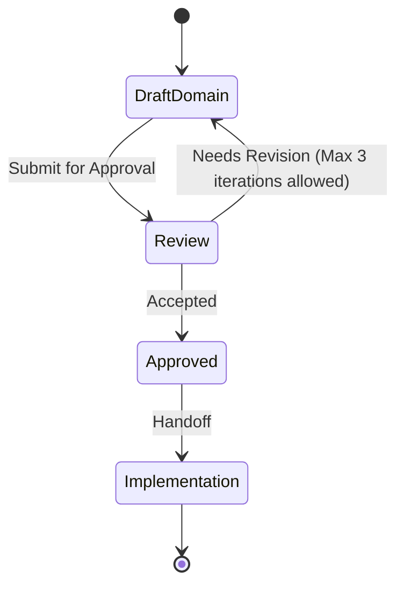

# Vault domain

This file is a **Domain Consultant** payload. The MCP tool `get_domain_consultant` discovers it as `DOMAIN.md` under a domain directory. Other skills treat MUST/NEVER as hard constraints. Write for agents: short, testable, unambiguous.

**Quality bar:** An agent can decide whether a change belongs in this domain, which entities it may touch, and which integrations are forbidden — without reading application code.

**Status: Proposed. Needs approval by mjbvilhena.**

One bounded context: the vault. Capture, search, sync, reminders, and topics are capabilities of this context. They are not separate domains. `get_domain_consultant("capture")` and `get_domain_consultant("knowledge")` have no payload of their own.

Package `com.mjbvilhena.lagoon`. Actor: Miguel. No other persona is named.

MUST and NEVER below restate rules already in the approved specification, the approved epics, or an approved story. A Proposed ADR is not a MUST. See Change control.

## Bounded context

- **Owns:** items and their attachments, personal notes, tags, topics and suggestions, the one reminder or the one expiry, the sensitive mark, vault-header salt and KDF parameters, and the rules for what may leave the phone.
- **Does not own:** Google Drive's file store (this context sends ciphertext only), the xAI Grok API's retention (the topic call uses that API, with zero data retention turned on for his xAI team, decided in ADR-0003 and not a MUST while that ADR is unapproved), Android Keystore hardware, or another app that receives a share. Call those systems at the boundary. Do not treat their models as vault entities.
- **Published language:** item, attachment, personal note, tag, topic, suggestion, reminder, expiry, sensitive, vault key, passphrase, salt. A code is text already in a title. It is not a field.
- **Actors:** Miguel. He captures, edits, searches, marks sensitive, and sets the passphrase. No second role is named.

## Core entities and invariants

The item is the aggregate root for its attachments, personal-note entries, tag links, sensitive mark, and its one reminder or one expiry. A tag is its own aggregate: one case-insensitive name, referenced by many items. A topic is its own aggregate: confirmed name, notes, and links to items. A suggestion is not a topic. The vault header is a value object, not an item.

| Entity | Meaning | Invariants (always true) |
| --- | --- | --- |
| Item | One saved link, note, image, or PDF (E1). A plain-text share is a note. That mapping is US-02, which is Draft. | Stable id across edit, sync, and a repeat of the same link (E4). `createdAt` does not move when `updatedAt` does. That immutability is US-56 only, and US-56 is Draft. An empty title fills from the page title or the file name, including a screenshot, image, or scan, and is capped at 120 characters (spec, US-40). |
| Attachment | A file on an item. | An item may hold more than one (E1, US-32). Bytes are vault content, encrypted at rest with the vault key (US-35). |
| Personal note entry | Dated text on an item, separate from the body. | On a repeat of the same page, existing text is not overwritten and the new note is appended under `YYYY-MM-DD` (spec, US-49). US-64 "note text" means the body, not this entry. |
| Tag | A label Miguel applies. | A rename applies to every item. A case-insensitive clash asks, then merges (spec, US-29). The Untagged inbox is a view, not a stored tag (E3, US-38). A tag is not a topic (US-41). |
| Topic | A subject he has confirmed. | Created only after he confirms (E11, US-43). Every stored result is marked AI-generated (US-41). A quote is kept as grounded only when it appears word for word in the text that was sent (US-41). |
| Suggestion | A topic name not yet confirmed. | No cap on how many suggestions may be offered (spec, US-41). Decline, rename, or merge of a suggestion does not create a topic he refused. That sentence is US-46 only, and US-46 is Draft. |
| Reminder | The optional local time on an item. It is an hour and minute in the phone's current local zone, not an instant. | At most one. Default 09:00. A 09:00 reminder fires at 09:00 wherever the phone is (spec, US-34, US-55). Inexact. Lagoon never requests `SCHEDULE_EXACT_ALARM` or `USE_EXACT_ALARM` (spec, US-34). The exact-alarm permission story US-77 is Draft. Which install posts: the signed-in install with the newest check-in; a sole signed-in install that holds the vault key always posts; equal check-ins are broken by the lower install id, plain string comparison; a check-in is written only once that install holds the vault key, on app open or a successful sync; the same rule covers expiry (US-55). |
| Expiry | The optional expiry date on an item. | Notifies 7 days before and on the day (E9, US-54). Upcoming shows the one reminder or the one expiry, not a return-by date or a warranty end (spec, US-62). |
| Vault header | Non-secret salt and KDF parameters. | The vault key is derived from his passphrase. No copy of the key, wrapped or otherwise, is stored off the phone (spec, US-35). The header is readable before the key exists. Method and parameters are proposed in ADR-0001, not fixed here. |

### Value objects

- **Item id.** Assigned once. Never reused for a different item (US-56).
- **Normalised URL.** Match ignores scheme, a leading `www.`, a trailing slash, the fragment, host case, and `utm_*` / tracking parameters (spec, E1). The stored source URL remains the first one. "Any other query parameter, including an order id, stays a different item" is US-49 only, and US-49 is Draft.
- **Passphrase.** Derives the vault key. It is not the vault key. It is never stored and never logged (US-35).
- **Sensitive mark.** A boolean on the item, not a tag (US-37, US-75).

### Aggregates

- **Item.** Consistency boundary for attachments, notes, tags on that item, the sensitive mark, and the one reminder or expiry. Deleting it removes its FTS row, reminders, topic links, queued topic job, pending suggestions, and topic notes written from it, once undo has ended. That cleanup list is US-13 only, and US-13 is Draft. After undo, the item stays in trash on this phone for 30 days. The delete does not spread. A restore, or a later edit on another phone, brings it back. When the 30 days end, a tombstone spreads, and an id with a tombstone is not a one-sided item the other phone keeps. That rule is decided in ADR-0002. The ADR is still Proposed, so the rule is not a MUST. The spec amendment that says the same thing is not approved.
- **Tag.** The name is the identity, compared case-insensitively (spec, US-29). US-29 is Draft. The specification already states rename-and-merge.
- **Topic.** Links and notes. Sensitive topic notes stay hidden until the US-37 unlock (US-75). Unlink and merge of a saved topic are US-48 only, and US-48 is Draft.

## Ubiquitous language

- Item → the saved record. Do not call the whole record a note.
- Body → the item text US-64 can share. Personal note → the dated "why it matters" entries.
- Tag → his label. Topic → a confirmed AI subject. Never call a topic a tag.
- Inbox → the untagged view. Never persist an Inbox tag.
- Vault key → the derived key that encrypts vault bytes. Passphrase → the secret he types to re-create that key. Salt → the non-secret header value.
- Code → words already in the title (US-34). Never add a code field.
- Sync → background ciphertext to Drive `appDataFolder`. Never call it backup or restore. There is no Back up now, no Restore, and no last-backup time (spec, US-30).
- Banned aliases: backup button, restore button, merchant, booking reference, return-by, warranty end, trip, collection. Those are out of v1 or removed.

## Integrations and boundaries

- **Inbound:** the share sheet (link, plain text, image, PDF), in-app add, and the system camera via `ACTION_IMAGE_CAPTURE`. Lagoon does not request `CAMERA` (US-65).
- **Outbound:** Drive receives ciphertext only (US-36). A topic call may send readable text of an ordinary item (E11, US-41). OCR does not send the image or the recognized text (US-07, US-31). A share out may send an attachment, a URL, or the body, never the database, the vault key, or snapshot internals (US-64).
- **Anti-corruption:** a token-looking URL is not auto-fetched (US-79). A PDF password is not a vault secret: v1 does not ask for one or store one (US-04, US-85). The Google account is not a source of the vault key (spec, US-36).

## MUST rules

- MUST derive the vault key from the passphrase he chooses, with a slow memory-hard KDF and a salt, so another device can re-create the same key (spec, US-35).
- MUST keep the vault key off Drive and out of every zip. A wrapped copy off the phone is still a copy (spec, US-35, US-74).
- MUST hold the derived key in the Android Keystore, or wrap it with a hardware-backed Keystore key, without user authentication, so sync and reminders can decrypt after the first unlock since boot (spec, US-35). On a phone without secure hardware the key may be software-backed. Before any vault bytes are written he must accept that someone with the phone could extract the key. The same warning stays in Settings and is not asked again. That exception is decided in ADR-0001. It is not a MUST while that ADR and the spec amendment are unapproved.
- MUST leave sensitive content behind the US-37 unlock even when the vault key needs no user authentication (spec, US-35, US-75).
- MUST treat a forgotten passphrase plus a phone that no longer holds the key as lost content. There is no recovery (spec, US-35).
- MUST let a phone that still holds the key set a new passphrase after the US-37 unlock, without the old passphrase, and re-encrypt as in US-86 (spec, US-35, US-86). The forgotten-passphrase reset keeps the Drive copy on the old passphrase for 24 hours after a pending-reset marker is on Drive. During those 24 hours every other phone that holds the key shows a notice and can cancel. A normal passphrase change, where he enters the current passphrase, does not wait. One phone still waits. An offline phone does not start the clock until the marker is on Drive. A cancel leaves Drive on the old passphrase. Items saved on the resetting phone during the 24 hours are copied into the restored vault under the old passphrase and are not lost. The phone vault and the Drive copy each stay readable under exactly one passphrase. That delay, and the US-37 biometric or device PIN that the reset accepts, are decided in ADR-0001. Neither is a MUST while that ADR and the spec amendment are unapproved.
- MUST encrypt the database, attachment files, and derived files (thumbnails, previews, snapshots, OCR cache, WebView cache, image cache, WorkManager inputs, logs, export temp copies) with the vault key (US-35).
- MUST keep `allowBackup` false and exclude the vault from `dataExtractionRules` (US-35).
- MUST upload only ciphertext, under opaque Drive names, with granted scopes exactly `drive.appdata` (US-36, US-78).
- MUST keep an item that exists on only one side and has no tombstone (spec, US-20). Field merge for two edits of one id is proposed in ADR-0002 and is not a MUST while that ADR is Proposed. Deletion propagation is the decided 30-day trash rule in ADR-0002, and it is not a MUST while that ADR and the spec amendment are unapproved.
- MUST union tags, keep existing text, and append a dated note when the same normalised URL is shared again (spec, US-49).
- MUST search title, body, extracted text, OCR text, tags, and the personal note with the specified BM25 weights: title 10, tags 5, personal note 3, body and extracted text 1, OCR text 1 (spec, US-15, US-50).
- MUST exclude a sensitive item's title, snippet, thumbnail, and OCR text in rows and search, and exclude it from search highlights, topic calls, and both notification versions, until the rules in US-75 are met.
- MUST show an ordinary lock-screen reminder's title, and show both versions of a sensitive notification as only "Lagoon reminder" (US-34, US-75).
- MUST run link work in this order after the save returns: enrich, then snapshot from that fetch, then OCR, then the topic job (E1, US-58).
- MUST keep topic extraction on for a new ordinary item, with a Settings switch, with no per-item opt-out, and with sensitive items always excluded (spec, US-41, US-75). The topic call uses the xAI Grok API. Zero data retention is turned on for his xAI team. The default low-cost model is grok-4.20-0309-non-reasoning. A response that does not include `x-zero-data-retention` set to `true` is discarded, and topics on that install pause until he checks. That provider is decided in ADR-0003. It is not a MUST while that ADR and the spec amendment are unapproved. What happens to items saved while no key was stored stays Decision pending.
- MUST NOT start ML Kit until he accepts the US-07 disclosure. There is no telemetry off switch (spec, US-07, US-31).
- MUST use the bundled Latin-script model `com.google.mlkit:text-recognition` and keep `com.google.android.gms:play-services-mlkit-text-recognition` absent (US-31).
- MUST post a reminder or an expiry only from the install US-55 picks, including after boot (US-55).
- MUST leave the phone vault and the Drive copy each readable under exactly one passphrase if re-encryption crashes, with neither in a mixed state (US-86).
- MUST NOT treat US-85's password-protected full-screen scenario as a MUST. That scenario is Could. Asking for or storing a PDF password is already refused by US-85's other text and by US-04, and US-04 is Draft. A password-protected PDF means only a PDF that needs a password to open. A PDF restricted only by an owner password opens, renders, and is searchable as a normal PDF. That definition is decided in ADR-0005. It is not a MUST while that ADR is unapproved.

## NEVER rules

- NEVER store the passphrase, the vault key, or a PDF password.
- NEVER store a copy of the vault key off the phone, wrapped or otherwise.
- NEVER put plaintext vault bytes on disk before the key exists. A share that arrives first stays in memory until he accepts the warning (US-35).
- NEVER add Firebase Analytics, Crashlytics, or another analytics or crash product the app chooses (spec, US-07).
- NEVER send a sensitive item, an image, or attachment bytes to the topic provider (US-41, US-75, E7). Cloud OCR and cloud vision are out of scope.
- NEVER auto-fetch a token-looking URL (US-79).
- NEVER request `CAMERA`, `SCHEDULE_EXACT_ALARM`, `USE_EXACT_ALARM`, or `WRITE_SETTINGS` (US-65, US-77, US-80, US-85).
- NEVER offer Back up now, Restore, or a last-backup time (spec, US-30).
- NEVER delete the phone vault on sign-out (US-78).
- NEVER invent a code field, a merchant, a trip, or a return-by date.

## Error and compliance posture

- A wrong passphrase is reported and changes nothing (US-35).
- A failed topic call leaves the item and creates no topic (US-47).
- A failed link fetch keeps the URL (US-09).
- Enrichment, snapshot, OCR, and topic outcomes that are still pending stay visible as pending or failed, not as invented text (US-31, US-70).
- Provenance for a topic result records item id, fields sent, timestamp, and model or prompt version. It does not record the credential or the passphrase (US-41).
- No retention period is stated for ordinary vault content beyond the product rules. Trash is 30 days on the phone that deleted the item, then a tombstone. Tombstone garbage collection stays as ADR-0002 states it: until every known install has merged the tombstone, and at least 90 days after the tombstone. US-66 is Proposed for story review, not approved. The spec amendment is not approved. This file does not make those durations a MUST.
- Drive keeps old revisions for about 30 days or about 100 revisions, whichever keeps more, unless keep-forever is set. ADR-0001 proposes that the app does not set keep-forever and does not delete revisions. US-86 already says an old revision or an old zip may open with the old passphrase. A zip he keeps is outside that purge. That sentence is not a change to US-86.

## Change control

An ADR is required before any of these become MUST: the KDF and its parameters (ADR-0001), sync conflicts and deletions (ADR-0002), the topic provider, credential, and payload (ADR-0003), ML Kit telemetry handling (ADR-0004), PDF rendering on API 26–29 (ADR-0005), and the content cipher and container (ADR-0006, Proposed; the specification still says the cipher waits for an ADR). Items marked Decision pending in those ADRs are not MUSTs. An invariant whose only source is a Draft story is marked above and is not a MUST.

Only mjbvilhena may accept an ADR or add a published term. This file is Proposed. It does not approve those ADRs and it does not change approved story text.

## Anti-patterns

- A second DOMAIN.md for capture or topics that restates these rules.
- Treating a Proposed ADR parameter as a MUST.
- Naming a cipher here. The proposal is ADR-0006, and it is not a MUST.
- Promoting a Draft-only invariant, or US-85's Could, into a MUST.
- Calling the inbox a tag, or a topic a tag.

## Skill State Machine (sdlc-domain-architect)

Status: Proposed. Needs approval by mjbvilhena.
