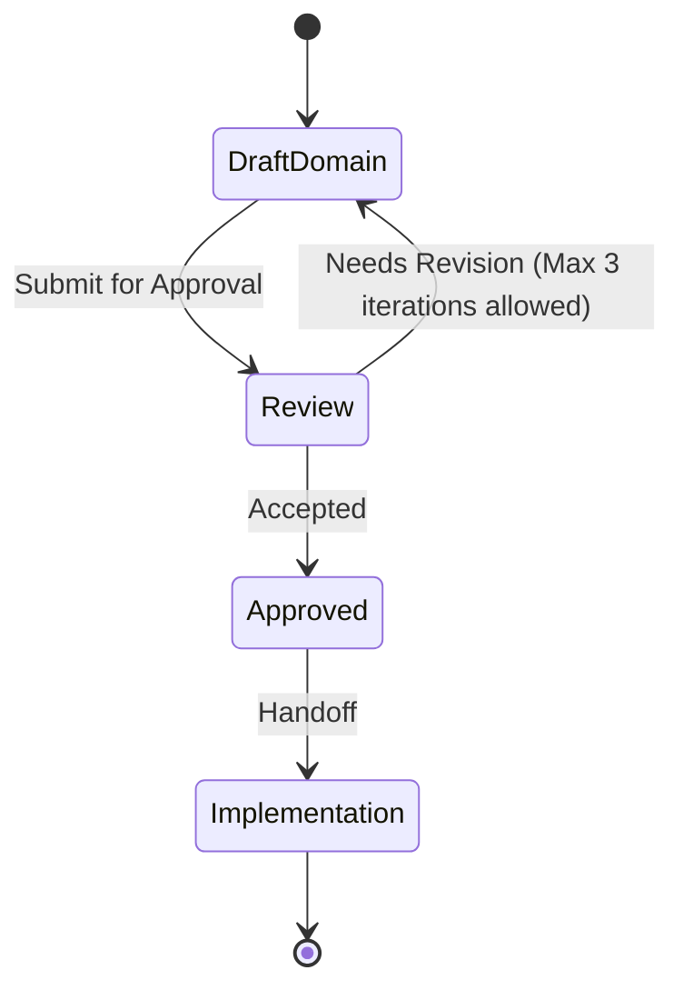

# Vault domain

This file is a **Domain Consultant** payload. The MCP tool `get_domain_consultant` discovers it as `DOMAIN.md` under a domain directory. Other skills treat MUST/NEVER as hard constraints. Write for agents: short, testable, unambiguous.

**Quality bar:** An agent can decide whether a change belongs in this domain, which entities it may touch, and which integrations are forbidden — without reading application code.

**Status: Approved. Approved by mjbvilhena on 2026-10-20.**

One bounded context: the vault. Capture, search, sync, reminders, and topics are capabilities of this context. They are not separate domains. `get_domain_consultant("capture")` and `get_domain_consultant("knowledge")` have no payload of their own.

Package `com.mjbvilhena.lagoon`. Actor: Miguel. No other persona is named.

MUST and NEVER below restate rules already in the approved specification, the approved epics, an approved story, or an accepted ADR. ADR-0001 through ADR-0006 are accepted. Approved by mjbvilhena on 2026-10-20. See Change control.

## Bounded context

- **Owns:** items and their attachments, personal notes, tags, topics and suggestions, the one reminder or the one expiry, the sensitive mark, vault-header salt and KDF parameters, and the rules for what may leave the phone.
- **Does not own:** Google Drive's file store (this context sends ciphertext only), the xAI Grok API's retention (the topic call uses that API, with zero data retention turned on for his xAI team, decided in accepted ADR-0003. Approved by mjbvilhena on 2026-10-20.), Android Keystore hardware, or another app that receives a share. Call those systems at the boundary. Do not treat their models as vault entities.
- **Published language:** item, attachment, personal note, tag, topic, suggestion, reminder, expiry, sensitive, vault key, passphrase, salt. A code is text already in a title. It is not a field. Also used, from accepted ADR-0001 and ADR-0002: install id, check-in, trash (`inTrash`, `trashedAt`, and `trashChangedAt`), `userEditedAt`, tombstone, generation (the per-install snapshot counter), and key version (the passphrase generation in the header).
- Amendment approved by mjbvilhena on 2026-10-22. Also used: device name, model, and one forgotten-installs file for each phone that runs Forget this phone. Each install's records file carries that install's device name and model, as well as its check-in and install id. Each of those phones writes only its own forgotten-installs file, and no other phone writes that file, except a re-key, which rewrites every forgotten-installs file under the new key version and never deletes one.
- **Actors:** Miguel. He captures, edits, searches, marks sensitive, and sets the passphrase. No second role is named.

## Core entities and invariants

The item is the aggregate root for its attachments, personal-note entries, tag links, sensitive mark, and its one reminder or one expiry. A tag is its own aggregate: one case-insensitive name, referenced by many items. A topic is its own aggregate: confirmed name, notes, and links to items. A suggestion is not a topic. The vault header is a value object, not an item.

| Entity | Meaning | Invariants (always true) |
| --- | --- | --- |
| Item | One saved link, note, image, or PDF (E1). A plain-text share is a note. That mapping is US-02, which is Draft. | Stable id across edit, sync, and a repeat of the same link (E4). `createdAt` does not move when `updatedAt` does. That immutability is US-56 only, and US-56 is Draft. An empty title fills from the page title or the file name, including a screenshot, image, or scan, and is capped at 120 characters (spec, US-40). |
| Attachment | A file on an item. | An item may hold more than one (E1, US-32). Bytes are vault content, encrypted at rest with the vault key (US-35). |
| Personal note entry | Dated text on an item, separate from the body. | On a repeat of the same page, existing text is not overwritten and the new note is appended under `YYYY-MM-DD` (spec, US-49). Amendment approved by mjbvilhena on 2026-10-22. On an accepted restore offer, the new share's note is added as a new personal-note entry with its own id under a date separator `YYYY-MM-DD`, the tags are unioned, and this does not set `userEditedAt`. That is an explicit exception to the note-edit rule. US-64 "note text" means the body, not this entry. |
| Tag | A label Miguel applies. | A rename applies to every item. A case-insensitive clash asks, then merges (spec, US-29). The Untagged inbox is a view, not a stored tag (E3, US-38). A tag is not a topic (US-41). |
| Topic | A subject he has confirmed. | Created only after he confirms (E11, US-43). Every stored result is marked AI-generated (US-41). A quote is kept as grounded only when it appears word for word in the text that was sent (US-41). |
| Suggestion | A topic name not yet confirmed. | No cap on how many suggestions may be offered (spec, US-41). Decline, rename, or merge of a suggestion does not create a topic he refused. That sentence is US-46 only, and US-46 is Draft. |
| Reminder | The optional local time on an item. It is an hour and minute in the phone's current local zone, not an instant. | At most one. Default 09:00. A 09:00 reminder fires at 09:00 wherever the phone is (spec, US-34, US-55). Inexact. Lagoon never requests `SCHEDULE_EXACT_ALARM` or `USE_EXACT_ALARM` (spec, US-34). The exact-alarm permission story US-77 is Draft. Which install posts: the signed-in install with the newest check-in; a sole signed-in install that holds the vault key always posts; equal check-ins are broken by the lower install id, plain string comparison; a check-in is written only once that install holds the vault key, on app open or a successful sync; the same rule covers expiry (US-55). |
| Expiry | The optional expiry date on an item. | Notifies 7 days before and on the day (E9, US-54). Upcoming shows the one reminder or the one expiry, not a return-by date or a warranty end (spec, US-62). |
| Vault header | Non-secret salt and KDF parameters. | The vault key is derived from his passphrase. No copy of the key, wrapped or otherwise, is stored off the phone (spec, US-35). The header is readable before the key exists. Method and parameters are proposed in ADR-0001, not fixed here. |

### Value objects

- **Item id.** Assigned once. Never reused for a different item (US-56).
- **Normalised URL.** Match ignores scheme, a leading `www.`, a trailing slash, the fragment, host case, and `utm_*` / tracking parameters (spec, E1). The stored source URL remains the first one. "Any other query parameter, including an order id, stays a different item" is US-49 only, and US-49 is Proposed for story review.
- **Passphrase.** Derives the vault key. It is not the vault key. It is never stored and never logged (US-35).
- **Sensitive mark.** A boolean on the item, not a tag (US-37, US-75).

### Aggregates

- **Item.** Consistency boundary for attachments, notes, tags on that item, the sensitive mark, and the one reminder or expiry. Deleting it removes its FTS row, reminders, topic links, queued topic job, pending suggestions, and topic notes written from it, once the tombstone is written. That cleanup list is US-13 only, and US-13 is Draft. After undo, `inTrash` merges by the later `trashChangedAt`, not by `updatedAt`. On every phone the item is hidden and its reminders are silenced, and he can restore it from any phone. Only a user-initiated edit whose `userEditedAt` is later than `trashChangedAt` brings it back. A system write does not. An older user edit is kept, and it is present if the item is restored. A reminder that fell due in trash fires once on restore, on the install US-55 picks, and not twice. A restore made before the deadline that arrives after a tombstone brings the item back and the tombstone is dropped. The tombstone, the permanent delete, spreads only after 30 × 24 hours from `trashedAt`. An id with a tombstone is not a one-sided item the other phone keeps. Approved by mjbvilhena on 2026-10-20. `trashedAt`, `trashChangedAt`, and `updatedAt` are UTC instants. `updatedAt` does not decide trash. Each phone checks the deadline on its own clock. A clock set ahead can write `trashChangedAt` or the tombstone early. No guard is chosen. Every phone that has merged `inTrash` writes the tombstone at that deadline, and those tombstones are one delete. A phone that never merged the trash drops the item when the tombstone arrives. An equal `trashChangedAt` uses the lower install id. A re-trash sets a new `trashedAt` and `trashChangedAt`, and the 30 × 24 hours start again. Restore leaves the other fields unchanged. Topic notes written from a trashed item are hidden while it is in trash. A US-29 rename or merge, a link-preview or snapshot refresh, OCR, topic links, an automatic reminder reschedule, and any other background write do not set `userEditedAt` and do not clear trash. `userEditedAt` is one instant for the item, not a clock per field. User fields merge by the later `userEditedAt`. A zip export carries the trash fields, and an import keeps the item in trash. The US-49 match on a trashed item offers to restore it and does not create a duplicate. v1 has no Delete forever, Delete now, or Empty trash. Trash is opened from Settings.
- Amendment approved by mjbvilhena on 2026-10-22. A user edit that brings an item out of trash does not change `trashChangedAt`. Toggling the sensitive mark on or off counts as a user edit, so it sets `userEditedAt` and brings a trashed item out of trash.
- Amendment approved by mjbvilhena on 2026-10-22. A late restore is compared with the earliest tombstone timestamp when several phones wrote one, and with the `trashedAt` of the trash that the tombstone ended.
- Amendment approved by mjbvilhena on 2026-10-22. A zip import keeps the item in trash when this phone has no later `trashChangedAt`. A later restore or a later user edit means the zip's trash state does not apply and no tombstone is written.
- Amendment approved by mjbvilhena on 2026-10-22. When that zip's trash state does not apply, the trash state does not change and no tombstone is written; user fields still merge by `userEditedAt`.
- Amendment approved by mjbvilhena on 2026-10-22. When a share matches live and trashed items, trashed matches are ignored. The live item is updated, or the which-item picker is shown when two or more live items match. There is no restore offer. Dismissing the which-item picker saves the share as a new item.
- Amendment approved by mjbvilhena on 2026-10-22. On an accepted restore offer, the new share's note is added as a new personal-note entry with its own id under a date separator `YYYY-MM-DD`, the tags are unioned, and `userEditedAt` is not set. That is an explicit exception to the note-edit rule.
- Amendment approved by mjbvilhena on 2026-10-22. When a share matches two or more trashed items and no item that is not in trash matches, the which-item picker lists the trashed matches, and the chosen one gets the restore offer.
- Security criteria approved by mjbvilhena on 2026-10-22. In both which-item pickers, every sensitive item listed shows a neutral row (no title or preview) until the US-37 unlock, then it shows the title.
- Amendment approved by mjbvilhena on 2026-10-22. Dismissing the trashed-matches picker saves the share as a new item, and the trashed items stay in trash.
- Amendment approved by mjbvilhena on 2026-10-22. Each phone that runs Forget this phone writes only its own forgotten-installs file, and no other phone writes that file, except a re-key, which rewrites every forgotten-installs file under the new key version and never deletes one. Forget this phone writes that other install's id into this phone's forgotten-installs file and reads that file back before it deletes the other install's records file. If that write or that read-back fails, nothing is deleted and he is told. A returning phone reads every forgotten-installs file. It treats itself as forgotten only when every one of those files was read successfully and one of them contains its install id. If any read fails, or the listing fails, it keeps the local vault, does not upload, and retries at a later sync. If every read succeeds and its id is in none of them, or a successful listing finds no forgotten-installs file, it keeps the local vault and uploads its records file. A missing records file alone, a US-78 Drive delete, or a never-uploaded phone never wipes the local vault. The trigger is the next sync that finds the entry. After rebuilding, the phone rejoins with a new install id. It uploads a new records file under its new install id and the current key version, and the old id stays in the forgotten-installs file. That phone's unsynced local edits are lost. The short notice saying so shows only when something was actually lost.
- Security criteria approved by mjbvilhena on 2026-10-22. A re-key rewrites every forgotten-installs file under the new key version and never deletes one.
- Amendment approved by mjbvilhena on 2026-10-23. If the records-file delete fails after the forgotten-installs entry is written and read back, the entry stays. He is told that phone will be forgotten at its next sync, and the delete is retried.
- Forget this phone never deletes the forgotten phone's own forgotten-installs file, and the ids in it stay forgotten. A rebuilt or rejoined phone's old forgotten-installs file keeps the same ids. Forget and rebuild never change it. A re-key may rewrite it under the new key with the same ids. Only a US-78 delete removes these files. A rejoined phone that later runs Forget writes a new forgotten-installs file under its new install id. Proposed amendment. Needs approval by mjbvilhena.
- Security criteria approved by mjbvilhena on 2026-10-23. Before a phone forgets another, it uploads its own merged records file.
- Security criteria approved by mjbvilhena on 2026-10-23. If the upload of this phone's own merged records file before Forget fails, or the phone is offline, nothing is written or deleted, he is told, and he can retry.
- Security criteria approved by mjbvilhena on 2026-10-23. A failed records-file delete is retried at each later sync of this phone until that records file is gone. Until then, that phone shows as pending ("will be forgotten at its next sync") in the Forget this phone list.
- Security criteria approved by mjbvilhena on 2026-10-23. If the forgotten phone syncs before the retry deletes its records file, it is handled as a returning forgotten phone. Its old records file is not used in the rebuild and is not counted as an active phone (US-55), and this phone's retry still deletes it.
- The sync-paused notice shows after 3 consecutive syncs with a failed forgotten-installs read or listing, and clears at the first sync that reads every forgotten-installs file successfully. Proposed amendment. Needs approval by mjbvilhena.
- Security criteria approved by mjbvilhena on 2026-10-23. A re-key reads back each forgotten-installs file it rewrites and retries if an entry is missing. After a re-key, each phone re-reads its own forgotten-installs file and re-adds any missing id it wrote.
- Security criteria approved by mjbvilhena on 2026-10-23. A forgotten phone that returns after a passphrase change, and finds the files under a newer key, asks for the new passphrase first and then reads the forgotten-installs files. Cancelling or entering a wrong passphrase discards nothing, the phone does not upload, and it asks again at the next sync. A newer-key file is not a read failure.
- If the passphrase was already accepted at this sync in the newer-key scenario ("files are under a newer key"), he is not asked again in 'the phone returns'. Decided by mjbvilhena; this record is Proposed until he approves it.
- Security criteria approved by mjbvilhena on 2026-10-22. On a returning forgotten phone, cancelling the passphrase prompt or entering a wrong passphrase discards nothing, the phone does not upload, and it asks again at the next sync.
- Security criteria approved by mjbvilhena on 2026-10-22. US-78 warns that the Drive delete only lasts if every other phone is signed out first. The delete also removes the forgotten-installs files, so a forgotten phone that returns afterwards can bring deleted items back.
- Security criteria approved by mjbvilhena on 2026-10-22. Forget this phone does not revoke a stolen phone. Revoking a stolen phone is a passphrase change (US-86) and Google sign-out.
- Security criteria approved by mjbvilhena on 2026-10-22. During a pending forgotten-passphrase reset, Forget this phone requires the current passphrase, the same as US-78. Until the reset completes, the current passphrase is the old passphrase. The new passphrase counts only after the reset completes.
- Security criteria approved by mjbvilhena on 2026-10-22. The returning phone's orphan-attachment cleanup deletes local copies only, never a Drive object.
- Amendment approved by mjbvilhena on 2026-10-22. That cleanup runs after the rebuild from Drive. Attachments of items that are live or in trash are rebuilt from Drive.
- **Tag.** The name is the identity, compared case-insensitively (spec, US-29). US-29 is Draft. The specification already states rename-and-merge.
- **Topic.** Links and notes. Sensitive topic notes stay hidden until the US-37 unlock (US-75). Unlink and merge of a saved topic are US-48 only, and US-48 is Draft.

## Ubiquitous language

- Item → the saved record. Do not call the whole record a note.
- Body → the item text US-64 can share. Personal note → the dated "why it matters" entries.
- Tag → his label. Topic → a confirmed AI subject. Never call a topic a tag.
- Inbox → the untagged view. Never persist an Inbox tag.
- Vault key → the derived key that encrypts vault bytes. Passphrase → the secret he types to re-create that key. Salt → the non-secret header value.
- Code → words already in the title (US-34). Never add a code field.
- Sync → background ciphertext to Drive `appDataFolder`. Never call it backup or restore. There is no Back up now, no Restore, and no last-backup time (spec, US-30).
- Banned aliases: backup button, restore button, merchant, booking reference, return-by, warranty end, trip, collection. Those are out of v1 or removed.

## Integrations and boundaries

- **Inbound:** the share sheet (link, plain text, image, PDF), in-app add, and the system camera via `ACTION_IMAGE_CAPTURE`. Lagoon does not request `CAMERA` (US-65).
- **Outbound:** Drive receives ciphertext only (US-36). A topic call may send readable text of an ordinary item (E11, US-41). OCR does not send the image or the recognized text (US-07, US-31). A share out may send an attachment, a URL, or the body, never the database, the vault key, or snapshot internals (US-64).
- **Anti-corruption:** a token-looking URL is not auto-fetched (US-79). A PDF password is not a vault secret: v1 does not ask for one or store one (US-04, US-85). The Google account is not a source of the vault key (spec, US-36).

## MUST rules

- MUST derive the vault key from the passphrase he chooses, with a slow memory-hard KDF and a salt, so another device can re-create the same key (spec, US-35).
- MUST keep the vault key off Drive and out of every zip. A wrapped copy off the phone is still a copy (spec, US-35, US-74).
- MUST hold the derived key in the Android Keystore, or wrap it with a hardware-backed Keystore key, without user authentication, so sync and reminders can decrypt after the first unlock since boot (spec, US-35). On a phone without secure hardware the key may be software-backed. Before any vault bytes are written he must accept that someone with the phone could extract the key. The same warning stays in Settings and is not asked again. That exception is decided in accepted ADR-0001. Approved by mjbvilhena on 2026-10-20.
- MUST leave sensitive content behind the US-37 unlock even when the vault key needs no user authentication (spec, US-35, US-75).
- MUST treat a forgotten passphrase plus a phone that no longer holds the key as lost content. There is no recovery (spec, US-35). There is no passphrase recall check, no "Check my passphrase" control, and no periodic reminder. A forgotten passphrase, together with losing every phone that holds the key, means the content is lost, with no in-app aid to remember it. Approved by mjbvilhena on 2026-10-20.
- MUST let a phone that still holds the key set a new passphrase after the US-37 unlock, without the old passphrase, and re-encrypt as in US-86 (spec, US-35, US-86). The forgotten-passphrase reset keeps the Drive copy on the old passphrase for 24 hours after a pending-reset marker is on Drive. During those 24 hours every other phone that holds the key shows a notice and can cancel. A normal passphrase change, where he enters the current passphrase, does not wait. One phone still waits. An offline phone does not start the clock until the marker is on Drive. A cancel leaves Drive on the old passphrase. Items saved on the resetting phone during the 24 hours are copied into the restored vault under the old passphrase and are not lost. The phone vault and the Drive copy each stay readable under exactly one passphrase. That delay, and the US-37 biometric or device PIN that the reset accepts, are decided in accepted ADR-0001. Approved by mjbvilhena on 2026-10-20.
- Security criteria approved by mjbvilhena on 2026-10-22. During a pending forgotten-passphrase reset, "current passphrase" means the old passphrase until the reset completes. The new passphrase counts only after the reset completes.
- MUST encrypt the database, attachment files, and derived files (thumbnails, previews, snapshots, OCR cache, WebView cache, image cache, WorkManager inputs, logs, export temp copies) with the vault key (US-35).
- MUST keep `allowBackup` false and exclude the vault from `dataExtractionRules` (US-35).
- MUST upload only ciphertext, under opaque Drive names, with granted scopes exactly `drive.appdata` (US-36, US-78).
- MUST keep an item that exists on only one side (spec, US-20). An id with a tombstone is not that case. That qualifier, the field merge for two edits of one id, and the synced in-trash rule are in accepted ADR-0002. Approved by mjbvilhena on 2026-10-20.
- MUST union tags, keep existing text, and append a dated note when the same normalised URL is shared again (spec, US-49).
- MUST search title, body, extracted text, OCR text, tags, and the personal note with the specified BM25 weights: title 10, tags 5, personal note 3, body and extracted text 1, OCR text 1 (spec, US-15, US-50). Snapshot text is searchable (spec). The spec does not give it a separate BM25 weight, and this file does not invent one.
- MUST exclude a sensitive item's title, snippet, thumbnail, and OCR text in rows and search, and exclude it from search highlights, topic calls, and both notification versions, until the rules in US-75 are met.
- MUST show an ordinary lock-screen reminder's title, and show both versions of a sensitive notification as only "Lagoon reminder" (US-34, US-75).
- MUST run link work in this order after the save returns: enrich, then snapshot from that fetch, then OCR, then the topic job (E1, US-58).
- MUST keep topic extraction on for a new ordinary item, with a Settings switch, with no per-item opt-out, and with sensitive items always excluded (spec, US-41, US-75). The topic call uses the xAI Grok API. Zero data retention is turned on for his xAI team. The default low-cost model is grok-4.20-0309-non-reasoning. A response that does not include `x-zero-data-retention` set to `true` is discarded, and topics on that install pause until he checks. When the key is first added, Lagoon asks once: "Send N earlier items for topics?" N is the number of earlier ordinary items on this install that have no topic provenance, and the default is No. A sensitive item is not counted and is not sent. Per-item "Get topics" stays. There is no monthly cap. Settings shows this month's call count on this install. That count is not synced. De-duplication still applies. The enterprise terms, including the business-purposes grant, are accepted for this personal vault. Governing law is Texas. Data transfer is under the standard contractual clauses. There is no EU region. That provider and that question are decided in accepted ADR-0003. Approved by mjbvilhena on 2026-10-20.
- MUST NOT start ML Kit until he accepts the US-07 disclosure. There is no telemetry off switch (spec, US-07, US-31).
- MUST use the bundled Latin-script model `com.google.mlkit:text-recognition` and keep `com.google.android.gms:play-services-mlkit-text-recognition` absent (US-31).
- MUST post a reminder or an expiry only from the install US-55 picks, including after boot (US-55).
- MUST leave the phone vault and the Drive copy each readable under exactly one passphrase if re-encryption crashes, with neither in a mixed state (US-86).
- MUST NOT treat US-85's password-protected full-screen scenario as a MUST. That scenario is Could. Asking for or storing a PDF password is already refused by US-85's other text and by US-04, and US-04 is Draft. A password-protected PDF means only a PDF that needs a password to open. A PDF restricted only by an owner password opens, renders, and is searchable as a normal PDF. That definition is decided in accepted ADR-0005. Approved by mjbvilhena on 2026-10-20.

## NEVER rules

- NEVER store the passphrase, the vault key, or a PDF password.
- NEVER store a copy of the vault key off the phone, wrapped or otherwise.
- NEVER put plaintext vault bytes on disk before the key exists. A share that arrives first stays in memory until he accepts the warning (US-35).
- NEVER add Firebase Analytics, Crashlytics, or another analytics or crash product the app chooses (spec, US-07).
- NEVER send a sensitive item, an image, or attachment bytes to the topic provider (US-41, US-75, E7). Cloud OCR and cloud vision are out of scope.
- NEVER auto-fetch a token-looking URL (US-79).
- NEVER request `CAMERA`, `SCHEDULE_EXACT_ALARM`, `USE_EXACT_ALARM`, or `WRITE_SETTINGS` (US-65, US-77, US-80, US-85).
- NEVER offer Back up now, Restore, or a last-backup time (spec, US-30).
- NEVER delete the phone vault on sign-out (US-78).
- NEVER invent a code field, a merchant, a trip, or a return-by date.

## Error and compliance posture

- A wrong passphrase is reported and changes nothing (US-35).
- A failed topic call leaves the item and creates no topic (US-47).
- A failed link fetch keeps the URL (US-09).
- Enrichment, snapshot, OCR, and topic outcomes that are still pending stay visible as pending or failed, not as invented text (US-31, US-70).
- Provenance for a topic result records item id, fields sent, timestamp, and model or prompt version. It does not record the credential or the passphrase (US-41).
- No retention period is stated for ordinary vault content beyond the product rules. Trash is the synced `inTrash` field for 30 × 24 hours after `trashedAt`, then a tombstone. US-66 is Must for v1. v1 does not ship without it. A delete does not become a tombstone by skipping trash. Approved by mjbvilhena on 2026-10-20. Tombstone garbage collection stays as ADR-0002 states it: until every known install has merged the tombstone, and at least 90 days after the tombstone. US-66 is Proposed for story review, not approved. The spec amendment is approved. Approved by mjbvilhena on 2026-10-20. Those durations are a domain MUST.
- Purgeable Drive revisions are typically kept about 30 days, and can be purged sooner once a file has 100 revisions that are not Keep Forever and a new revision is uploaded. Only a Keep Forever revision persists past that purge, and only a Keep Forever blob revision can be downloaded through the API. ADR-0001 does not set Keep Forever. Amendment approved by mjbvilhena on 2026-10-22. After a permanent delete, Lagoon deletes the older Drive revisions of its sync files. The newest revision, the head, always stays, because Drive will not delete the last remaining revision. Each install deletes revisions only of its own records file. US-86 already says an old revision or an old zip may open with the old passphrase. A zip he keeps is the residual that still opens with the old passphrase. That sentence is not a change to US-86.

## Change control

ADR-0001 through ADR-0006 are accepted. Approved by mjbvilhena on 2026-10-20. Their rules in this file are MUST. The specification still says the cipher waits for an ADR. That sentence is not edited. An invariant whose only source is a Draft story is marked above and is not a MUST. US-66 is Proposed for story review and is not approved. US-49 and US-87 are Proposed for story review and are not approved.

Only mjbvilhena may accept an ADR or add a published term. This file is approved. Approved by mjbvilhena on 2026-10-20. It does not change approved story text.

## Anti-patterns

- A second DOMAIN.md for capture or topics that restates these rules.
- Naming a cipher here. The cipher MUST is accepted ADR-0006.
- Promoting a Draft-only invariant, or US-85's Could, into a MUST.
- Calling the inbox a tag, or a topic a tag.

## Skill State Machine (sdlc-domain-architect)

Status: Approved. Approved by mjbvilhena on 2026-10-20.
