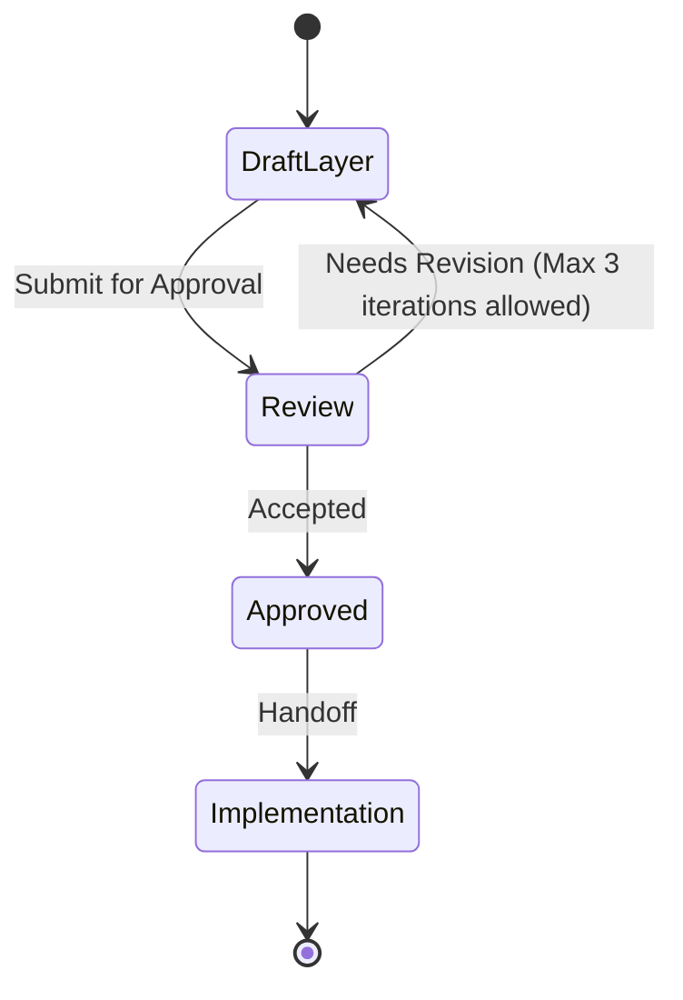

# Data layer

This file is a **Layer Consultant** payload. The MCP tool `get_layer_consultant` discovers it as `LAYER.md` under a layer directory. Skills treat MUST/NEVER as hard technical constraints. Keep rules executable by an agent reviewing a diff.

**Quality bar:** An agent can accept or reject a change in this layer using only this file plus the diff.

**Status: Approved. Approved by mjbvilhena on 2026-10-20.**

Business invariants live in `docs/domain/vault/DOMAIN.md`. This layer stores and moves bytes. It does not invent product rules.

## Technical scope

- **Responsibility:** Room, files, encryption adapters, Drive sync, FTS, reminder alarms, share-byte reading, link fetch, OCR adapter, topic HTTP, PDF extract and render.
- **Not responsible for:** Compose, copy, or deciding a conflict rule, a KDF parameter, or a topic vendor. Those are the domain consultant and the ADRs.
- **Typical entry points:** `com.mjbvilhena.lagoon.data`, WorkManager workers, `AlarmManager` scheduling, the Drive client. Gradle module `:data`. The module graph is under Patterns.

Where the named capabilities live:

| Capability | Package | Calls |
| --- | --- | --- |
| Encryption and KDF | `data.crypto` | Keystore wrap, header read, encrypt-before-write. Parameters come from accepted ADR-0001. Cipher and container come from accepted ADR-0006 |
| Sync | `data.sync` | WorkManager, Drive `appDataFolder`, one records file per install. Merge through the domain port. Conflict rule is accepted ADR-0002 |
| Search | `data.search` | The FTS index behind `SearchIndex`. Weights stay in the domain |
| Reminders | `data.reminder` | Inexact `setAndAllowWhileIdle`. Reschedule on every US-55 trigger. Notification text follows US-34 and US-75 |
| Share intake bytes | `data.capture` | Read the content URI for a link, plain text, an image, or a PDF. Approved by mjbvilhena on 2026-10-20. Reject `file://` and Lagoon's own FileProvider URIs, and refuse a single image larger than 20 MiB. Those rules are US-01. The 20 MiB figure is the same figure as US-31's OCR input cap. Keep a pre-key share off disk. The Activity is the UI layer |

## Allowed dependencies

| May depend on | How | Notes |
| --- | --- | --- |
| Domain layer | implement ports | `com.mjbvilhena.lagoon.domain` only |
| Room | import | Spec requires Room with FTS. Engine for encryption plus FTS waits on US-57 |
| SQLCipher | import | Database encryption in ADR-0006. The subkey is raw key data, `PRAGMA key = "x'<64 hex>'"`, and `temp_store` is `MEMORY`. US-57 still has to show FTS with it |
| Native Argon2id | import | JNI to the PHC reference. Not a pure-Java port (ADR-0001) |
| Android Keystore | import | AES-256-GCM wrap. No user authentication (US-35, ADR-0001) |
| PdfBox-Android | import | Extract, and render on API 26–29, inside the isolated process (ADR-0005) |
| Credential Manager or AuthorizationClient | import | Drive sign-in. Not a WebView. Scope `drive.appdata` only (US-78) |
| WorkManager | import | Sync and background jobs. Unmetered constraint from US-19 and US-44 |
| Drive API | HTTP via the official client | Scope `drive.appdata` only (US-78) |
| AlarmManager | import | Inexact alarms only. The spec allows `setWindow` or `setAndAllowWhileIdle`. This layer narrows that to `setAndAllowWhileIdle` (US-77 is Draft; the spec already requires inexact alarms) |
| ML Kit text-recognition, bundled | import | `com.google.mlkit:text-recognition` after US-07 acceptance (ADR-0004). Datatransport components are named on the US-80 allowlist or removed |
| Topic HTTP client | import | The same OkHttp or `HttpURLConnection` stack as link preview. Key in the `Authorization: Bearer` header to `https://api.x.ai/v1` (ADR-0003). The default low-cost model is grok-4.20-0309-non-reasoning. A response whose `x-zero-data-retention` header is not `true` is discarded, and topic calls pause until he checks. No second generative SDK, and no Cursor agent SDK |
| OkHttp or `HttpURLConnection` | import | Link preview (US-79) and the topic HTTP client |

If a dependency is missing from this table, treat it as **disallowed** until a human updates the file.

Amendment approved by mjbvilhena on 2026-10-29. Add `com.google.crypto.tink:tink-android:1.24.0` to the allowed dependencies, and only for streaming encryption of files, derived files, Drive records, and zip entries, as proposed ADR-0007 (`AES256_GCM_HKDF_1MB`). It is not a dependency for SQLCipher, Argon2id, or the Keystore wrap. The accepted table above is unchanged. This paragraph does not change the status line of this file.

## Forbidden dependencies

- NEVER import Compose or `com.mjbvilhena.lagoon.ui`.
- NEVER add Firebase Analytics, Crashlytics, or `com.google.android.gms:play-services-mlkit-text-recognition` (US-07, US-31).
- NEVER call the topic endpoint with image bytes or with a sensitive item.

## MUST rules (technical)

- MUST encrypt vault bytes before they touch disk, using the vault key, including the derived files US-35 lists. SQLCipher uses `PRAGMA temp_store = MEMORY`, as ADR-0006 states once that record is accepted.
- MUST keep the salt and KDF parameters in a header that can be read before decrypt. MUST keep the wrapped key blob on the phone only.
- MUST send Drive file names and metadata with no title and no tag (US-36).
- MUST NOT create a software-backed vault key unless he has accepted the warning in ADR-0001. MUST NOT ask for the passphrase on every launch because secure hardware is missing.
- MUST run preview fetches with the US-79 limits: no cookies, no Referer, no authorization, User-Agent `LagoonPreview`, at most 5 redirects, 15 seconds, 10 MiB decompressed.
- MUST remove `com.google.mlkit.common.internal.MlKitInitProvider` with `tools:node="remove"` and call `MlKit.initialize` only after acceptance, and only once per process (US-07, ADR-0004).
- MUST keep the manifest allowlist in US-80, including ML Kit datatransport components named or removed (ADR-0004). `allowBackup` false and vault exclusion in `dataExtractionRules` (US-35).
- MUST post sensitive notifications as public and private text "Lagoon reminder" (US-75).
- MUST schedule reminders with `setAndAllowWhileIdle`, and MUST reschedule on every US-55 trigger: boot, clock or time zone change, app update, notification permission change, and app start. The spec also allows `setWindow`. This layer's narrower choice is Approved by mjbvilhena on 2026-10-20.
- MUST accept share bytes that are a link, plain text, an image, or a PDF. A PDF share that is not a PDF is still rejected (US-04, Draft). Image and text shares are not rejected for being non-PDF.
- Approved by mjbvilhena on 2026-10-20. Reject a share URI whose scheme is `file`, and reject a URI from Lagoon's own FileProvider. Refuse a single image larger than 20 MiB at intake. Those rules are US-01. The 20 MiB figure is the same figure as US-31's OCR input cap.
- A release build strips `Log`. Crash and exception text carries no item body (T-31). Approved by mjbvilhena on 2026-10-20.
- MUST wipe a share temp file on return, within 15 minutes, and on next launch, and revoke the URI grant with that wipe (US-64).

## NEVER rules (technical)

- NEVER log a passphrase, vault key, OAuth token, or topic API key. Tokens stay out of WorkManager input data (US-35, US-78).
- NEVER upload the SQLite header `SQLite format 3` or a seeded plaintext sentinel (US-36).
- NEVER request exact alarms or `CAMERA`.
- NEVER write a plaintext PDF to disk so `PdfRenderer` can open it (US-85, ADR-0005).
- NEVER run `PdfRenderer` or PdfBox in the app process or in a plain `android:process`. The service is `android:isolatedProcess="true"` (ADR-0005).
- NEVER bake a topic API key into the APK, `BuildConfig`, or assets, and NEVER put that key in the request URL (US-41, ADR-0003).
- NEVER treat FTS5 plus SQLCipher as proven before the US-57 spike. The dependency is allowed. The spec's fallback, if that spike fails, is Room 2 FTS4 plus app-side ranking.

## Patterns and frameworks

- Kotlin. Room is the local store. WorkManager is the background runner. Both are specification constraints.
- Cipher, container, and the AES-256-GCM Keystore wrap are accepted ADR-0001 and accepted ADR-0006. Approved by mjbvilhena on 2026-10-20.
- Amendment approved by mjbvilhena on 2026-10-22. Implementation has not started.
- Gradle modules, once implementation starts: `:domain` is pure Kotlin with no Android dependency, `:data` implements the ports, `:ui` does not depend on `:data`, `:data` does not depend on `:ui`, and `:app` is the only module that depends on both `:data` and `:ui`. An architecture test fails the build when that graph breaks. No Gradle project exists yet. This file is the rule that project has to meet.
- Repository tests cover search ranking and ciphertext packaging without a live Drive call (US-25).

## Observability and safety

- No analytics SDK.
- Sync and topic failures use the plain sentences the stories name. No vault bytes in the message.
- Preview and topic calls are bounded by the timeouts above. KDF retry delay is ADR-0001, enforced in `data.crypto`, not in the UI timer alone.
- Secrets are not in source. The OAuth client id is build-time configuration (spec). The topic key is entered at runtime and stored as vault ciphertext (accepted ADR-0003).

## Change control

A layer ADR is required for a new datastore, a new network SDK, a cipher choice, or dropping encrypt-before-write. US-57 is the gate for the FTS and encryption combination. This file is approved. Approved by mjbvilhena on 2026-10-20. Amendment approved by mjbvilhena on 2026-10-27. US-49 is approved.

## Anti-patterns

- SQL or Drive calls inside a domain use case "for now".
- A plaintext cache "until encryption lands".
- Copying BM25 weights into a DAO so they can drift from the domain.

## Skill State Machine (sdlc-layer-architect)

Status: Approved. Approved by mjbvilhena on 2026-10-20.
