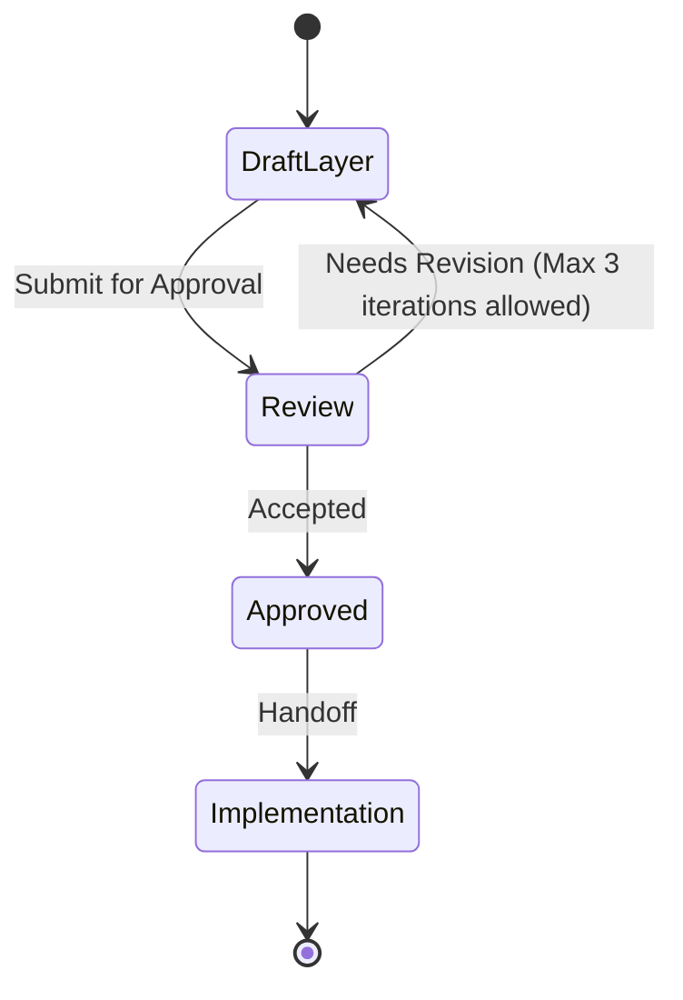

# Data layer

This file is a **Layer Consultant** payload. The MCP tool `get_layer_consultant` discovers it as `LAYER.md` under a layer directory. Skills treat MUST/NEVER as hard technical constraints. Keep rules executable by an agent reviewing a diff.

**Quality bar:** An agent can accept or reject a change in this layer using only this file plus the diff.

**Status: Proposed. Needs approval by mjbvilhena.**

Business invariants live in `docs/domain/vault/DOMAIN.md`. This layer stores and moves bytes. It does not invent product rules.

## Technical scope

- **Responsibility:** Room, files, encryption adapters, Drive sync, FTS, reminder alarms, share-byte reading, link fetch, OCR adapter, topic HTTP, PDF extract and render.
- **Not responsible for:** Compose, copy, or deciding a conflict rule, a KDF parameter, or a topic vendor. Those are the domain consultant and the ADRs.
- **Typical entry points:** `com.mjbvilhena.lagoon.data`, WorkManager workers, `AlarmManager` scheduling, the Drive client.

Where the named capabilities live:

| Capability | Package | Calls |
| --- | --- | --- |
| Encryption and KDF | `data.crypto` | Keystore wrap, header read, encrypt-before-write. Parameters come from ADR-0001 once accepted |
| Sync | `data.sync` | WorkManager, Drive `appDataFolder`, merge through the domain port. Conflict rule is ADR-0002 once accepted |
| Search | `data.search` | The FTS index behind `SearchIndex`. Weights stay in the domain |
| Reminders | `data.reminder` | Inexact `setWindow` or `setAndAllowWhileIdle`, reschedule on boot. Notification text follows US-34 and US-75 |
| Share intake bytes | `data.capture` | Read the content URI, reject non-PDF bytes, keep a pre-key share off disk. The Activity is the UI layer |

## Allowed dependencies

| May depend on | How | Notes |
| --- | --- | --- |
| Domain layer | implement ports | `com.mjbvilhena.lagoon.domain` only |
| Room | import | Spec requires Room with FTS. Engine for encryption plus FTS waits on US-57 |
| Android Keystore | import | Wrap or hold the derived key. No user authentication (US-35) |
| WorkManager | import | Sync and background jobs. Unmetered constraint from US-19 and US-44 |
| Drive API | HTTP via the official client | Scope `drive.appdata` only (US-78) |
| AlarmManager | import | Inexact alarms only (US-77) |
| ML Kit text-recognition, bundled | import | `com.google.mlkit:text-recognition` after US-07 acceptance (ADR-0004) |
| PDF library | import | Extraction on minSdk 26. Render path is ADR-0005 |
| OkHttp or `HttpURLConnection` | import | Link preview (US-79) and the topic call (ADR-0003) |

If a dependency is missing from this table, treat it as **disallowed** until a human updates the file.

## Forbidden dependencies

- NEVER import Compose or `com.mjbvilhena.lagoon.ui`.
- NEVER add Firebase Analytics, Crashlytics, or `com.google.android.gms:play-services-mlkit-text-recognition` (US-07, US-31).
- NEVER call the topic endpoint with image bytes or with a sensitive item.

## MUST rules (technical)

- MUST encrypt vault bytes before they touch disk, using the vault key, including the derived files US-35 lists.
- MUST keep the salt and KDF parameters in a header that can be read before decrypt. MUST keep the wrapped key blob on the phone only.
- MUST send Drive file names and metadata with no title and no tag (US-36).
- MUST refuse a software-backed Keystore key when ADR-0001 is accepted. Until then, do not invent a software fallback in code.
- MUST run preview fetches with the US-79 limits: no cookies, no Referer, no authorization, User-Agent `LagoonPreview`, at most 5 redirects, 15 seconds, 10 MiB decompressed.
- MUST remove `com.google.mlkit.common.internal.MlKitInitProvider` with `tools:node="remove"` and call `MlKit.initialize` only after acceptance (US-07).
- MUST keep the manifest allowlist in US-80. `allowBackup` false and vault exclusion in `dataExtractionRules` (US-35).
- MUST post sensitive notifications as public and private text "Lagoon reminder" (US-75).
- MUST wipe a share temp file on return, within 15 minutes, and on next launch, and revoke the URI grant with that wipe (US-64).

## NEVER rules (technical)

- NEVER log a passphrase, vault key, OAuth token, or topic API key. Tokens stay out of WorkManager input data (US-35, US-78).
- NEVER upload the SQLite header `SQLite format 3` or a seeded plaintext sentinel (US-36).
- NEVER request exact alarms or `CAMERA`.
- NEVER write a plaintext PDF to disk so `PdfRenderer` can open it (US-85, ADR-0005).
- NEVER bake a topic API key into the APK, `BuildConfig`, or assets (US-41).
- NEVER treat FTS5 plus SQLCipher as chosen before the US-57 spike. The spec's fallback, if that spike fails, is Room 2 FTS4 plus app-side ranking.

## Patterns and frameworks

- Kotlin. Room is the local store. WorkManager is the background runner. Both are specification constraints.
- The content cipher (algorithm, mode, key size) and the key-wrap algorithm are not chosen. The specification leaves them for an ADR this layer must not pretend exists.
- Repository tests cover search ranking and ciphertext packaging without a live Drive call (US-25).

## Observability and safety

- No analytics SDK.
- Sync and topic failures use the plain sentences the stories name. No vault bytes in the message.
- Preview and topic calls are bounded by the timeouts above. KDF retry delay is ADR-0001, enforced in `data.crypto`, not in the UI timer alone.
- Secrets are not in source. The OAuth client id is build-time configuration (spec). The topic key is entered at runtime and stored as vault ciphertext (ADR-0003, once accepted).

## Change control

A layer ADR is required for a new datastore, a new network SDK, a cipher choice, or dropping encrypt-before-write. US-57 is the gate for the FTS and encryption combination. This file is Proposed.

## Anti-patterns

- SQL or Drive calls inside a domain use case "for now".
- A plaintext cache "until encryption lands".
- Copying BM25 weights into a DAO so they can drift from the domain.

## Skill State Machine (sdlc-layer-architect)

Status: Proposed. Needs approval by mjbvilhena.
