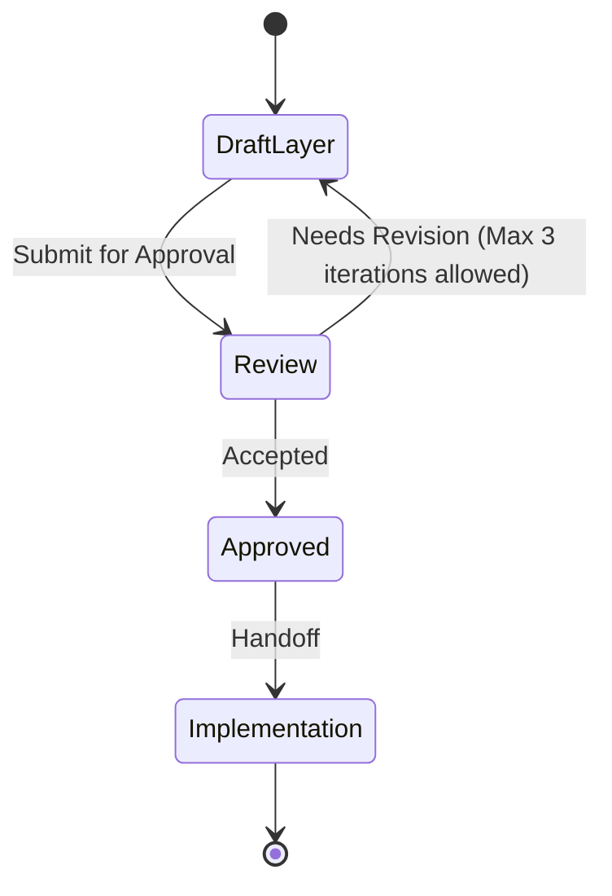

# Domain layer

This file is a **Layer Consultant** payload. The MCP tool `get_layer_consultant` discovers it as `LAYER.md` under a layer directory. Skills treat MUST/NEVER as hard technical constraints. Keep rules executable by an agent reviewing a diff.

**Quality bar:** An agent can accept or reject a change in this layer using only this file plus the diff.

**Status: Proposed. Needs approval by mjbvilhena.**

Business invariants live in `docs/domain/vault/DOMAIN.md`. This file is the Kotlin module boundary, not a second copy of those rules.

## Technical scope

- **Responsibility:** entities, value objects, use cases, and repository ports for `com.mjbvilhena.lagoon.domain`.
- **Not responsible for:** Compose, Room, Keystore, Drive, WorkManager, HTTP, PDF libraries, or ML Kit.
- **Typical entry points:** use cases the UI calls (`CaptureShare`, `SaveItem`, `Search`, `SetReminder`, `ChangePassphrase`, `ResetPassphrase`). Ports the data layer implements (`VaultStore`, `SyncPort`, `SearchIndex`, `Clock`, `TopicClient`, `PageRenderer`). `PageRenderer` returns a byte buffer or a failure. It does not return an Android `Bitmap`. Gradle module `:domain`.

## Allowed dependencies

| May depend on | How | Notes |
| --- | --- | --- |
| Kotlin standard library | import | Pure Kotlin. `kotlinx.coroutines` is allowed for use-case signatures |
| Domain consultant | read, do not import | `docs/domain/vault/DOMAIN.md` |

If a dependency is missing from this table, treat it as **disallowed** until a human updates the file.

## Forbidden dependencies

- NEVER import `android.*`, AndroidX, Compose, Room, OkHttp, the Drive SDK, ML Kit, or PdfBox.
- NEVER import `com.mjbvilhena.lagoon.ui` or `com.mjbvilhena.lagoon.data`.

## MUST rules (technical)

- MUST express I/O as a port. A use case orchestrates; it does not open a socket or a file.
- MUST keep the passphrase and the vault key out of use-case return values that the UI logs. Accept a passphrase in, return a result type.
- MUST model the item id as stable and the tag name as case-insensitive, matching the domain consultant.
- MUST keep search weights, URL normalisation, and the sensitive-item filter in this layer so the data layer cannot invent a second ranking.

## NEVER rules (technical)

- NEVER log secrets or item bodies from a use case.
- NEVER encode SQL, HTTP, or Keystore parameters in a domain type.
- NEVER decide the content cipher, the KDF parameters, or the topic vendor inside a use case. Those are ADR-0001, ADR-0003, and ADR-0006, all Proposed. A port may accept a header value object once the ADR is accepted. A rule that exists only in a Proposed ADR is not a domain rule.

## Patterns and frameworks

- Kotlin only. No Android framework types in signatures. A URI from the share sheet is a string or a small value object at this boundary; the data layer resolves it.
- Package root `com.mjbvilhena.lagoon.domain`. Suggested packages: `item`, `tag`, `topic`, `search`, `sync`, `reminder`, `capture`.
- Module `:domain` is pure Kotlin. It does not depend on Android, `:data`, or `:ui`. An architecture test fails the build otherwise. `:app` is the module that wires the others. No Gradle project exists yet. The data-layer file states the full graph. A reminder value in this module is a local time, not an instant.
- Testing is JVM unit tests of use cases with fake ports (US-25's repository and search tests belong with the data adapter; domain tests fake that adapter).

## Observability and safety

- Result types carry the story's outcome (wrong passphrase, topic failed, not a PDF). They do not carry stack traces with vault bytes.
- No clocks except a `Clock` port, so reminder zone tests do not read the device.

## Change control

A layer ADR is required to add an Android or network dependency here, or to move a business rule into the data layer. This file is Proposed.

## Anti-patterns

- Restating DOMAIN.md MUST lines as Kotlin comments and letting them drift.
- A use case that calls WorkManager.
- Passing a `Context` into domain code.

## Skill State Machine (sdlc-layer-architect)

Status: Proposed. Needs approval by mjbvilhena.
