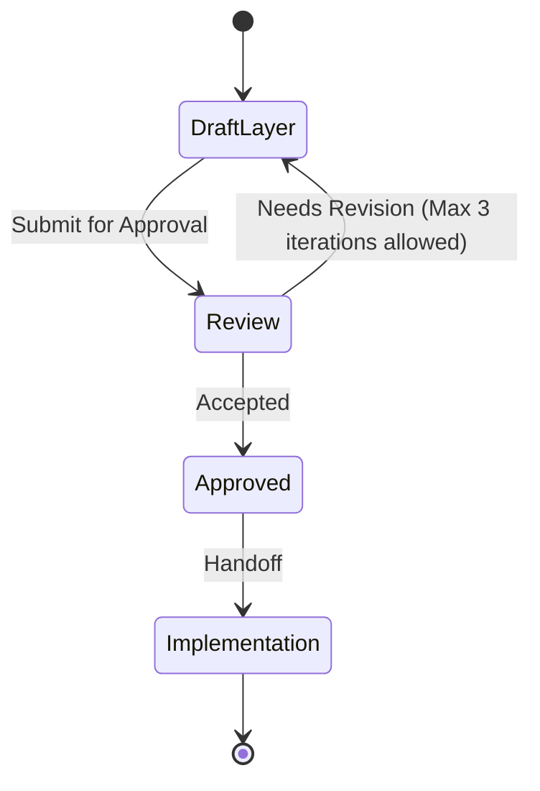

# UI layer

This file is a **Layer Consultant** payload. The MCP tool `get_layer_consultant` discovers it as `LAYER.md` under a layer directory. Skills treat MUST/NEVER as hard technical constraints. Keep rules executable by an agent reviewing a diff.

**Quality bar:** An agent can accept or reject a change in this layer using only this file plus the diff.

**Status: Proposed. Needs approval by mjbvilhena.**

Business rules live in `docs/domain/vault/DOMAIN.md`. This file only says where the UI sits.

## Technical scope

- **Responsibility:** Jetpack Compose screens, navigation, the share-sheet entry activity, theme, and sending user intents to domain use cases.
- **Not responsible for:** encryption, Drive, Room, FTS, KDF, ML Kit calls, PDF parsing, alarm scheduling, or topic HTTP. Those are the data layer.
- **Typical entry points:** `com.mjbvilhena.lagoon.ui` (Compose), plus the launcher activity and the exported share target that the manifest allows (US-80). The application class in `com.mjbvilhena.lagoon` may construct the graph. Feature composables may not.

Share intake lives here only as the `ACTION_SEND` entry. It maps the incoming intent to a domain capture command. It does not write the database and it does not decrypt.

## Allowed dependencies

| May depend on | How | Notes |
| --- | --- | --- |
| Domain layer | Kotlin call | Use cases and read models in `com.mjbvilhena.lagoon.domain` |
| Jetpack Compose and Material 3 | UI toolkit | Spec constraint. Light, Dark, System. Teal tokens from the spec |
| Android UI | Activity, Intent, Window | Share target, `FLAG_SECURE`, brightness override, Custom Tabs or `ACTION_VIEW` |
| Data layer | Not from a feature composable | Only the application class wires implementations |

If a dependency is missing from this table, treat it as **disallowed** until a human updates the file.

## Forbidden dependencies

- NEVER import `com.mjbvilhena.lagoon.data`, Room, SQLCipher, the Drive client, or Android Keystore from a composable or an Activity.
- NEVER call `PdfRenderer`, ML Kit, `MlKit.initialize`, or a topic HTTP client from this layer.
- NEVER reach into the database to answer a click.

## MUST rules (technical)

- MUST keep composables free of I/O. A click calls a domain use case.
- MUST apply `FLAG_SECURE` on the passphrase screen (US-35) and on a screen that shows unlocked sensitive content, not app-wide (US-75).
- MUST set the passphrase field to a password input type and `IME_FLAG_NO_PERSONALIZED_LEARNING` (US-35).
- MUST open a link with Custom Tabs or `ACTION_VIEW`, `http` or `https` only, never a WebView (US-64).
- MUST use `WindowManager.LayoutParams.screenBrightness = 1.0f` for the full-screen page, and MUST NOT request `WRITE_SETTINGS` (US-85).
- MUST show the US-07 disclosure before any path that could initialize ML Kit. The disclosure facts are domain rules.
- MUST keep one Settings screen as the host for theme, sync, reminder default, app lock, topic controls, and the ML Kit disclosure (US-59).

## NEVER rules (technical)

- NEVER log a passphrase, token, vault key, or item body.
- NEVER request `CAMERA`, exact-alarm permissions, or storage permissions (US-80).
- NEVER put a Back up now or Restore control on screen (US-30).
- NEVER write a decoded image or a rendered PDF page to disk (US-85).
- NEVER show a sensitive title, snippet, thumbnail, or code in a row or a notification payload built by UI. Notification text policy is the domain rule in US-34 and US-75; the poster is the data layer.

## Patterns and frameworks

- Kotlin, Jetpack Compose, Material 3, as in the specification.
- Package root `com.mjbvilhena.lagoon.ui`. Suggested packages: `share`, `list`, `detail`, `settings`, `fullscreen`. Names can move; the dependency rule cannot.
- Errors from domain use cases surface as the story's plain sentence (wrong passphrase, nothing saved, sync not configured). No new product copy in this file.
- UI tests are Compose tests when a screen story is implemented (US-25). This layer does not invent them now.

## Observability and safety

- No analytics events (US-07).
- No passphrase or token in logs.
- Share intake holds a pre-key share in memory only, by calling the domain command that US-35 describes. It does not create a file.

## Change control

A layer ADR is required to add a UI toolkit, to let a composable import the data layer, or to drop a MUST. This file is Proposed.

## Anti-patterns

- Copying domain invariants into composables instead of calling a use case.
- Rendering PDFs or running OCR in an Activity because it is "just UI".
- A second settings screen for sync or topics.

## Skill State Machine (sdlc-layer-architect)

Status: Proposed. Needs approval by mjbvilhena.
